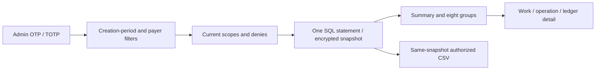

# 用戶消耗報表 / User consumption report

管理員從「用戶消耗」建立固定快照，也可從用戶詳情進入。香港今日／近七日／本月預設可調整；按發起人、付款帳戶、企業、項目、任務、角色、執行來源、能力版本及模型篩選。頁面分列確認扣費、退回消耗、淨消耗、預留及待對賬。個人和企業帳戶不合併，團隊子任務只歸實際發起人一次。

Admins create a fixed report in User consumption or enter from a user profile. Hong Kong day/week/month presets and exact filters lead to eight groupings, work details and CSV. Personal and enterprise payers stay separate. Charges are attributed once to the work initiator; every team member does not receive the same charge.

**時間口徑**：篩選工作建立時間的左閉右開期間，顯示這批工作截至快照的累計帳務；不是入帳日期區間報表。能力篩選選取有匹配操作的工作；能力分組只列工作／操作次數，不把整筆費用重複歸屬。工作明細顯示安全操作／模型／能力版本／已記錄嘗試、固定模板及 runtime ID、原扣費及退款來源；歷史未記錄欄位保持空缺。

**Time basis**: this is a half-open work-creation cohort with cumulative accounting as of the snapshot, not a posting-period report. Capability filters select matching works; capability groups count works/operations without allocating whole-work charges again. Missing historical attempt/configuration facts remain unrecorded.

摘要、分組、分頁、詳情、匯出讀取同一加密五分鐘快照。金額以十進位字串與 BigInt 計算；未知用量與未連接內部實際供應商成本不當作零。內部成本欄位需獨立範圍權限，客戶售價不能代替公司成本。最多5000工作／20000操作／16MiB，超出要求縮小篩選，禁止靜默截斷總數。

Summary, grouping, paging, detail and export read one encrypted five-minute snapshot. Monetary values remain exact decimal strings/BigInt. Unknown usage/cost stays unknown. Internal supplier cost requires its own scope and remains null/not_recorded until actual bills are connected. Bounded size rejects excess instead of silently truncating totals.

每次讀取需當前獨立Admin身份、近期MFA、原會話、授權版本及相同環境；範圍或拒絕規則改變立即使快照失效。按用戶鑽取還需目錄權限。匯出必須同時具有 create/download 且覆蓋全部所選工作，否則拒絕整次匯出。CSV保留每列快照時間／水印並防試算表公式注入，不含工作正文／電子郵件／網關憑證或提供方回應。

Every access rechecks current Admin identity, recent MFA, original session/auth version, binding hash and mode. User drilldown also requires directory access. Both export permissions must cover every selected work; partial authorization rejects the export. CSV retains the same watermark/as_of per row and protects formula cells without exposing prompts, email, secrets or provider bodies.

本輪 Backend/Admin 構建、6項原生SQL/API與6組實際瀏覽器檢查；原查詢失敗留存。這是有限功能驗證，不代表全部原始驗收通過。供應商帳單、入帳期間報表、真實提供方／完整角色與OS／生產規模仍按原台賬保留；不阻塞已授權假數據首版。舊 v0.1.0 原包保持不變，本增量會納入下一完整凍結包。

Backend/Admin builds, six native SQL/API tests and six actual browser checks cover this bounded increment; original query failures remain. Actual supplier bills, posting-period reporting and all original full-acceptance scopes remain tracked. Existing v0.1.0 assets are preserved; this increment is intended for the next complete frozen bundle.
