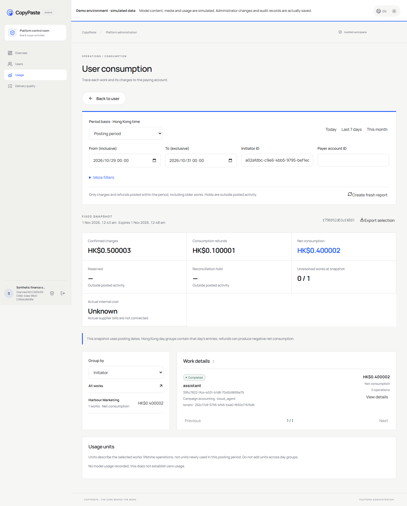

# 172 · 按实际入账期间查询消耗 / Posting-period consumption

旧报表按工作建立时间筛选，无法直接查询旧工作本期扣费或退回。现在Admin可选费用入账期间；香港每日汇总、明细、原扣费追溯和CSV使用同一快照及相同账目投影。旧期间、严格权限与重放行为保留。

Admin can now report this period's charges/refunds on older works. Hong Kong day summaries, original-charge detail and CSV share the same projected snapshot. Legacy cohorts, authorization and replay behavior remain.

|编号|本轮实现／待办|状态|
|---|---|---|
|1|实际入账期间与旧工作本期账目|已实现|
|2|退款来源跨区间、负净消耗与精确微额|已实现|
|3|每日账目投影、同选择明细／CSV及刷新|已实现|
|4|预留与累积操作用量说明，旧请求兼容|已实现|
|5|8项新原生SQL/API、1项精确投影、6项源码一致的原报表通过结果及7组实际Admin操作|通过；首次资料失败保留|
|6|中英README、逻辑图、5PNG／1GIF／1MP4、机器契约及原编号台账|已更新|
|7|真实内部成本、正式服务、签名／其他OS与全部专业验收|原范围继续待办|

The first fixture omitted settlement funding sources and was rejected by existing guards. A new version supplies balanced sources and funding movements; the failed attempt remains immutable. No broad historical rerun or whole-acceptance closure is claimed.

[MP4](../assets/admin-posting-period-172/workmate-admin-posting-period-172-01-posting-period-workflow.mp4) · [Evidence](../quality/admin-posting-period-172.json) · [Original ledger](../quality/remaining-work-stage172.md) · [Implementation](../development/172-admin-posting-period.md)

此源码增量不在既有v0.1.1冻结ZIP内。原冻结包及标签保留；Backend/Admin需使用本次配套源码构建，数据库仍为156。This source increment is outside the frozen v0.1.1 ZIP; use matching backend/Admin builds with schema156.
