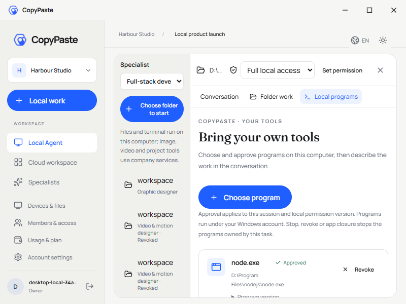
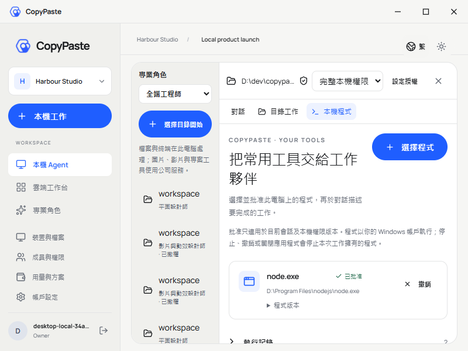

# 本机程序界面核对 / Local programs visual review

本次依据实际打包 Desktop 尝试 72 的原始画面与 68 项交互回执。程序、进程、文件、数据库和账本实际运行；模型回复、原生选择器/确认决定使用明确假数据。不是设计稿或重绘截图。

| 范围 | 本次观察 | 仍须验收 |
| --- | --- | --- |
| CopyPaste 品牌 | 延续蓝色主操作、浅中性色、显示/正文字体及自定义标题栏；无 Electron 原生边框菜单 | 全产品视觉一致性与客户设计评审 |
| 实际窗口 | 回执覆盖 1440×980、1024×768、800×600，分别核对英文/繁体中文；人工查看所附输出及两种紧凑窗口原像素 | 200% 缩放、系统 DPI、其他系统与所有动态/错误/空状态 |
| 程序选择 | 先授予完整本机权限，再选择并原生确认实际程序；取消/拒绝不批准 | 全部应用类型和安装环境 |
| 程序运行历史 | 程序名、批准状态、原任务、PID、退出码与折叠参数/输出；失败与成功分别显示 | 大量历史的真实客户使用与容量归档流程 |
| 紧凑布局 | 主操作会换行、路径与长参数不产生水平滚动；保留内部实际滚动，侧边无可见滚动轨道 | 完整键盘/辅助技术矩阵 |
| 多会话 | 等待状态和错误按所属会话保存；首个任务等待时仍可新建第二个任务 | 全部身份切换、断网及草稿恢复矩阵 |

紧凑提问场景 70 和多任务场景 71 的失败保留原回执；本次修复后独立重跑为 72。实际录制共 10 组 GIF/MP4，20 个文件完整解码，95 张截图保留原像素。源码、录制/截图摘要及环境清理见[当前检查点](../../quality/local-programs-checkpoint.json)，媒体解码见[核对回执](../../quality/local-programs-media-review-01.json)。原 102 项需求、26 组差异、至少十二个合格角色和 G01–G10 继续保留。

English: These are unchanged pixels from packaged Desktop attempt 72. Exact source/receipt bindings distinguish real native processes, files and original billing from synthetic model/dialog content. English and Traditional Chinese program layouts cover three native window sizes. Compact controls wrap without horizontal overflow or visible scroll rails. The current agent review inspects the output view and both compact-language screenshots; it does not qualify every product state, DPI/zoom combination, accessibility path or professional business outcome.
