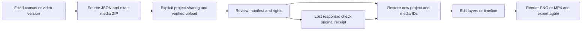

# 工程打包与恢复 / Creative project packages

普通分层画布与 campaign-cuts 影片可以打包固定版本的来源；编辑影片后可重新整理工程版本，再确认导出。上传后先校验、预览，再明确确认恢复为目的项目的共用副本。原工程与原素材不被覆盖；导入不调用 AI，不产生 AI 费用。

Layered canvases and campaign-cuts video projects export their fixed sources. Refresh project versions after editing before choosing the exact export. Upload, inspect and explicitly approve a new shared copy in the destination project. Original projects and media remain intact. Import/export make no AI request or AI charge.

## 使用流程 / User flow

1. Web/Desktop：进入「设计画布 → 工程打包与恢复」，选择固定版本下载ZIP。Extension：点击工具栏打开原生右侧栏，在「工作、通知与账户 → 工程打包与恢复」操作。
2. 明确确认上传工程包可供当前项目成员使用，再选择ZIP。一般文件上限100 MiB；扩展为工程包单独提供已校验的分片上传，原私人会话附件的5 MiB限制不被放宽。
3. 查看类型、素材数量、文件清单和限制；填写新名称，确认素材权利及新的共用副本。系统逐个核对SHA-256、大小和固定引用后，以新工程／素材ID创建副本。
4. Web/Desktop直接继续编辑：画布修改图层后输出PNG；影片修改脚本、逐帧分镜、字幕及音轨后渲染MP4。Extension恢复后的内容可在同一项目的Web/Desktop编辑器中使用。
5. 结果未确认时，保留原请求。重新打开页面后核对原结果，再继续同一请求；已移除的结果不重新创建。原工程始终不覆写。

On Web/Desktop open Design canvas → Project packages & restore. In Extension use the toolbar-opened native right SIDE_PANEL → Work, notices & account. Explicitly approve project sharing before upload. Inspect the package, give the new copy a name and confirm media rights. Continue editing in the existing Web/Desktop editor; Extension restores to that same project. Unknown results retain the original request across reload. Removed results are not recreated.

## 包结构和边界 / Format and boundaries

- `project.json`：严格校验的分层画布或视频定义。视频保留脚本、分镜、逐帧时间线、字幕及音轨设置。
- `media/NNN.png|wav|mp3`：每个固定版本的实际素材；映射后重新分配ID，不绑定旧项目授权。
- `manifest.json`、`SHA256SUMS`、双语`README.md`：大小、SHA-256、来源版本参考、渲染约束及使用说明。
- 影片另含固定`fonts/NotoSansTC-VF.ttf`及`fonts/OFL.txt`。当前需完全匹配的原生渲染配置；缺少或不相容会阻止恢复。
- 画布另含`preview.svg`，使用包内媒体的相对引用。画布的原系统字体参考保留，换环境可能改变排版，不能据此声称全部字体均可移植或逐像素一致。
- v1只接受产品生成的未压缩ZIP成员，以惰性读流逐个落盘，文件白名单、数量、单项和总大小有上限。拒绝加密、压缩、路径穿越、重复名称、链接、缺失引用及散列不符；不执行包内脚本，不按包内路径解压到客户工作区。
- 不导入身份、权限、账单、VIP、连接器凭据、旧任务或已验证来源标记。导入素材明确标注为用户上传与用户权利确认。Admin继续按既有范围和独立正文权限管理新内容。
- 生命周期、当前登录、项目写权限、素材可用性、存储额度和原请求幂等都参与校验。清理由本次操作自己的临时目录承担，用户上传包作为普通素材保留。

## API

以下前缀统一为`/v1/tenants/:tenant/projects/:project/creative-project-packages`。

| 方法 / Method | 路径 / Path | 作用 / Behavior |
|---|---|---|
| GET | `/` | 当前可见画布／影片列表，最多100项 / Up to100 visible current projects |
| GET | `/:id?expected_version=N` | 校验精确版本并流式下载ZIP / Exact-version streamed export |
| POST | `/preview` | 固定上传素材ID、版本与SHA-256，返回清单和preview_hash / Inspect exact archive version |
| POST | `/restore` | 强制preview_hash、名称、共用及权利确认，Idempotency-Key保持原请求 / Explicit new-copy import |
| GET | `/requests/:key` | 当前发起人原恢复结果；未记录、已完成或已移除 / Original request outcome |

导出需要项目读取权限；预览／恢复及回执核对需要项目写权限。重操作按已认证用户限流，每进程最多2项、每人1项并行，避免同一企业出口IP使所有员工共用一个操作额度。AI成本始终为0；以后发起Agent修改仍沿用原有费用与权限确认。

## 当前验收和待项 / Acceptance limits

本轮验证不同项目间的实际恢复，保留既有视频回归及三端真实操作。业务内容为假数据；HTTP、OTP/PKCE、原生PostgreSQL、分片上传、ZIP校验、PNG/MP4渲染和Windows程序／右侧栏操作真实执行。Windows包未签名，本轮未发起模型调用。

仍需完成品牌绑定画布的明确重绑、所有SVG/PPTX及专业工程的完整应用内恢复、全部字体和复杂来源依赖、不同机器和渲染环境的完整验收，以及原需求清单中的其他模块完整验收。102项完整范围不缩减，本轮不新增整项验收关闭。

This is a canvas/campaign-video restoration slice, validated across different projects with synthetic campaign content and real clients/storage/rendering. It does not complete all-format or cross-machine recovery, brand rebinding, professional project dependencies, signed installation or full-platform acceptance.

