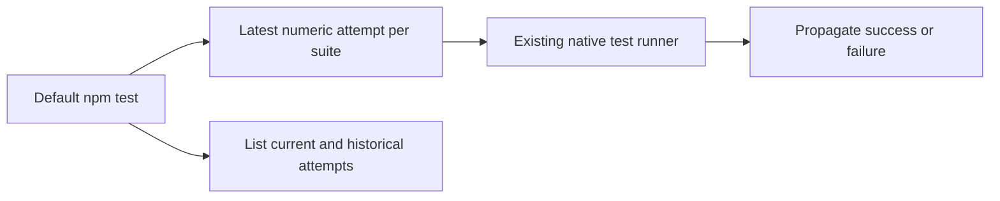

# 默认测试入口 / Current test entry

`npm test` 采用 `scripts/run-current-tests-owned-v10.mjs`。对同一阶段、同一测试组的 `-vN.test.ts` 尝试选用最大的数字版本；普通独立测试组保留。原测试和运行器逐字节保留，通过 `node scripts/run-tests-owned.mjs tests/<文件>` 显式复现。已由阶段139新版覆盖的旧 Desktop 基础测试维持历史归类。

`npm test -- --list` 检查实际选择，不执行数据库测试。正常 `npm test` 仍通过既有原生测试运行器启动当前134组，并传播失败退出码。当前六项端到端检查用会主动失败的旧测试验证它们不被执行，覆盖数字版本、不同测试组、普通测试、只读查看、子进程失败与错误参数，并核对真实仓库入口。本轮未重跑134组完整回归。

Only the npm test command and three test infrastructure sources change. All1771 previously qualified runtime/source files retain their bytes; dependency metadata is identical. Stage140 actual Web, frameless Desktop and native SIDE_PANEL capture/render results remain the runtime evidence. The original checkpoint stays intact; the Stage141 supplement binds the current Git metadata and test-entry checks. Full-product acceptance remains open.

