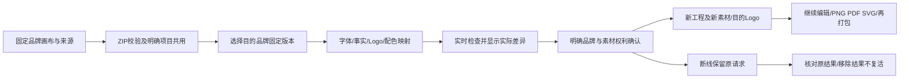

# 品牌工程复用 / Reuse a campaign with another brand

客户可把品牌画布连同固定来源打包，在另一个有权限的项目中选择明确的目的品牌版本，逐项核对字体、同类型事实、Logo和可选配色，确认后建立新工程。来源工程保持原版本。恢复不发起AI调用或AI费用；以后启动Agent修改仍执行原权限和费用确认。

Export a brand canvas with its fixed media, then choose an authorized destination brand revision in another project. Map fonts, facts of the same type and Logos, optionally replace colors, review changes and explicitly approve a new shared copy. Source content stays intact. Restore makes no AI request or AI charge; later Agent work follows existing permission and cost confirmations.

## 用户操作 / Customer flow

1. 在Web/Desktop「设计画布 → 工程打包与恢复」选择工程当前版本，下载ZIP。扩展在工具栏开启的原生右侧栏提供相同工程入口。
2. 先确认上传包及恢复素材可供目的项目成员使用，再选择文件并上传。继续沿用固定版本、SHA-256、100MiB总包上限与分片上传。
3. 选择目的项目的固定品牌版本、使用渠道和地区语言。品牌列表支持分页；不自动升级到更新版本。
4. 将来源字体、事实和Logo逐项映射到目的品牌。价格只映射到价格、促销只映射到促销；系统检查生效时间、字体使用范围、实际字形与Logo尺寸／留白。
5. 可将原设计颜色替换为目的品牌中已声明的颜色。不指定替换的颜色和未绑定事实的文案会保留，需要客户明确确认仍适用。
6. 点击「核对品牌替换内容」，查看实际新价格／文案、字体与Logo的逐项变化；任何选择变化都会使之前确认失效。
7. 明确确认品牌变化及素材权利，再恢复为新共用工程。目标Logo复用当前项目已授权的固定文件；一般源图片重新分配ID。源品牌ID、权限和旧字体文件不作为目的授权导入。
8. Web/Desktop继续修改图层并输出PNG、PDF或SVG，之后可重新整理版本并打包。扩展负责上传、核对与恢复，继续编辑在同项目的Web/Desktop完成。
9. 连接中断时保留原请求并核对回执。成功结果不重复创建；已移除结果不复活。扩展可先核对原结果，再明确重新选择来源。

On all three clients, explicitly approve project sharing before upload. Select an exact destination brand revision, channel and locale; map each required source font/fact/Logo. Optional colors must belong to the destination palette. Review actual resolved changes and approve both brand suitability and media rights. Changing a choice invalidates approval. Restore creates new content and media IDs, reuses authorized destination Logos, and never imports old brand authority. Continue editing in Web/Desktop. Unknown outcomes keep the original request; receipts prevent duplicate or removed-content recreation.

## 实现与控制 / Implementation and control

- 工程清单新增可选品牌依赖描述，逐层记录来源字体、事实类型、已解析文字与Logo用途键。包内声明只是客户上传内容，不能授予项目权限或证明来源可信。
- 服务器在恢复事务中重新检查当前身份、目的项目写权限、固定品牌版本、素材状态、字体权利、事实期限、字形、Logo文件完整性及版面限制。替换确认摘要绑定包、版本、目的品牌与实际差异。
- 每个必要来源键必须且只能映射一次，目标字段必须存在；拒绝漏项、重复项、未知字段、不同事实类型及未声明的目标颜色。
- 先验证品牌约束，再保存导入内容。恢复、资源分配和审计在同一事务中完成；沿用原请求幂等、移除结果拒绝、存储配额与生命周期控制。
- 字体矢量化逐个文字层转换，保留原图片、形状及层叠顺序。共享修复同时用于品牌画布、矢量稿及演示稿的PNG/PDF预览；原生PPTX继续保留可编辑文字、形状与实际图片。
- 原接口清单漏记的54个实际操作补入可变的客户端操作增量声明；历史基线散列保持。既有完整实际路由集合相等检查继续执行。
- Desktop继续在本机运行Codex，窗口无边框、无Electron菜单；扩展继续使用原生右Side Panel和云端Agent。

Archive declarations carry no authority. Server-side restoration rechecks live identity, project write access, exact brand revision, media lifecycle, font rights/glyphs, fact validity and Logo bytes/layout. Exact maps and a package/brand/change-bound digest gate the atomic restore. Font outlining preserves source images and shape order in brand/vector/presentation output. Original route inventory equality remains strict; the immutable baseline is unchanged. Desktop remains local Codex; Extension remains the native right Side Panel with cloud execution.

## API

前缀 / Prefix: `/v1/tenants/:tenant/projects/:project/creative-project-packages`

| 方法 | 路径 | 行为 |
|---|---|---|
| GET | `/brand-options?cursor=...` | 项目写权限范围内分页列出固定品牌、渠道、字型、事实状态及Logo字段 |
| POST | `/preview` | 固定上传版本校验，品牌包另返回完整依赖与设计原色 |
| POST | `/brand-preview` | 接收固定上传选择及brand_target，重新校验并返回差异和review_hash |
| POST | `/restore` | 品牌包强制brand_target、brand_review_hash与confirm_brand_review=true；原有共用／权利／预览确认仍必需 |
| GET | `/requests/:key` | 当前发起人在当前项目核对原结果，不重新创建已移除内容 |

`brand_target`包含固定`binding`，以及完整的`fonts/facts/logos`映射和明确的`colors`替换列表。普通画布与影片包不能附带品牌重绑字段。旧普通工程包继续可读；旧客户端不支持新的品牌依赖，需要升级后使用。

`brand_target` contains a fixed binding, exact font/fact/Logo maps and explicit optional palette replacements. Non-brand canvases and video packages reject these fields. Existing ordinary packages remain readable; older clients must upgrade to consume brand dependency descriptions.

## 当前证据与边界 / Evidence and limits

62项相关检查覆盖8项品牌恢复集成、6项既有普通工程恢复、13项品牌生产、7项可编辑设计、2项新增矢量／演示图像像素、23项视频和3项扩展下载边界。实际三端使用邮箱OTP／PKCE、原生PostgreSQL、上传与ZIP校验；Web与未签名无边框Windows包均完成品牌替换、图层续改、真实PNG输出和v2再次打包；Chrome通过工具栏打开原生右侧栏并在侧栏中上传、确认和恢复。5张截图、3组真实GIF／MP4和3份实际工程包绑定确切源码。所有自建浏览器、页面、Windows程序及服务在结束后关闭。

Synthetic campaign data exercises real native storage, rendering and client controls. These 62 checks and actual client journeys have source-bound evidence; they do not constitute the whole platform regression, a professional creative-quality review or a signed installer test.

仍待完成：全部SVG／PPTX／专业工程的应用内恢复、所有字体与复杂依赖、跨机器与渲染环境的一致性、真实Image2／视频／广告服务与客户质量验收、正式签名安装及其余原始验收范围。品牌权利为客户声明，不能将字段有效视为已完成法律授权核验。完整102项范围不缩减，整项验收不新增关闭。

