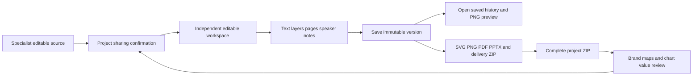

# 矢量设计与演示文稿工程 / Vector and presentation workspaces

客户可以把专员交付的固定可编辑来源建立为共用工程，修改后保存新版本并制作实际交付文件；也可以把完整工程包上传到另一个有权限的项目，核对品牌、图表数据和素材授权后恢复新副本。

Create a shared workspace from a specialist's exact editable source, save another version and produce actual deliverables. A complete package can also be uploaded to another authorized project and restored after brand, chart-value and media-rights review.

## 使用路径 / Customer workflow

1. 在 Web 或 Desktop 的设计页面，展开「从已交付来源建立工程」，选择确切来源版本、填写名称并确认项目共用。来源分页展示，每页20项。From Web/Desktop Design, expand Create a project from delivered source, choose an exact source version, name it and confirm sharing. Sources are paged in groups of 20.
2. 打开工程。可修改文案、字体大小和字重、颜色、位置与尺寸，添加文字／矩形／椭圆，调整图层前后顺序。演示文稿还可修改受众、目标、页标题和演讲备注，复制、移除和调换页面。Open a project to edit copy, text size/weight, color and geometry, add text/rectangle/ellipse layers and change stacking order. Presentations support audience, decision, page title and notes plus duplicate/remove/reorder.
3. 点击「保存为新版本」。服务端按当前版本比较写入；并发修改会要求刷新，原版本不覆盖。通过版本号打开任意保留版本，再保存可形成新的当前版本。预览明确对应已保存版本。Save as new version uses an optimistic version check; concurrent changes require a refresh. Retained history is never overwritten. Opening an older saved version and saving it creates another current version. Preview is tied to the saved revision.
4. 点击「制作交付文件」。矢量稿输出可编辑SVG、文字轮廓SVG、PNG、PDF；演示稿输出原生可编辑PPTX、逐页SVG/PNG及PDF。均附可编辑来源、图表原值CSV、审阅HTML、字型授权和交付ZIP。Create delivery files produces editable SVG, outlined SVG, PNG and PDF for vectors, and native editable PPTX, per-page SVG/PNG and PDF for presentations. Both include editable source, exact chart CSV, HTML review, licensed font files and a delivery ZIP.
5. 在「工程打包与恢复」选择当前工程固定版本，下载完整工程ZIP。到目的项目上传，查看文件清单及图表原值；逐页预览保存在包内，恢复后可在工程里逐页查看。品牌工程逐项映射当前目的品牌的固定字型、Logo与可选配色，核对实际文案并独立确认品牌；素材授权与导入数据分别确认。工程包包含图表时，缺少数据确认不能恢复。Download a complete fixed-version project ZIP from Project packages & restore, upload it to the destination project and review the file list and exact chart values. Page previews are retained in the ZIP and become available in the restored workspace. Branded packages require explicit current brand font/Logo mappings, optional colors and a separate copy/brand review. Media rights and imported chart values require independent acknowledgement.
6. 恢复后生成新工程、素材版本和图表记录编号。来源工程、账号、收费、VIP、连接器权限和原任务验证状态均不导入。导入图表标记为自行确认的数据快照；缺失值保留原因，不变成零。可继续手动修改，也可把实际交付来源交给专员继续修改。Restoration allocates new project, media-version and chart-record IDs. It never imports account, fee, VIP, connector authority or original verification claims. Imported charts remain user-attested snapshots; missing values retain their reasons. Continue manually or give the real delivered source to a specialist for another revision.

## 三端边界 / Client responsibilities

| 端 / Client | 本次路径 / Workflow |
|---|---|
| Web | 云端工程创建、实际来源编辑、保存历史、交付下载、工程包上传／恢复。Cloud workspaces, source editing, saved history, deliverable downloads and package upload/restore. |
| Desktop | 同样的工程功能、原生保存窗口；无边框、本地Codex及用户授予的本地权限继续由桌面执行链处理。Same project workflow and native save dialogs; frameless local Codex and user-granted local permissions retain the desktop execution path. |
| Extension | ChatGPT式附件／对话结构内的原生右侧Side Panel上传、品牌及图表核对、恢复到云端项目；在Web/Desktop继续编辑。Native right Side Panel attachment upload, independent brand/chart review and cloud restoration, followed by Web/Desktop editing. |

## 实现约束 / Implementation contract

- API新增8个路由：来源列表、操作回执、工程列表、创建、固定版本详情、保存、PNG预览、制作交付。统一项目角色和租户边界，浏览者可读取／预览，创建和交付需要写权限。Eight scoped routes cover sources, receipts, list/create, detail/update, preview and delivery. Viewers can read/preview; creation and delivery require project write access.
- 数据库迁移138增加工程版本与交付来源绑定，行级权限同时覆盖应用与管理角色。已保存版本不可修改；交付依赖当前可用的父工程、品牌与素材。撤回后的回执不自动重建内容；后台删除会清理全部新增工程历史与衍生文件，不删除独立的客户原始素材。Migration 138 adds immutable workspace versions and deliverable lineage with application/control row policies. Withdrawn parent projects, brands or sources fence derived delivery and replay cannot recreate removed content. Administrative deletion erases the new workspace history and derived files while independent customer source files remain.
- 预览与紧随其后的保存按用户顺序等待，避免正常交互被误判为忙碌。每用户同时处理1项、全局2项；等待最多每用户4项、全局16项。排队后仍重新检查权限、来源和版本。Preview remounts and an immediate save queue in user order: one active job per user, two globally, at most four waiting per user and sixteen globally. Authority, sources and versions are checked when work actually starts.
- 完整工程包上限100 MiB；只接受受限存储型ZIP，核对所有成员路径、字节数和SHA-256；字型、授权及渲染配置须与本发行一致。图片保持实际PNG，图表范围与原值严格保留。Complete packages are limited to 100 MiB stored ZIPs with member/path/size/SHA-256 verification and pinned renderer/font/license checks. Images retain actual PNG bytes and chart values/scope remain exact.
- 保存、预览、打包及恢复不调用AI。后续专员工作通过现有Codex、模型网关、权限和费用流程。保存／交付结果不确定时，客户端保存原请求并先查询回执，防止重复创建。Save, preview, package and restore make no AI call. Later specialist work follows existing Codex, internal gateway and budget rules. Uncertain operations keep the original request and check its receipt before retrying.
- PPTX内文字、形状、路径及图表条形／标签可编辑；图表原值附CSV和来源，当前并非嵌入Excel工作簿。字型附带，未内嵌PPTX；仍需实际Office编辑器及跨机器验收。此次不宣称完整专业DTP、所有文件格式或真实外部模型验收。PPTX text/shapes/paths/chart bars and labels are editable; exact values are retained in CSV/source rather than an embedded Excel chart. Fonts are provided, not embedded. Actual Office editor, cross-machine, all-format and live-service acceptance remain open.

## 启动 / Run

各端现有README安装与启动步骤继续适用；后端先执行 `npm run db:migrate`，再启动相匹配的API和Worker。禁止Docker/WSL。Follow each repository's installation/start instructions; run `npm run db:migrate` before starting the matching API and workers. Native Windows services only; no Docker/WSL.

## 本轮验证 / Current validation

42项当前源码检查，4条实际三端旅程检查，6张页面截图，3组实际GIF/MP4录制；合成业务／模型数据，实际原生数据库、OTP/PKCE、字体、图像及文件渲染，Windows包未签名。42 current-source checks, real three-client journeys and actual captures; synthetic business/model fixtures, real native database/auth/renderers and unsigned Windows package.

本轮较早的90项相关回归通过记录保留原始源码快照；其后补齐新增工程的排队和删除处理，增加并发保存及历史／实物删除检查，并重跑受删除流程影响的视频检查；没有把旧记录改称为当前重跑。客户端源码完全一致，因此复用已成功构建的应用包并重新执行真实旅程。The earlier 90-case related regression receipt retains its original source snapshot. Later changes cover workspace queue/deletion handling, overlapping-preview/save and physical-erasure tests; affected video regressions run again. Those earlier results are not relabelled as a current rerun. Client/build sources are byte-identical, so the successful client package is reused and actual journeys run again.

见[本轮检查点](../quality/editable-projects-checkpoint-143.json)及[完整待验收范围](../quality/remaining-work-stage143.md)。See the source-bound checkpoint and complete remaining acceptance scope.
