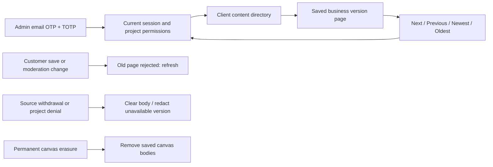

# 后台业务内容历史 / Administrator business content history

管理员可从统一「用户端内容」列表进入品牌、团队、项目简报、自动化计划及设计工程，阅读实际保存的完整版本记录。每页最多50条，保留客户／管理员／迁移快照来源，提供首尾及前后翻页。

From Client content, administrators can read retained versions of brands, teams, project briefs, automation schedules and creative projects. Pages contain at most 50 saved records, with original provenance, forward/backward navigation and first/last entry points.

## 覆盖范围 / Resource coverage

| 内容 / Content | 实际保存记录 / Retained record |
|---|---|
| 品牌 / Brands | 固定名称、定义、摘要、原操作者类别 / Exact name, definition, digest and original actor category |
| 团队 / Teams | 团队配置与客户／管理员修订来源 / Team definition and customer/administrator provenance |
| 项目简报 / Project briefs | 已发布简报版本；未发布草稿仍由原修订入口管理 / Published brief versions; drafts use the existing revision flow |
| 自动化计划 / Automation schedules | 计划定义修订；执行日志由原计划入口提供 / Schedule definition revisions; execution logs retain their existing entry |
| 普通画布 / Ordinary canvases | 从本次迁移起记录客户保存；已有数据只保留迁移时当前版 / Customer saves from this migration onward; existing canvases retain only their then-current body |
| 模板视频 / Template videos | 固定视频定义、摘要与渲染器参数 / Fixed video definition, digest and renderer profile |
| 矢量及演示稿 / Vectors and presentations | 固定页面、图层、备注和渲染器参数 / Exact pages, layers, notes and renderer profile |
| 批量设计 / Batch designs | 按作品分组，再按版本倒序；相同版号不合并 / Grouped by creative work, newest version first inside each work; equal version numbers remain distinct |

已有会话、专家和记忆完整历史入口继续保留。页面按已保存版本显示，不补造从未保存的内容。旧品牌没有操作者记录时显示「迁移时保留的现有版本」，本次修正后的新客户品牌保存会记录真实操作者。

Existing complete conversation, specialist and memory readers remain available. Unsaved historical content is never reconstructed. Legacy brands without an actor remain explicitly unattributed retained snapshots; new customer brand saves now preserve their actual actor.

## 权限与数据处理 / Authorization and data handling

- 每次翻页均要求有效管理员会话、已完成TOTP、`admin.content.read`和`admin.content.body.read`，并重新检查企业／项目范围及显式拒绝。A current MFA-authenticated session, both content permissions and current tenant/project scope are required on every read.
- 游标绑定管理员、登录会话、对象、类型、历史修订、内容版本和审核版本，30分钟失效；客户保存后旧页不能继续拼接。Cursors bind actor/session/object/kind/history/content/moderation versions and expire after 30 minutes; saves invalidate old pagination.
- 批量设计使用作品UUID与版号的组合游标，避免不同作品的v1、v2被误当成同一项。Batch paging uses work UUID plus version, preserving distinct works with equal version numbers.
- 原始文件或品牌来源不可用时，相关版本仍保留时间／身份，但正文不返回；管理员可按原权限调查被隔离的品牌自身。Withdrawn dependencies redact dependent bodies while retaining their time and identity; authorized moderation can still inspect the quarantined brand itself.
- 页面每15秒、重新聚焦或恢复可见时复查；发现内容／权限变化即清空正文，关闭时取消请求，正文和游标不存浏览器存储。Recheck every 15 seconds and on focus/visibility return; clear changed/unreadable bodies, abort closed requests and persist no private body/cursor in browser storage.
- 普通画布历史由数据库保存并禁止就地重写，永久删除流程清理其历史正文。Canvas snapshots are immutable database records; permanent erasure removes saved canvas bodies.
- 翻页不调用模型、不创建任务、费用预留或账务，只记录最少阅读审计。Reading creates no model calls, work, reservations or charges; audits contain only minimal read metadata.

## 实施与运行 / Implementation and operation

后端新增SQL139，最低数据库版本为139；升级后再启动新版API。沿用原生PostgreSQL启动／迁移流程及已有README安装命令，不依赖Docker或WSL。前端仍使用原CopyPaste品牌样式。

SQL139 adds canvas snapshots and business-history change fences. The release requires schema139 before API startup. Use the existing native PostgreSQL migration/startup instructions; no Docker or WSL is used. The administrator UI retains the CopyPaste design system.

API：`GET /v1/admin/content/:kind/:id/history?edge=first|last`，随后用返回的`next_cursor`或`previous_cursor`发起下一次请求。`kind`为`brand_profiles`、`agent_groups`、`project_configurations`、`workflow_schedules`或`creative_projects`，亦保留原三类。响应包括`content_kind`、`history_scope`、`items`、当前修订与签名游标。普通旧正文入口继续提供原字段，并增加完整历史链接。

API: request the first/last page using the route above, then the returned cursor. The five additional kinds coexist with the original three. Responses retain exact content kind, saved-history scope, items and signed cursors. Compatible body reads retain their existing fields and add the history link.

## 实际验证及边界 / Actual validation and limits

当前相关后端52项通过，实际Admin浏览器9项旅程通过。105次画布与105次品牌保存经真实客户API创建；检查首尾和双向翻页、版本变更、来源隔离、撤权清空、原样文本显示、无付费执行及1440／960／390像素布局。批量设计62个版本身份是明确的SQL夹具，验证阅读协议，不声称为本轮真实客户批量制作旅程。

The current source-bound backend run passes 52 cases; the real administrator browser passes 9 journeys. Canvas/brand histories use 105 actual API saves each. Tests cover navigation, version change, source withdrawal, scope denial, inert text, no paid execution and 1440/960/390px layouts. The 62 batch version identities are explicit SQL fixtures for reader behavior, not a claimed customer production journey.

首次编译失败和第二次夹具地址失败保留原来源与日志。第二次广泛检查95项通过、10项新用例在共享夹具中失败，该轮整体仍是失败；后续52项通过绑定修正后确切源码。全产品权限矩阵、其他资源完整治理、正式外部服务和签名安装等原完整验收继续开放。

The original compiler and fixture-URL failures remain archived. The second broad attempt passed 95 cases and failed 10 new cases in their shared fixture; it remains a failed run. The later 52-case pass binds the corrected sources. Full product matrices, remaining resource governance, real external services and signed-client installation remain open under their original acceptance scope.
