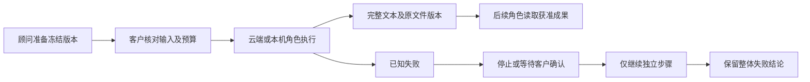

# 阶段145：工作流成果交接与失败确认 / Workflow handoffs and failure review

客户现在可以把上一角色的完整成果交给下一角色：在冻结的流程版本内选择前序步骤，保留完整文本文件及真实交付版本，查看每一步费用并下载原文件。已知且完成费用结算的失败可以按预设等待客户确认，再略过该步继续独立工作。不会自动重试；整条流程仍保留失败结论。

## 客户操作

1. 选择企业流程顾问，说明希望串联的业务、每步成果和预算。顾问保存、发布并发起固定版本；模型不能替客户确认。
2. 在 Web 的工作流程页面核对使用哪些前序成果、每步失败策略及独立子任务总预算。Extension 保持右侧聊天／文件上传，通过既有入口进入此云端确认页面。Desktop 使用可信本机确认卡，所有 Codex 子任务仍在同一获准本机目录执行。
3. 确认后才建立子任务和费用预留。后续角色可分页读取完整保存文本，并取得原文件版本、类型及摘要。页面的6000字符收据摘要不再充当完整交接内容。
4. 完成后在步骤交付中下载原版本文件。普通文本／Markdown／CSV／JSON可由专用只读工具读取；媒体文件使用既有专业读取工具，不能声称未读取的媒体已被理解。
5. 失败默认停止；预设为人工确认时，只对已知、已结算且没有未完成外部操作的失败提供略过确认。需要失败步骤成果的后续步骤会停止。取消、撤权、来源不可用、未知用量／外部结果均不能通过此入口继续。

## 代码与权限

- SQL140 扩展现有来源追踪与发布来源检查，保留 SQL001–139。完整输出保存为私有不可变文件；依赖固定 `asset_version_id`、SHA-256和版本号，不静默替换成最新文件。
- `input_steps` 使用从0开始的唯一前序产出步骤编号；省略表示全部先前产出，空数组表示独立工作。最多8步；不能选择自己、后序步骤或审批步骤。
- `on_failure` 为 `stop` 或 `review`。人工略过仍受版本摘要、revision、cursor、总预算和当前角色／来源约束；重复确认不能产生重复任务或收费。
- 提供 `workflow_inputs` 只读工具，按固定版本验证实际字节并分页返回文本。每页最多16000 UTF-16字符，完整文本读取上限2MB；更大文件和媒体交给相应读取／下载流程。每步最多200个既有文件版本及一个完整结果文件，超出明确停止。
- 失败检查使用仅返回布尔结果的受限数据库函数，不向应用开放音频服务的私有计量表；本机流程接口补齐可信 actor 上下文。
- 本机结果明确标为 `desktop_client_report`。本机文件仍留在客户设备，交接清单仅含已经获准上传的文件及原本已报告的文本；此次控制层检查不构成本机全部OS操作能力的验收。
- 旧运行若只有截短收据、没有完整保存文件，则以 `WORKFLOW_LEGACY_OUTPUT_INCOMPLETE` 停止并要求另行审阅，不伪造历史成果或自动重跑已付费步骤。
- 关闭窄屏导航时立即隐藏并禁止命中，避免动画残留遮挡正文；打开导航需客户主动操作。保留既有品牌色、字体、Desktop无边框及Extension原生Side Panel。

## 验证与范围

后端39项、可信本机流程控制12项均通过；实际Web客户流程7项通过，7张真实截图、2组实际时序GIF／MP4，以及1440／960／390宽度检查。长文本83,299字节的完整客户下载、中文／表情分页、旧版本读取、撤权前阻断模型、私有越权、确认竞争、失败跳过及整体失败保留均有定向检查。

当前选择后端 `backend-04` 与浏览器 `ui-03`。后者仅增加窄屏可见性修复及检查；两者实际后端与Desktop源码逐字一致。保留所有原失败尝试：核查入口旧文件名、本机新增测试参数顺序、成果来源标识、私有音频表读取权限、来源撤回后的隐藏行为，以及最初的浏览器按钮选择。

全部模型响应按已获授权的假数据处理。未接入正式公司AI密钥、真实广告／发布账户或生产付款；新增本机用例验证控制API和可信顺序器，并没有运行实际本机Codex／OS端到端流程。本轮没有关闭任何原始需求的完整验收。原102编号、88项必需完整范围开放、12项待确认建议、1项可选、REQ095既有验收保持原范围。

## English

Frozen private workflows select exact predecessor outputs and retain full private text files alongside original deliverable versions. Cloud and native children read verified saved bytes through a bounded read-only tool. Native Codex execution remains on the customer's device; uploaded files and client-reported text are clearly distinguished from independent OS verification.

Known settled failures can stop or await explicit customer review. Approval skips the failed step without replaying it, permits only independent later work, preserves incurred charges and leaves the overall workflow failed. Unknown usage, unresolved external effects, revoked authority and unavailable sources cannot use this continuation path.

The selected qualifications cover 39 backend cases, 12 trusted native-runner cases and seven actual Web journeys with seven screenshots and two real-time GIF/MP4 pairs. Model responses are explicitly synthetic. Production provider/payment acceptance and complete native Codex/OS qualification remain open. All original requirement identities and full acceptance scopes are retained.
