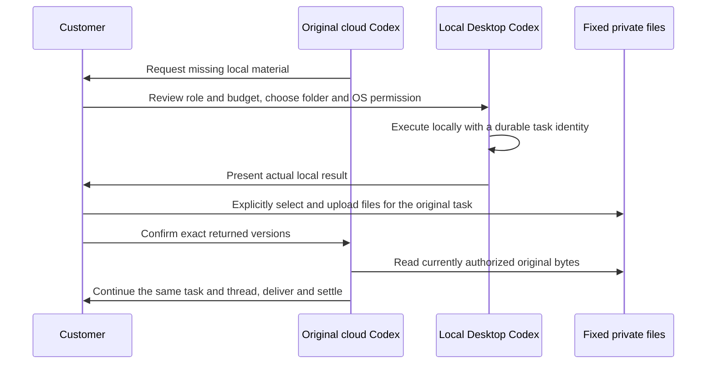

# 147：主链功能收口与使用流程 / Functional completion and customer journey

本轮交付两项可实际使用的业务能力：有命名输入／交付的可复用工作流，以及云端原任务请求本机文件、Desktop 实际执行、客户主动上传后回到原线程继续。技术契约和接口见 [详细方案](../technical/147-workflow-contract-and-local-handoff.md)，需求见 [补充需求](../requirements/12-workflow-contract-and-local-handoff.md)。

## 客户操作 / Customer actions

1. 现有邮箱验证码进入 Web；Desktop 和 Extension 使用浏览器授权及 PKCE，选择同一企业、项目。Extension 由工具栏打开真实 Chrome 原生右侧栏。
2. 云端 Codex 在原任务请求文件时，点击“交给 Desktop 准备文件”，核对具体要求、角色与本机独立预算。此时持久保存请求，不预先授予 OS 权限，也不自动开始执行。
3. Desktop 的本机工作区显示待处理请求。客户选择真实本机目录、受限或完整 OS 权限，再明确确认费用。受信任主进程运行客户本机 Codex；云端队列不执行这个本机步骤。
4. 本机完成后，客户逐个选择要上传的文件。上传固定绑定原任务及私有范围，私人无会话任务也不降为共享。续传、确认及完成均复核原任务／依赖。勾选确切文件版本后确认交回；不会自动上传整个目录。
5. 服务端原子补齐文件检查点，沿用原任务、会话、预算和真实 Codex 线程继续；其余必需输入未齐时继续等待。费用分原云端工作与本机工作各自结算，响应丢失不新建另一份执行。
6. 与此同时，流程顾问可用 `workflow_save` 定义 `input_schema` 与 `output_schema`，发布不可变版本，并用 `workflow_run.inputs` 提供文本、数字、布尔和精确文件版本。页面显示小数、0、false、文件名及版本。客户核对本次值和子步骤费用后才启动。
7. 专业步骤可以读取已获准的具名文件，包括本人其他会话的私人文件；只授予该运行批准的精确版本。设计编辑沿用被选图片版本，其他新版本不会静默取代它。完整文本交付来自核对字节／摘要的保存文件，避免把截短预览当成全部内容。
8. 定时和事件提案继承同一组不可变输入。Web／Desktop／Extension 在确认前显示实际值及精确文件版本，再分别授权每次／每日预算。输入不完整或来源撤回时不能启用／继续。
9. 客户正式删除原任务或单独删除上传文件时，对应上传回执清名并退役；私人文件内容和派生访问同步撤回，已产生的费用与不可变执行身份保留。只有真实对应的任务／固定上传版本和删除日志能够授权终态清理。
10. 心跳、工具授权和推理只共享读取原任务与本机请求，按固定顺序锁定本机执行，避免有效任务被后台心跳误中断；真实接单、交回、取消、删除及撤权继续按写入和当前来源检查处理。

## 验证 / Validation

最终选择 `backend-11`、`ui-08`：95项后端覆盖（同一产品源码的92项既有功能检查及3项并发复测）、83项Desktop受信任进程检查、12项Extension上传检查、5组实际客户流程、11张实际截图和5组时序GIF／MP4。还核对了6种窗口／面板宽度、无横向溢出、Desktop 隐藏菜单及滚动轨道。完整运行依据见 [来源检查点](../quality/functional-closure-checkpoint-147.json)。

backend10保留95次运行、93通过／2失败的原始记录。两处新增并发测试的持锁连接遗漏租户／用户上下文，v2仅补齐与实际事务一致的上下文，全部原断言保留。backend11单独复测这3项；产品代码、原测试及fixture字节均未更改，不重复运行已通过的92项或UI08。95表示组合覆盖，不宣称在新一次运行中全部95项通过。

实际使用原生 PostgreSQL、验证码／PKCE、打包 Windows Desktop、客户本机 Codex 写出 CSV、显式分块上传、原云端付费线程暂停／继续和真实 Side Panel。内部 Responses 服务按用户授权返回明确的假数据；实际 Codex 往返使用明确配置的固定 QA 二进制0.163.0-alpha.11。命名工作流界面另用有标识的脚本模型，不能冒充独立真实模型专业质量证明。既有生产锁定值不因这次 QA 自动升级。

Desktop 包尚未签名；此轮不代表全平台所有专业输出、所有 OS、生产广告／付款／真实AI服务均已验收。102项原编号和全部原始范围继续保留，未将功能定向核查等同于完整产品验收。全部失败、原始校验器、日志和源快照保留。所有本次自建浏览器／客户端／服务和数据库进程已按报告关闭；没有调用本地虚拟化。

## English

The original cloud task can now request local material, persist an owner-scoped Desktop handoff, wait for explicit folder/OS and fee approval, and resume the same paid Codex thread after the customer uploads and confirms exact file versions. Desktop executes the actual local Codex. Selected uploads remain bound to the original private task even without a chat; no whole-folder automatic upload occurs. Durable identities and admission/finish journals prevent repeated work after uncertain responses. Starter concurrency allows only the strictly verified waiting parent and its local preparation step to share a slot; every actual task retains its own fees and budget checks.

Reusable workflows declare bounded named text, number, boolean and file inputs plus named text/file outputs. Each run freezes actual values and original file versions, requires review of the input digest and step fees, and returns complete saved text. Specialist tools use the selected version and current authority, including explicitly chosen private files from the same owner's other conversation. Scheduled/event executions preserve the same values; the actual native Side Panel displays decimal, zero, false and file version before recurring authorization. Withdrawn input and output sources stop reads and execution.

Formal deletion of the original task or an individual uploaded asset retires its exact task-bound upload receipts and private content while preserving incurred fees and immutable execution identities. Only the authoritative source-task journal or actual fixed upload version and deleted-asset journal permits the completed upload to retire.

Selected evidence covers 95 backend cases across separate executions: 92 existing checks on identical product bytes and three targeted concurrency checks after correcting missing transaction caller context. Backend10's original 93-pass/two-failure report is retained; v2 preserves every assertion and only supplies the missing context. This is not a new full 95-case rerun. Product, original test and fixture bytes are unchanged, so the successful UI08/package qualification remains applicable. Evidence also covers 83 trusted Desktop process cases, 12 Extension upload cases, five actual client journeys, 11 screenshots, five real-time GIF/MP4 pairs and six layout checks. Real cloud/local Codex processes, native SQL, the unsigned Windows package, OTP/PKCE, file bytes and the native right SIDE_PANEL are exercised against an explicitly synthetic internal Responses service. The real roundtrip explicitly configures pinned QA Codex0.163.0-alpha.11; it does not silently update production locks. Named workflow interface evidence uses a separately labelled scripted model. Production services, signed releases and all original complete professional/OS acceptance scopes remain separately open.
