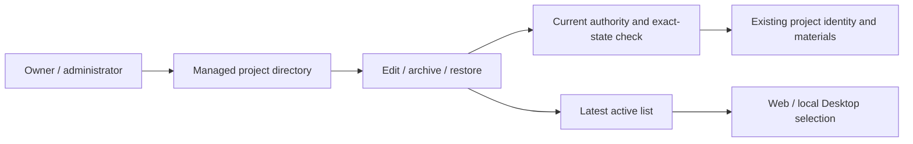
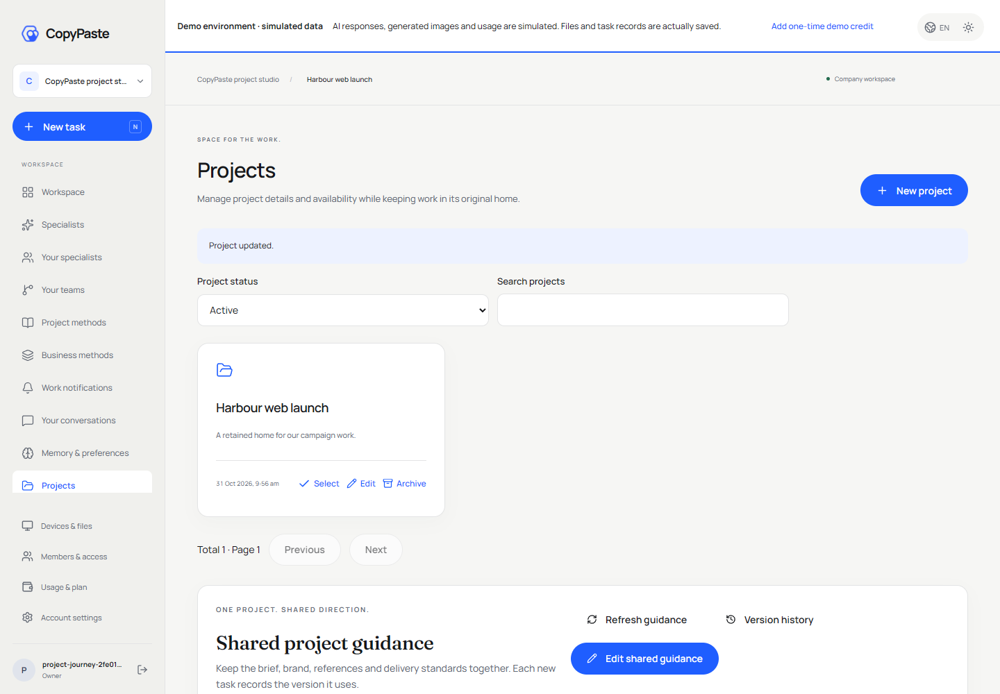

# 项目管理与最后项目恢复 / Project management and last-project recovery

本轮属于首个冻结版本 `v0.1.0-rc.1` 之后的开发修复，冻结标签、五个ZIP、清单及校验值保持原样。六个独立仓库的分支会继续同步；此修复没有被倒填到旧发行包。

This is an unreleased increment after the first frozen candidate. Its seven frozen tags and original five archives are retained. Branches advance independently; the old release packages do not silently acquire these fixes.

## 使用流程 / Usage

企业 owner/admin 在 Web 或 Desktop 打开「项目」，按使用中、已封存或全部筛选，使用文字搜索和每页12条分页。新增或编辑名称与简介；归档/恢复必须明确勾选确认。归档最后一个项目后页面仍可访问，切换已封存列表可以恢复原项目，不需要创建替代企业或项目。

Workspace owners/admins open Projects, filter Active/Archived/All, search by literal text and page through twelve cards. Create or edit details; archive/restore requires explicit confirmation. The management page remains reachable with no active project. Restore from Archived to reuse the original project and its existing materials/grants. Removed grants stay removed. Other members only see their authorized active projects.

归档是可逆的可用性状态，在封存期间普通任务、文件和本机执行继续通过 active-only 权限边界拒绝访问。它不等于永久删除或持久取消：云端任务定期及工具调用前复查，短暂归档后立即恢复可能没有触发周期检查。需要结束的任务必须先明确取消；不以归档批量释放费用预留，也不承诺撤回客户已下载的文件。

Archiving is reversible availability control. Normal task/source/native paths still require an active project. It is not permanent erasure or durable cancellation: a rapid archive/restore may occur between worker checks. Cancel work separately when termination is intended. Archiving does not bulk-release financial holds or recall downloaded files.

## 实现约束 / Implementation

`GET /v1/tenants/:tenant/project-directory` 为当前 owner/admin 提供独立管理目录；原活动项目列表保持不变。查询严格限制 state、search≤160、page≤10000、page_size≤100，使用参数化字面子串搜索及企业RLS。响应禁止缓存。项目资料更新保持原 PATCH 路径，并支持 expected_archived/name/description，冲突返回409 PROJECT_CHANGED。

The management directory is separate from active project access. The existing PATCH path accepts optional expected-state fields and rejects stale changes. The request locks user authority, tenant memberships and the project row in the established order, then rechecks current authorization after all waits. A suspended/removed/demoted actor cannot finish using stale authority. Cross-tenant path/header mismatches cannot mutate the target.

更新可使用持久幂等键；所有重放先验证当前权限，只记录最小成功标识，再返回当前项目状态。因此归档成功但回复丢失、用户已恢复后再重试，不会再次归档。审计仅记录变更字段名与状态，避免把客户名称、简介写入审计正文。

Idempotent retries reauthorize and return current state instead of applying a cached mutation again. A lost archive response followed by a restore cannot rearchive on retry. Audit records contain changed field names and state, excluding private project text.

Web/Desktop 的项目目录组件按用户与企业隔离；项目列表请求使用单独递增序号和企业校验，旧结果不能覆盖新状态。新增/恢复后的 preferred project 仅从最新接受的 active list 选择；等待操作摘要后、发送前还验证组件、操作与会话没有切换。共享主布局允许项目/成员/设备/用量/设置在无项目时访问，业务路由仍要求有效项目。Desktop 的本机工作区、会话、权限和固定Codex运行时没有被Web代码覆盖。

The clients fence stale list results by tenant and request generation, validate preferred selections against the latest accepted active list and guard the pre-send digest wait against session/action/unmount changes. Management routes work without a selected project; project business routes still require one. Desktop keeps its native local Codex bridge and execution paths. Extension retains cloud execution and the native right Side Panel.

## 聚焦验证 / Focused qualification

10项真实SQL/HTTP检查通过：最后项目恢复保留身份及原指令；owner/admin正向；普通角色拒绝；跨企业与未登录拒绝；竞争更新只成功一次；重复请求返回当前状态；等待真实权限锁时降权/移除/封禁拒绝；撤销的项目绑定不复建；分页、字面搜索、资料冲突及审计最小化。

Ten focused SQL/HTTP cases passed. Six build steps passed, including twelve native-surface boundaries, Web and renderer compilers/builds and a distinct unsigned Windows directory package. Five actual client groups cover Web OTP/new company onboarding, a delayed real pre-archive response, Web archive-last/restore, native Desktop PKCE and Desktop archive-last/restore. Four actual PNGs and two actual GIF/MP4 pairs are retained. All owned browsers, native windows, API, isolated fixtures and native databases closed. No model call was made in this increment.

Web在1440/390宽度无横向溢出；Desktop在1360/1000宽度无横向溢出，侧栏与正文不显示滚动条、无系统菜单。当前证据位于 delivery/evidence/project-lifecycle-149，后端02、构建01、UI01。原后端01失败保留：检查器曾读取错误的错误字段，并依赖无权读取的数据库查询文本；V2保留原业务断言，改用标准错误结构和真实pg_locks阻塞证据。没有修改已执行的测试或覆盖失败。

Broad model, Extension, production and historical regressions were deliberately omitted under the user's fast-release instruction. Historical Stage147/148 results are not relabelled as current acceptance. Schema remains145, with no new migration. The distinct candidate is desktop/release/project-lifecycle-149-01/win-unpacked; it does not replace the frozen release directory.

## 仍待完成 / Remaining

项目/企业聚合整删仍缺少路由、范围服务、队列协调和恢复重放，不能描述为仅剩测试。已有21类资源根清理和35天备份轮换；后续聚合实现需覆盖权限撤回、派生数据、私有连接/回执、外部不确定费用、不可删除的财务审计事实、共享资源边界及备份重放。全量导出与生产恢复完整验收也保持开放。

Aggregate project/tenant erasure remains unimplemented, while single-resource cleanup and 35-day backup rotation already exist. Comprehensive export, derived-data coverage, production recovery, real provider/Google/Meta account integration, signing/install/update and whole-product acceptance remain open. Preserve all102 original requirement records; 88 required whole acceptance scopes remain open, not88 entirely absent modules.

[当前完整编号 / Full ledger](../quality/remaining-work-stage149.md) · [API contract](../contracts/project-management-openapi.json) · [First frozen release](../releases/v0.1.0-rc.1.md)

[Web MP4](../assets/project-lifecycle-149/copypaste-web__workmate-project-lifecycle-149-01-project-archive-restore.mp4) · [Desktop MP4](../assets/project-lifecycle-149/copypaste-desktop__workmate-project-lifecycle-149-01-project-archive-restore.mp4)
