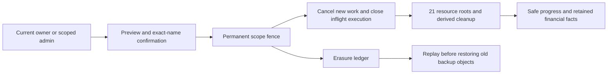
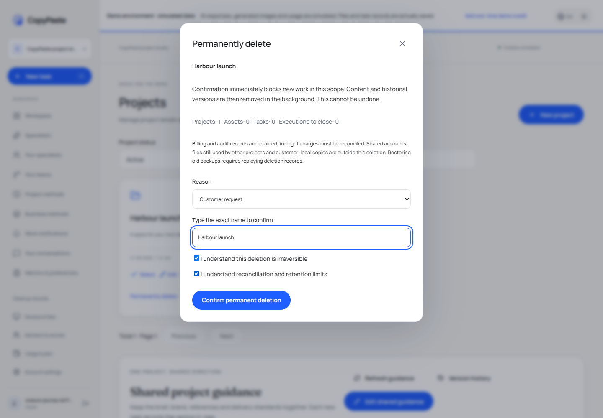
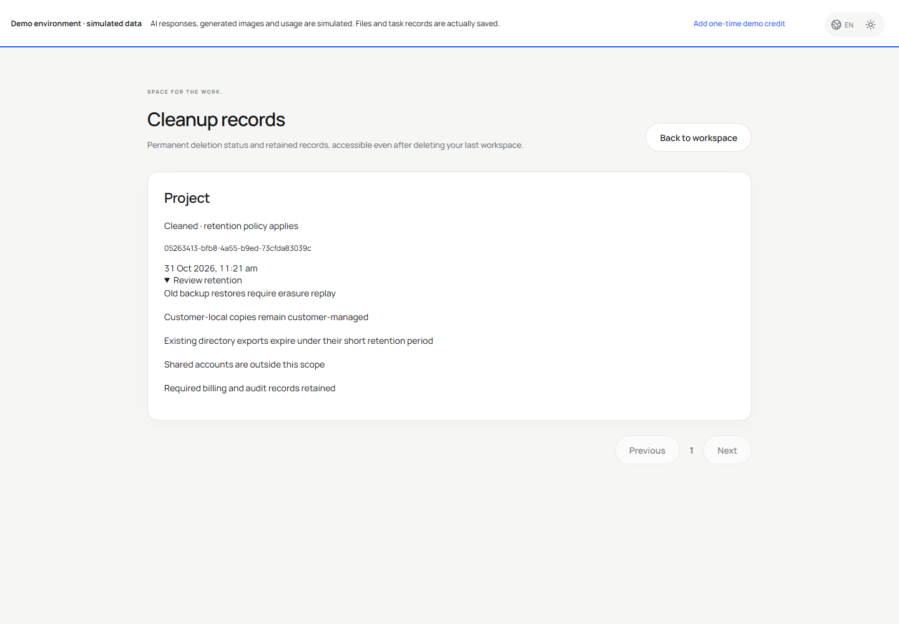
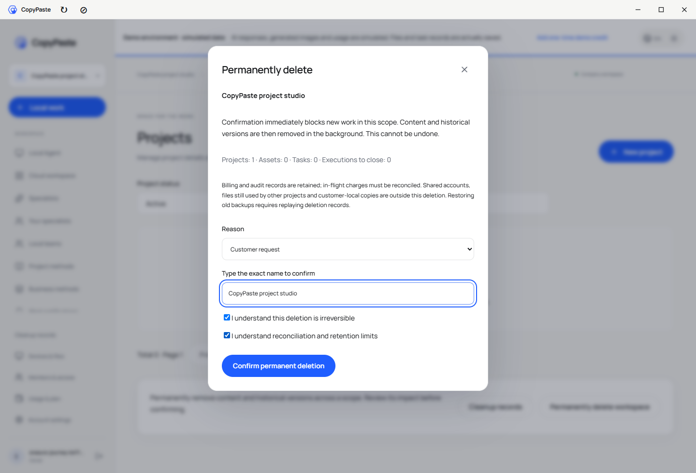
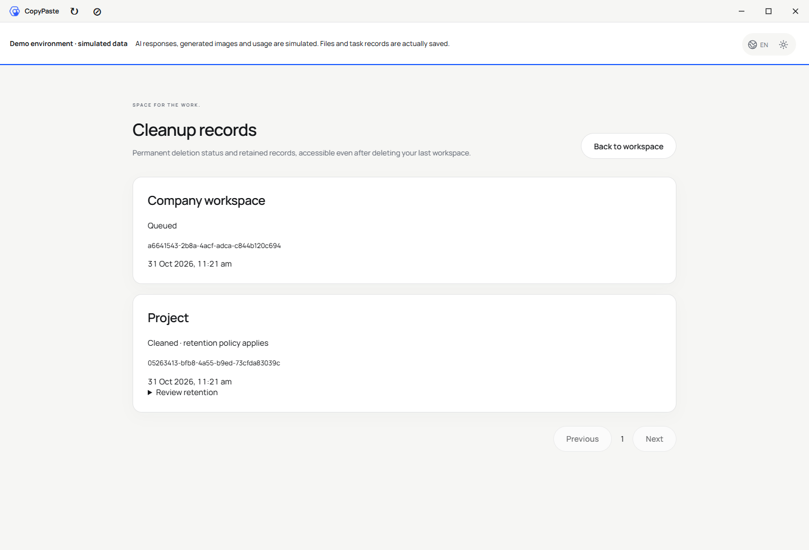
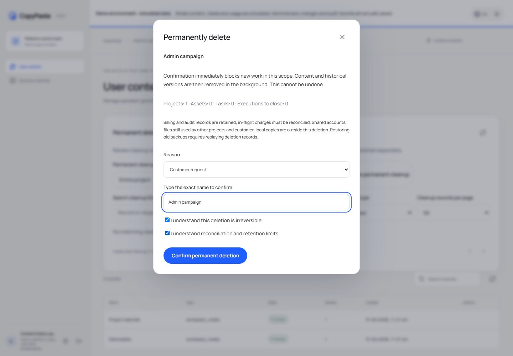
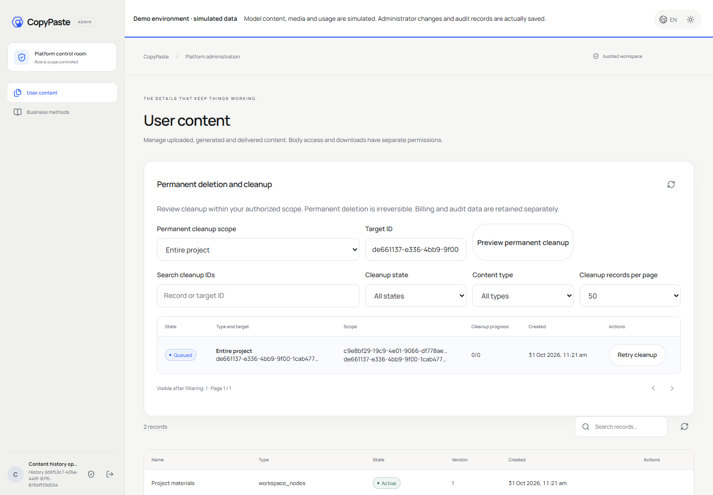
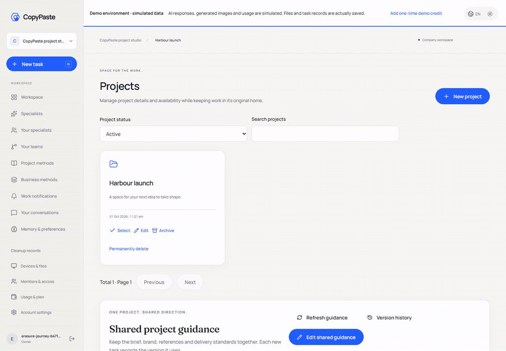
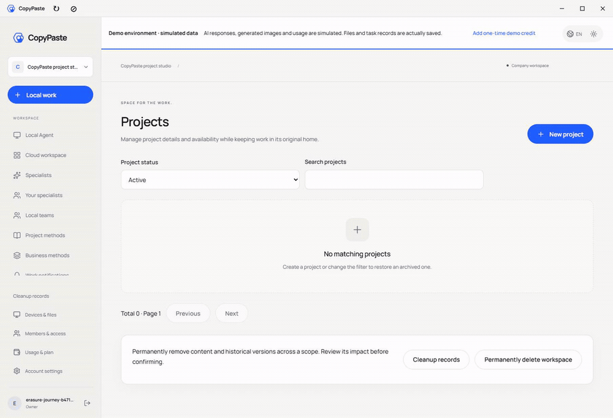
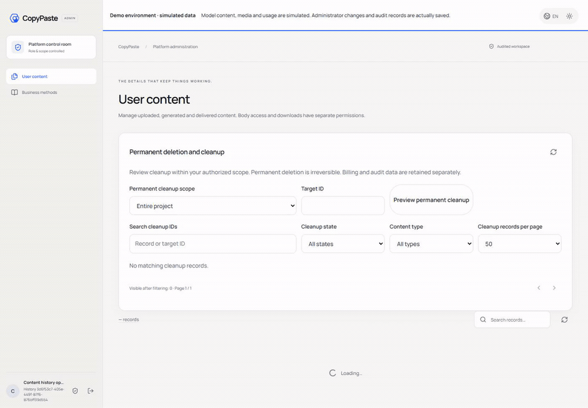

# 聚合永久删除 / Aggregate permanent scope erasure

本轮为首个冻结版 v0.1.0-rc.1 后的未冻结开发增量，不替换原标签和五个ZIP。All current changes are an unreleased increment; original frozen tags and archives remain intact.

企业 owner/admin 从 Web/Desktop「项目」进入永久删除预览；整企业仅 owner 可操作。输入精确名称，选择原因，分别确认不可恢复和保留范围。Admin从内容管理选择项目/企业ID，预览并确认；服务端要求当前范围的 admin.content.delete 与近期MFA，企业删除逐一检查子项目的明确拒绝。

Web/Desktop owners/admins preview a project scope; only owners delete a whole workspace. Exact-name confirmation, a controlled reason and two acknowledgements are mandatory. Administrators use Content management with current scoped deletion permission and recent MFA. Previewing never deletes content. A successful request returns202 and a durable job. Current exact user/session locks serialize acceptance with logout and session withdrawal; membership is rechecked before acceptance. Replays return current state after reauthorization.

接受后立即永久封闭新任务、文件读取和新内容写入，后台扩展21类资源根、历史版本、连接与自动化、上传、发布预览/凭据等清理。数据库写入规则阻止持有旧请求快照的写入复活。仍被其他项目使用的物件与连接受到保护；不会删除共享账户或其他企业资料。

A permanent database marker fences new private writes even from stale request snapshots. Background jobs rescan all resource roots, histories and scoped ingress. Shared live object references and connections remain protected. Native Desktop stays local and only its original active login family can submit minimal cancellation/finish receipts after erasure; model, tools, source reads and heartbeats remain blocked. Closing uses server-observed cost, null output and original report hashes. Expired or unknown charges stay reconciling; deletion never fabricates success or releases unknown holds.

清理记录是独立账户页面 /cleanup，删除最后企业后仍可查看。后台可查看状态、重试及保留类别。必要帐务/审计事实保留；共用全球用户身份不属于企业删除；既有目录导出依原有短有效期到期；客户已下载或本机文件由客户管理。备份需在隔离、升级后、还原物件前重播根级ledger2，兼容既有单资源ledger1。35天轮换不等同于保证所有备份字节在第35天消失。

Cleanup history remains accessible outside the workspace shell, including after deleting the last workspace. Billing/audit facts, shared account identities and short-lived directory export metadata follow explicit retention boundaries. Customer-local copies cannot be recalled. Backup restoration applies current migrations in isolation and replays root-level erasure before materializing objects. Legacy ledger1 remains compatible. Backup rotation does not promise destruction of every byte on day35.

本轮只做必要检查：11项当前SQL/HTTP检查通过，1项耗时旧备份重复检查明确省略；该旧145快照加ledger2的真实恢复在backend05单项通过，原始报告整体仍因另一夹具失败而保持失败，不改为通过。三端6组实际界面流程、6张PNG及3组真实GIF/MP4，初次8步构建及3步定向重构建含12项本机边界检查和独立未签名Windows目录包。关闭所有本轮浏览器、原生窗口、API及原生数据库。

Focused qualification passed11 current SQL/HTTP cases,6 actual Web/Desktop/Admin groups and3 targeted rebuild steps after8 all-client build steps. No broad regression or paid model request was run. Original failed attempts are retained. The repeated expensive backup scenario was skipped; its earlier individual pass is historical within this increment, before forward repairs147/148, and is not represented as current full recovery acceptance. Database schema advances to148 using forward-only repairs; executed146/147 are not edited. The native closure exception is limited to permanently erased roots; moderator-quarantined/deleted tasks in an otherwise active project still return404 on finish/cancel replays, even while private output remains stored pending cleanup.

仍待完整导出、所有衍生和供应方副本覆盖、真实内部API/广告平台联调、生产恢复、签名与安装更新完整验收。本轮不宣布整产品完成；REQ049保持开放。Desktop候选在 release/scope-erasure-150-02/win-unpacked，首个冻结包另行保留。

[完整待项 / Full ledger](../quality/remaining-work-stage150.md) · [API contract](../contracts/scope-erasure-openapi.json) · [First frozen release](../releases/v0.1.0-rc.1.md)

