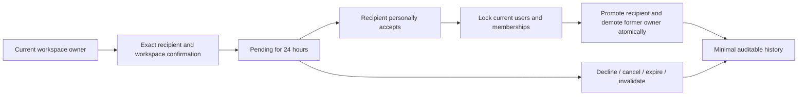
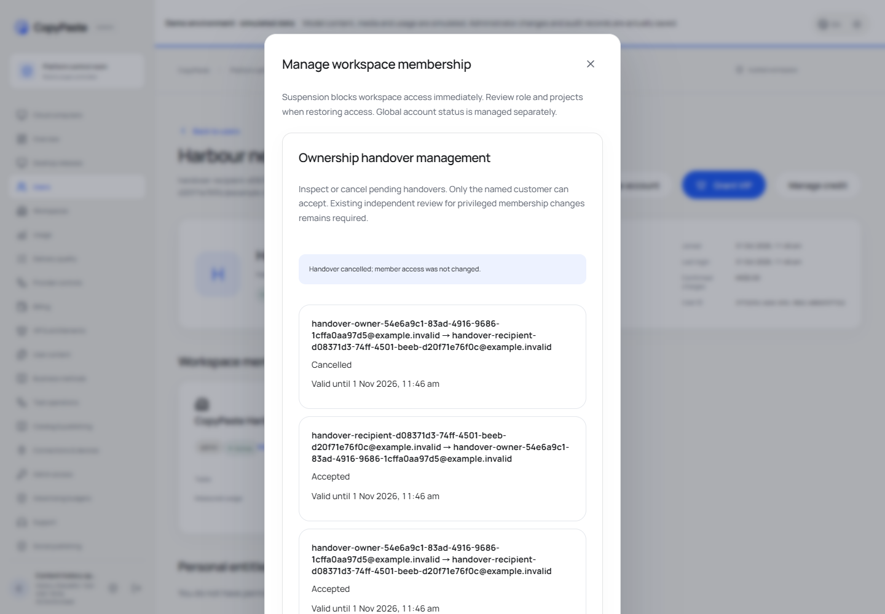

# 企業所有權交接 / Workspace ownership handover

本輪為首個凍結版之後的開發增量151；v0.1.0-rc.1原標籤和五個ZIP保留。

**客戶流程 / Customer workflow**：owner在「成員與權限」找到接收方，點「交接所有權」，輸入目前企業全名及確認責任。接收方必須是同企業啟用且未被暫停的非owner成員；不能自行交給另一郵箱而跳過成員加入。每企業最多一筆待確認，有效期24小時。原權限維持到接收方親自登入確認；接收方可拒絕，來源方/其他現有owner可撤銷。

Owners choose an existing active non-owner member from Members & access, review the exact recipient, type the current workspace name and acknowledge responsibility. Only one pending intent exists per workspace for24 hours. The signed-in named recipient sees a workspace notice and can accept or decline in Members & access even without member-management rights. Before acceptance, roles stay unchanged. Acceptance makes the recipient an owner and the former owner an admin in one transaction; other owners keep their roles.

**權限與業務 / Authority and business behavior**：雙方帳戶授權及成員版本、有效登入、當前owner/接收方狀態、企業狀態、永久刪除標記與有效期皆在提交時核對。排序取得帳戶鎖及實體users行共享鎖，覆蓋SSO直接撤權；再取得成員、企業及交接鎖。會員或帳戶授權版本變更使舊意向失效。重試終態不重新提升角色或回退後續權限變更。先提升再降級，避免無owner視窗；審計與兩筆角色變更原子提交。

Current user/account and membership versions, exact session, workspace state, deadline and permanent-erasure fences are rechecked. Sorted physical account locks serialize SSO withdrawal before role writes. Both membership updates and the terminal audit commit together; terminal retries do not regrant access. Decline, cancellation and expiry do not change member roles. Existing personal conversations/files, task actors, billing identity, incurred costs and local OS permission are separate; handover does not rewrite them. Running work continues under its original actor and current authorization/accounting rules.

**管理後台 / Admin**：使用原有用戶詳情→管理企業成員入口查看交接和取消。要求當前企業成員寫入權限admin.tenants.members.write與近期MFA，重疊project deny阻止整企業動作。管理員不能代接收方接受。既有特權會員變更仍走原獨立審批流程。沒有新增共用密碼、交接令牌或外部連結。最小治理ID、版本、固定狀態理由及審計保留；不保存企業名稱快照、自由文字理由或登入憑證。

Admin uses the existing user membership manager to inspect and cancel. Tenant membership-write permission, recent MFA and overlapping project-deny rules apply. Operators cannot impersonate recipient acceptance or bypass existing independent privileged membership review. Only minimal governance IDs, versions, controlled state reasons and audit survive; current access still controls reads.

**必要驗證 / Focused qualification**：9項實際SQL/HTTP檢查、6組Web/真實Windows目錄包/Admin操作、6張PNG和3組GIF/MP4。8步三端構建及12項本機/雲端邊界檢查通過；Desktop仍無原生菜單、無可見側欄滾動軌及橫向溢出。本輪無模型請求或新增AI費用，省略廣泛歷史、跨OS及生產完整矩陣。backend01是夾具引用不存在的會話欄位，原失敗及執行器保留；backend02修正查詢後全部通過。

Nine targeted real backend cases and six actual three-client journey groups passed. Eight build steps include the unsigned Windows candidate and12 native-surface boundaries. All task-owned browsers, native windows, API and disposable native database are closed. Broad historical, production and cross-OS regression was deliberately omitted. This handover increment is implemented; original full account/inflight and whole-product acceptance remain open. Current Desktop candidate: release/ownership-transfer-151-01/win-unpacked.

[八項需求 / Requirements](../requirements/17-ownership-transfer.md) · [API](../contracts/ownership-transfer-openapi.json) · [完整待項 / Full ledger](../quality/remaining-work-stage151.md) · [凍結版 / Frozen release](../releases/v0.1.0-rc.1.md)

