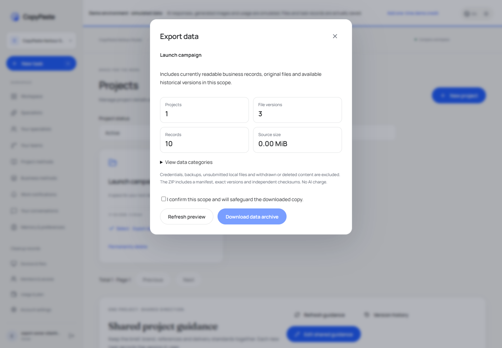
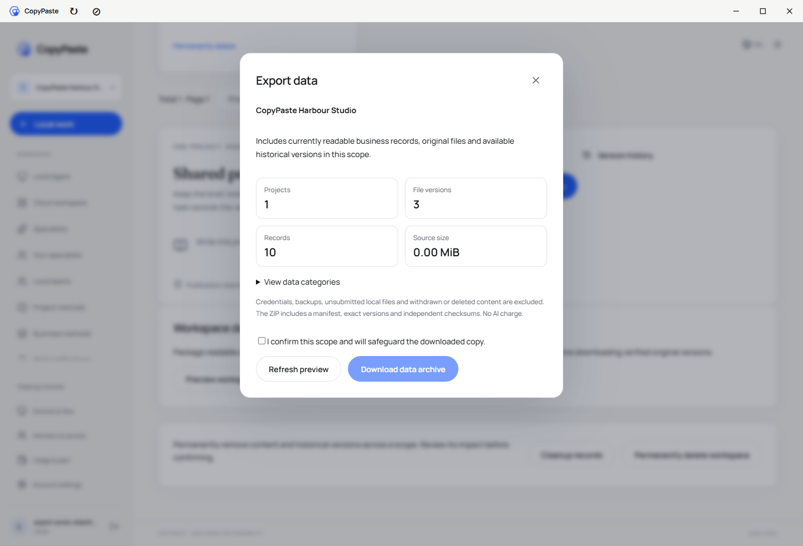
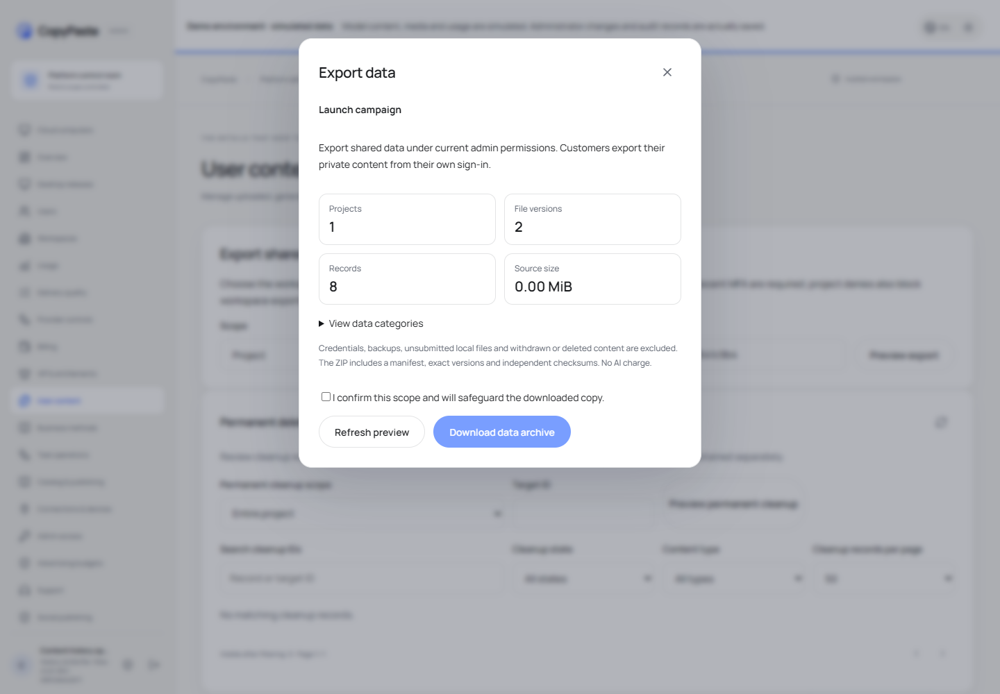

# 完整範圍資料匯出 / Complete authorized scope export

增量152已實現並定向驗證；首個凍結版v0.1.0-rc.1的原標籤與五個ZIP保持原樣。本增量不在該凍結包內。

Web/Desktop：「專案」→「匯出資料」→核對預覽→確認保管副本→下載。企業owner/admin可用「預覽企業匯出」一次打包使用中專案及本人可讀私人資料。封存專案先恢復；企業匯出列出排除的封存專案。單一專案包明確排除企業/個人全局記憶，企業包則各包含一次。project viewer可讀自己的授權專案包，不能執行整企業匯出。

Web/Desktop: Projects → Export data → review the preview → acknowledge custody → download. A current workspace owner/admin can export all readable active projects and their own private data. Archived projects must be restored first. Project exports omit global workspace/personal memories; workspace exports include them once. Project viewers can export readable project content; workspace management never grants another member's private content.

Admin：「內容」→「範圍共享資料匯出」→選企業/專案及其ID→預覽→確認→下載。要求admin.exports.create、admin.content.body.read與10分鐘內MFA；企業操作逐一核對專案拒絕。私人會話、私人原始檔及私人工程不冒用客戶導出。權限不足、撤權或永久刪除標記立即阻止新的下載。

Admin: Content → Export shared scope data → choose project/workspace ID → preview → acknowledge → download. Both scoped export and body-read permissions and recent MFA are mandatory; overlapping project denies also block workspace selection. Customer-private content must be exported by the customer. This does not impersonate a customer or transfer their local OS permissions.

ZIP包含manifest.json、SHA256SUMS、中英README、data/*.ndjson及files/<project>/<asset>/v<version>/<original-name>。原始CSV直接導入也保留raw_csv、口徑及摘要；每個可用檔案歷史版本逐一打包原始位元組。會話、任務/事件、分層記憶及版本、品牌、Agent/技能、雲端目錄、設計/影片/矢量/簡報工程、分析/SEO/GEO、工作流/例行/事件、團隊及方案均用明確欄位清單。共享操作記錄不等於全庫備份。沒有自動還原工具。

The ZIP contains a manifest, independent SHA-256 checksums, a bilingual guide, UTF-8 NDJSON categories and exact retained original files. Int64 counters, file sizes and monetary micros use decimal strings. The manifest lists every category, selected project, fixed original/version and explicit exclusion. Credentials, internal storage locations, security/execution logs, backups, withdrawn/deleted/expired sources and unsubmitted local files are excluded. Customer-authored business prose stays business data. Exporting makes no model request and no additional AI charge.

以cp_app RLS讀取客戶資料；控制表保留既有DTO/本人範圍，不增加資料庫授權。受控權限連線匯出PostgreSQL snapshot，資料連線在repeatable-read導入同一快照。一般任務來源、報告/SEO、修訂來源及工作流固定輸入/輸出使用既有讀取檢查；父工程與逐版本來源約束同時保護子表，管理端不能藉缺少private_owner的子表讀到私人正文。預覽摘要綁定帳戶/範圍/整個選擇；打包後再核對，資料改變明確要求刷新，毀損物件不回傳ZIP。

Customer reads retain existing RLS. Control-only publication/feedback data uses explicit public DTOs and ownership rules. Both connections share one exported PostgreSQL snapshot. Source readers include report/revision provenance and fixed workflow outputs; revoked workflow origins also hide retained definitions. Packaging verifies every object's length and hash, then rechecks current authority and the full selection before serving bytes. Completed/aborted/timed-out streams close and remove temporary files; later cloud deletion cannot remove copies already saved by a customer.

每包上限16GiB原始二進位、10,000檔案版本、每類100,000筆、64MiB文字。兩個全局打包槽、每帳戶一個，五分鐘上限延伸到回應流；容量不足明確失敗，不靜默截斷。Desktop經主進程受限下載IPC、原生目的地與串流校驗；支援的瀏覽器使用File System Access串流，其他瀏覽器只允許64MiB以內的完整包。沒有把所有原始檔讀進一個Blob。

Limits are explicit:16GiB original binary data,10,000 versions,100,000 records per category,64MiB metadata,2 global exports,1 per actor and a5-minute timeout through response streaming. Large exports use the native Desktop save path or a supporting browser's file writer. The unsupported-browser fallback refuses archives above64MiB. Exceeding capacity returns an explicit error and suggests exporting individual projects.

必要驗證：9項真實SQL/HTTP、6組實際三端下載、8步三端構建與12項本機/雲端邊界。6張PNG、3組GIF/MP4、三個實際下載ZIP逐一核對原始版本與SHA。Web/Admin使用產品既有的小包fallback（測試中明確停用File System Access能力）；Desktop只固定OS儲存目的地，登入、IPC、HTTP、SQL、原始物件、ZIP與畫面均實際執行。大型File System Access/16GiB/逾時慢接收實機矩陣、跨OS、生產供應方及廣泛歷史回歸按快速發版要求省略。

Nine targeted backend cases and six actual client journey groups passed. The browser capability and native OS destination are controlled test inputs; responses, authentication, original files and archives are not mocked. No live model is invoked. All created windows, browsers, API and disposable native databases are closed. backend01 preserves the original missing-column and fixture failure; backend03 preserves two fixture assumptions; backend04/ui02 passed before the final history fence, and backend05/ui03 qualify the final code. All executed verifiers/results remain unchanged. This is functional completion of authorized export, not full production or whole-product acceptance.

[需求 / Requirements](../requirements/18-scope-data-export.md) · [API](../contracts/scope-data-export-openapi.json) · [完整待項 / Ledger](../quality/remaining-work-stage152.md) · [首個凍結版 / Frozen release](../releases/v0.1.0-rc.1.md)

實際匯出類別 / Actual manifest categories: agent_group_members, agent_group_nodes, agent_group_runs, agent_group_versions, agent_groups, agent_skill_bindings, agent_versions, agents, analysis_evidence, analysis_report_sources, analysis_reports, analysis_snapshots, analytics_datasets, asset_versions, assets, brand_profile_versions, brand_profiles, brand_version_assets, cloud_event_inbox, cloud_event_triggers, cloud_event_versions, cloud_schedule_occurrences, cloud_schedule_versions, cloud_schedules, cloud_workspaces, connections, connector_profiles, connector_snapshots, conversation_messages, conversations, creative_feedback_mappings, creative_feedback_reports, creative_mappings, creative_matrix_revisions, creative_matrix_units, creative_projects, dataset_evidence, delivery_reviews, editable_project_outputs, editable_project_versions, geo_experiments, geo_runs, geo_samples, memories, memory_versions, poster_project_versions, project_configuration_versions, project_configurations, projects, publication_effects, publication_events, publication_operations, publication_policies, seo_documents, seo_runs, skill_installations, solution_installations, solution_trials, solution_versions, task_dependencies, task_events, task_plans, task_quality_measurements, task_source_reads, tasks, video_project_sources, video_project_versions, video_renders, workflow_runs, workflow_schedule_versions, workflow_schedules, workflow_versions, workflows, workspace_nodes.

