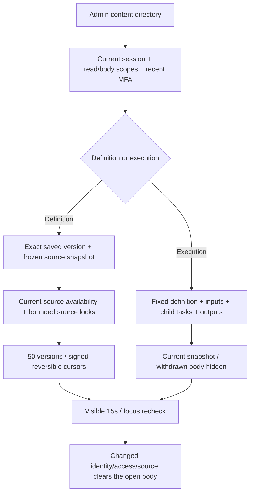

# 工作流完整定义与受控执行阅读 / Workflow content readers

后台旧入口对Desktop定义仅返回100版，云端仅返回当前定义，并缺少历史组件的实时权限复查。此增量把共享、私有云端和本机工作流接入现有完整历史阅读器；工作流运行接入明确标注的当前执行快照。首个冻结 `v0.1.0-rc.1` 及其五个ZIP保留原样，本增量尚未加入冻结包。

Previously, Admin exposed at most100 Desktop definitions and only the current cloud definition. This increment adds all retained definition pages and a separately labelled current execution snapshot, preserving the first frozen release.

SQL150 `150-workflow-content-history-v2.sql`增加共享工作流的不可变快照和定义历史修订号。迁移仅为现有非删除共享工作流保存当前版，`retained_current`与迁移采集时间明确区分；新创建记录客户来源，后续保存记录实际可知操作者，控制层无客户身份时标记 `system_snapshot`。定义变化要求新版本，同版覆盖和历史改写被数据库拒绝。私有云端/Desktop继续读取既有 `workflow_versions`，发布变化推进历史修订。

SQL150 adds shared immutable snapshots and history fences. Existing unsaved history is never reconstructed. Native/private cloud versions retain their existing storage; publishing a retained version invalidates older cursors.

来源检查从该版`source_refs`开始，克隆当前安装的完整底层遍历及外层已确认创意反馈检查，保留品牌、GEO、可编辑工程、方案、团队、本机接续等已有来源约束。仅新的管理员入口允许调查根自身隔离；其他依赖仍按当前状态约束。检查不伪造客户会话、不写入`native_workflow_reads`、不以旧创建任务存活代替冻结来源。来源锁采用闭合表清单及参数化ID，冲突要求刷新；审计始终记录真实管理员。普通客服缺少正文权限时继续拒绝。

前向SQL151/152把运行调查例外贯通到精确运行、子任务与保存版本自引用链，只有正在调查的根工作流/运行处于`quarantined`时可例外；已删除根和其他依赖不例外。定义与运行共用来源锁，包含项目配置及子任务读取的衍生来源，锁后重读并持锁至事务结束。当前开发源要求数据库版本152，已应用150/151保持原文。

Forward SQL151/152 preserves exact-root quarantine investigation through child tasks and nested saved publication chains. Shared source locking covers project configurations and derived run sources, rechecks after locking and holds locks until transaction completion. Current source requires schema152; applied migrations150/151 are unchanged.

The control-only source reader preserves both installed lineage layers and checks captured sources independently of the expired creator task. It never manufactures customer execution authority. Dependency withdrawal and root investigation remain distinct; source contention requests a refresh. Original customer/runtime source helpers are unchanged.

定义接口沿用`GET /v1/admin/content/workflows/:id/history`的闭合类别扩展，每页最多50条，游标签名绑定账号、会话、对象、治理版本、定义版本及历史修订，30分钟到期。兼容`GET /v1/admin/content/:id/body`保留`text`、`mime_type`等字段，显式返回`truncated`、`source_unavailable`及完整历史地址；旧Desktop最多100版的兼容响应同样逐版检查来源。新页面使用完整分页。

The definition endpoint extends the existing signed page protocol. Legacy fields remain compatible while explicit truncation and a full-history link replace the former silent cutoff. Both paths apply the same source fences.

`GET /v1/admin/content/workflow_runs/:id/history`返回`history_scope=current_snapshot`及一个当前执行记录，不提供伪造的运行状态历史或分页游标。定义、固定输入、子任务和固定输出均复查，具名文件输出沿用既有实际内容核验。前端明确区分快照与已保存定义历史，并沿用15秒、聚焦、切换身份的清除机制。旧运行正文接口也调用同一可用性检查。

Execution readers return one current snapshot, not a reconstructed execution-state history. Withdrawn inputs, child results or outputs withhold cached definitions/results. The visible page reuses the existing live private-state cleanup.

新增共享表接入既有工作流永久擦除和范围写入封锁。授权资料导出增加显式共享历史类别，逐版过滤不可用来源；共享工作流的当前定义不可用时，元资料保留但正文为null。既有私有导出边界不扩大。生产备份恢复仍依赖原删除账本重放；本轮定向检查不替代生产灾备演练。

Erasure scrubs the new history in the existing workflow deletion path. Complete authorized exports include available shared versions and withhold withdrawn definitions. Production disaster recovery remains a separate acceptance scope.

仅构建变更后的后端/Admin，执行相关真实SQL/HTTP与实际Admin页面旅程，保留原始失败及新版本检查脚本；按快速发版要求省略全平台回归、未变客户端重编译、真实模型/广告提供方和跨OS矩阵。假数据模型适配器负责准备业务场景，不能称作真实模型或原生Codex执行验收。

Only the changed backend/Admin are built and exercised. Actual UI captures use synthetic business fixtures and a model adapter. Unchanged client builds, broad regression, live providers and cross-OS acceptance are deliberately omitted. [Requirements](../requirements/19-workflow-content-history.md).

首次迁移草案150因函数锚点不匹配完整回滚，原文件原样保留在后端evidence，随后新建150v2；没有改写已应用迁移。失败检查与原始日志逐次保留。

The first150 draft rolled back completely and is retained verbatim under backend evidence. The new150v2 and later forward migrations preserve applied history. Failed attempts remain alongside successful evidence.

[API](../contracts/workflow-content-history-openapi.json) · [检查记录 / Checkpoint](../quality/workflow-content-history-checkpoint-153.json) · [完整待项 / Ledger](../quality/remaining-work-stage153.md)
