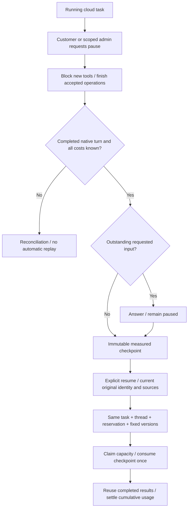

# 运行中云任务暂停 / Running cloud-task pause

客户：工作详情 → 暂停工作 → 等待当前轮次计量完成 → 继续工作。Admin：执行列表 → 管理工作 → 安全暂停 → 填写原因。原有精确权限、版本及费用守卫继续生效；管理员不能继承客户已撤销的执行权限。

Users choose Pause task, wait for a measured current turn, then choose Resume task. Scoped admins use Execution → Manage task with a reason. This source increment follows the first frozen release.

SQL153增加暂停意图和不可变task_pause_checkpoints，兼容既有付费补充资料检查点。SQL154将两类精确字段接入claim_execution_capacity_v89同一资格条件，保留容量、身份、原预算、来源、设备和未知副作用限制；本机执行所有权外层函数不改变。requiredSchemaVersion推进154，升级前按后端既有迁移步骤应用全部前向迁移。已执行的SQL153不改写。

业务工具在开始新操作时检查暂停标记，已接受操作的完成与费用登记不受新增拦截。工具锁之后的任务共享锁使用NOWAIT，与控制路径任务锁冲突时拒绝本次新操作，避免反向锁顺序等待。工具名称、参数与说明保持原指纹，允许原线程继续。

Worker只在completed且usageKnown回执下保存检查点，保存前核对原身份、角色、skill、套餐和固定来源，累计模型/工具费用，拒绝待办设备及未知副作用。原有补充资料检查点优先：如果带暂停要求，最后答案仅置为paused，不派发续跑。显式恢复先验证，再领取执行名额并一次消费检查点，已完成工具结果继续复用，最终累计费用只结算一次。

管理员控制事务原本没有租户范围，控制函数现在临时绑定此任务的精确企业/任务，按原客户进行来源及执行校验，成功后恢复原事务范围。真实管理员仍由请求主体验权和审计记录，不创建客户会话。新GET control-state仅提供状态提示，不能作为执行授权。

The sole new pause boundary is a completed, usage-known native turn. Accepted-operation finalizers retain settlement authority. Original identity/source checks, exact reservation, capacity admission and one-time checkpoint consumption precede continuation. Unknown effects are never automatically replayed.

本轮：6项后端SQL/HTTP/Worker检查、5组真实Web/Admin操作、7张截图、2组GIF/MP4；构建后端、Web、Admin、Desktop主进程类型/云详情渲染及Extension。明确使用假数据模型适配器，未启动真实Codex/模型提供方，未重打包或安装新桌面版本。按快速发版要求省略全平台历史回归、安装包/跨OS、正式广告/媒体提供方和生产负载矩阵。

原始失败保留：backend01夹具发送不支持的conversation_id；backend02发现暂停检查点未接入容量守卫，且撤权返回404与预期断言不符；backend03发现Admin恢复缺少来源事务范围。新版夹具/断言、前向SQL154和精确范围绑定分别修正。独立只读反证未另外发现阻断；静态结论不替代实测修复。

[需求 / Requirements](../requirements/20-runtime-pause.md) · [限定证据 / Evidence](../quality/runtime-pause-checkpoint-154.md) · [完整待项 / Remaining acceptance](../quality/remaining-work-stage154.md)
