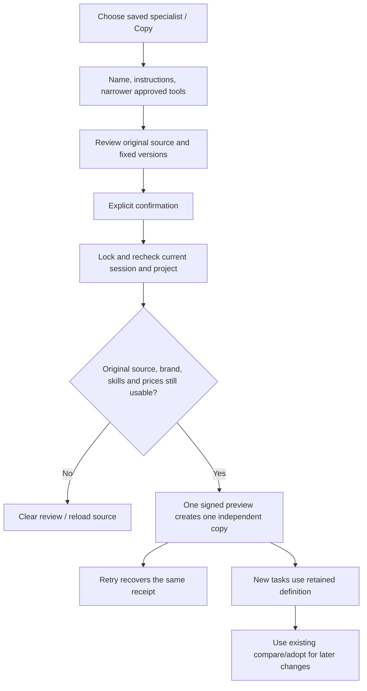

# 专家复制闭环 / Reviewed fixed specialist copies

用户路径：我的专家 → 复制 → 调整名称、职责、获准工具子集 → 查看原品牌/模型/费率/方法版本 → 勾选确认 → 创建独立副本。网络响应丢失时保持同一提案重试；来源被修改时清空比较并重新载入，不生成未经确认的配置。

Customer journey: Your specialists → Copy → edit name/instructions or narrow tools → review original brand/models/rates/methods → explicitly confirm. A lost accepted response recovers the same copy. A changed source invalidates the review.

后端新增agent-copy.ts。prepare锁住active来源并核对精确版本，复用当前能力、skill安装与品牌绑定守卫；固定定义按白名单复制，保留模板来源，不调用重新解析当前默认值的agentDefinition。共享persistSpecialist保留现有200个专家上限，并串行化创建/复制计数。角色和品牌在复制表单只读，工具仅可取原批准子集。

两路接口在所有来源/replay锁前复用agent-adoption的authority：按原锁顺序复查用户、exact session、联邦身份、成员及项目。预览即使命中缓存，也先重新验证来源。10分钟HMAC签名绑定用户/会话/身份版本/企业/项目/来源/提案/当前安装版本。确认的HTTP幂等回执之外，再以签名预览摘要作逻辑幂等键；不同重试键仍只创建一次。回执恢复仅返回已存在且当前可访问副本的id/version，不重新生成已删除副本。

Web和Desktop共享CopyReview。WebCrypto摘要返回后、请求发送前检查组件生命周期、当前范围及会话代次；退出同步撤销未发送操作，清理完成后再次检查才回调。展示只使用明确允许的模型与费率字段，整数micro-HKD通过原有精确格式器显示，不暴露gateway指纹或凭据。

No new SQL migration: required database schema remains154. This increment changes backend creation/copy logic and Web/Desktop cloud configuration renderers. Desktop customer-local Codex ownership/full-permission design and Extension native right Side Panel remain as specified. Admin/Extension product source is unchanged; their readmes reference the shared behavior.

验证限于7项实际SQL/HTTP用例及5组实际Web操作，7张PNG、2组GIF/MP4；后端、Web及Desktop主进程/renderer类型与构建通过。配置复制不调用模型；业务夹具为明确假数据。未运行新安装版Desktop/SidePanel或全平台历史、生产提供方、跨OS与压力矩阵。原REQ-079完整验收仍开放。

保留ui01编译失败原证据：费率是整数数字，复用的精确micro-HKD显示器要求字符串，已在UI边界显式转换。独立只读反证发现的会话撤权和异步提交竞态均已修正；后端认证读取后撤销exact session的实际SQL/HTTP用例拒绝提交。既有backend01的6项成功证据保留，最终backend02增加上述用例并通过。此前冻结包及标签不变。

[需求 / Requirements](../requirements/21-specialist-copy.md) · [证据 / Evidence](../quality/specialist-copy-checkpoint-155.md) · [当前完整待项 / Remaining acceptance](../quality/remaining-work-stage155.md)
