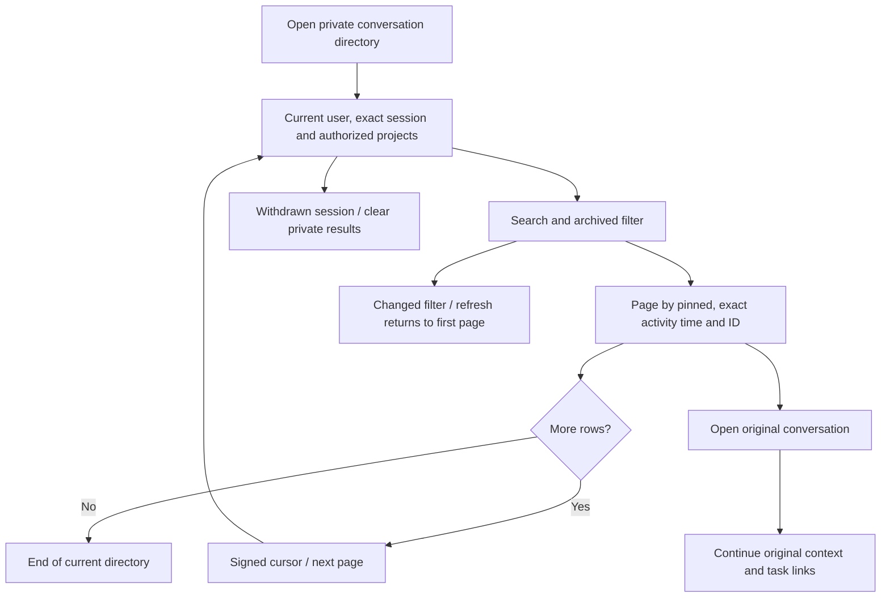

# 会话目录闭环 / Private conversation directory

用户路径：我的会话 → 搜索或切换已封存 → 下一页/上一页 → 打开原会话继续。Web和Desktop每页40条；扩展保留原生右侧栏及原来的首批200条，增加继续浏览、搜索、封存和刷新。扩展翻页不改变当前对话、未发送文字、附件和受理待确认消息。

Journey: Your conversations → search or Archived → next/previous page → open the original conversation. Web/Desktop use40 rows. The native Side Panel preserves its200-row initial compatibility and adds browsing/search/archive. Browsing does not replace its open chat, draft, attachments or pending receipt.

新增conversation-directory.ts，legacy GET /v1/tenants/:tenant/projects/:project/conversations与规范GET /v1/conversations共用目录查询。规范接口遵循既有ConversationList/Conversation字段：items、next_cursor、title和last_activity_at等；project_id缺省时按企业成员角色和当前项目绑定筛选本人会话。规范页量1–100、默认40，legacy1–200、默认200，旧客户端可忽略新增next_cursor。

游标包含置顶位、SQL UTC六位微秒时间和UUID，三列均降序并用元组小于号继续，查询limit+1识别后续页。HMAC绑定当前身份/会话、企业、项目可空范围、过滤摘要、页量和30分钟期限；不接受伪造、换筛选、换页量、换会话或超期游标。每页复查exact session、企业/项目当前权限，并只返回本人active会话。

原agent-adoption的authority按原锁顺序提取为project-authority.ts，保留写入/管理检查，增加只读项目及企业范围读取。agent-copy复用同一实现。用户、exact session、联邦身份及成员在短事务内检查；跨项目读取在SQL中再次限制非归档项目及当前项目成员关系，不能因持有游标扩大范围。仅目录元数据，不缓存消息正文。

Web/Desktop用独立游标栈和身份/项目/搜索/封存组合，筛选改变即用第一页；失败清空数据并提供刷新。Extension新增browseHistory，独立historyRevision与scope引用决定回执有效性，选择/新建对话不再使历史加载永久卡住；reset使旧响应失效。该目录按当前数据翻页，不声明并发修改时固定旧排序；刷新回到当前第一页，批量导出快照是另一独立能力。

7项实际SQL/HTTP检查通过，包含235条同名正常会话及207条同名封存会话、精确微秒排序、规范字段/跨项目/他人数据拒绝、撤会话竞争，以及Extension实际HTTP控制器在响应延迟时新建/reset。5组实际Web旅程验证邮件OTP、6页浏览重开旧空会话、封存及搜索重置、繁中390px、撤销后清空并登录。7张PNG、2组GIF/MP4；后端/Web/Desktop/Extension受影响构建通过。没有新SQL迁移，数据库仍154。

保留ui01失败：浏览器夹具在每次载入时强制改回英文，导致繁中按钮无法定位；新版通过真实语言按钮切换并断言zh-Hant-HK和繁中标题。也确认155的compact截图实际为英文，其390px布局证据有效，不能作为繁中验收；原图/报告不改写，本轮实际繁中证据独立补齐。

保留backend01失败：夹具将项目只读角色误写为reader，实际值为viewer；延迟夹具同时拦住新建会话需要的项目配置请求，造成夹具等待环。确认在运行的精确测试子进程后仅结束该子进程，父验证器正常回收夹具和原生数据库；新v2仅延迟目录响应并加限定超时。产品代码不为夹具改角色或放宽守卫。独立只读反证发现的目录/新会话状态竞态已修复后复核。

Actual Web and native SQL/HTTP evidence only. The Extension controller calls the real API during backend checks; no new installed Side Panel or Desktop window run is claimed. No model call. Broad historical, production-provider, cross-OS and full lifecycle acceptance are intentionally omitted under the fast-release instruction. This source increment follows the first frozen candidate; frozen artifacts/tags are unchanged.

[需求 / Requirements](../requirements/22-conversation-directory.md) · [限定证据 / Evidence](../quality/conversation-directory-checkpoint-156.md) · [完整待项 / Remaining acceptance](../quality/remaining-work-stage156.md)
