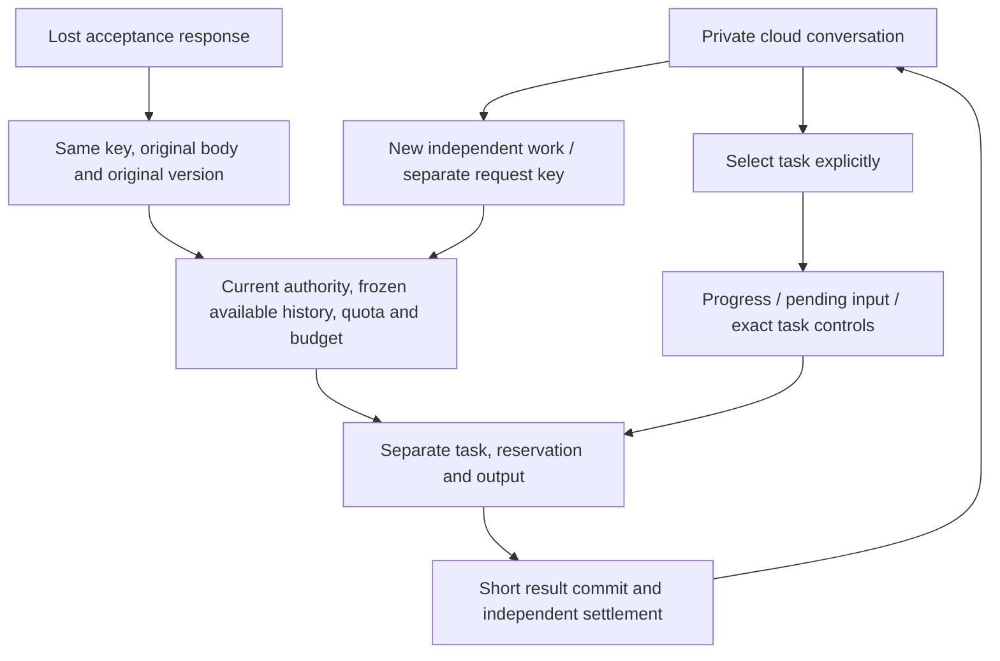

# 157 云端会话多工作 / Independent cloud tasks

同会话第二项普通云端工作此前被CONVERSATION_BUSY和唯一索引拒绝。现在可在额度内独立提交；进度、补充资料和停止显式选定任务，费用分别预留与结算。

实现：新增前向migration155，替换普通单活跃唯一索引为查询索引；requiredSchemaVersion=155。ownConversation锁定修改入口使用短事务try-advisory，竞争返回CONVERSATION_CHANGING并回滚；Worker.finish先取得相同会话gate，再锁任务/钱包，模型执行期间不持有gate，避免新提交会话→钱包与结果结算钱包→会话的反向等待。原角色、项目、套餐、源内容、计划版本、固定费率、独立预算、团队准入和文件版本检查保留。

Web为原业务输入保留请求键及首次会话版本，提交前复查组件、账号、范围和当前客户端会话代次。Extension显式选择任务，切换后清空旧进度和资料表单，迟到响应用选择代次丢弃；停止以当前已加载的任务ID执行。每个新任务以自身首段请求命名。

升级：先停止旧API/worker并备份，按原生PostgreSQL流程应用完整001–155前向迁移，再启动匹配源码的API/worker。不可将冻结stage148/schema145服务用于schema155数据库；本次源码不是旧ZIP的内容。回退须恢复匹配备份和版本，不逆改迁移历史。

验证限定：7项实际SQL/HTTP和Worker（合成runtime、不发真实模型请求）覆盖并行运行、独立取消/预算/一次结算、旧正文重试、待输入/暂停旁的新工作、提交与结算锁序、额度/权限、Extension任务目标与迟到回复。5组实际Web浏览器旅程覆盖OTP、双任务、丢失接收回复后刷新重试、选中项取消、390px繁中。文件版本代码保留，本轮未重跑完整文件写入矩阵。共享Desktop renderer重新构建，未新增安装版Desktop或真实Side Panel验收。依用户快速发版要求，跳过历史全量与跨系统回归。

原始失败01编译（不透明请求键类型）、02升级守卫、03复用检查拒绝失败报告、04不可变授权快照、05工作区owner权限与06项目隐私404测试前提均完整保留；修正使用新fixture/测试/验证器，未编辑已执行绑定文件。UI01是公共Field以可见标签覆盖aria-label而导致测试选择器失配，新旅程使用实际可见标签并等待已显示的任务目标；UI02四组主流程通过，语言切换测试误用了按钮可访问名，后改用实际切换控件title；UI03原四组主流程继续通过，但测试把应用存储语言zh-HK与HTML语言zh-Hant-HK混为一值，UI04分别按实际契约检查。最终以checkpoint引用成功报告为准。

English: the paid admission and result-commit path serializes only short commits, while each task retains its own budget, quota slot, frozen sources and control target. Deploy migration155 together with the matching source release. The stage148 v0.1.0-rc.1 ZIPs and tags remain immutable. Focused browser and SQL/Worker checks use explicit synthetic business/model fixtures; no production-provider or new native installation acceptance is asserted.

参见 [需求](../requirements/23-independent-cloud-work.md)、[检查点](../quality/conversation-work-checkpoint-157.json)、[完整待项](../quality/remaining-work-stage157.md)、[变更](../changes/157-independent-cloud-work.md)。
