# 158 · 当前源码首次运行 / Current source first run

本源码包是首次冻结版之后的源码交付（数据库 schema155）。它不会替换 stage148 的 v0.1.0-rc.1 安装包或修改冻结标签。六个端的完整源码、锁定依赖描述、独立中英 README 和 README 引用的媒体随包提供。Git 历史及历史原始验收材料在远端对应分支保留；压缩包排除本地密钥、数据库、依赖、构建输出及未引用的历史录屏。

This kit contains the current buildable sources after the first freeze, with schema155. The stage148 v0.1.0-rc.1 binaries/tags stay unchanged. All six source trees, lockfiles, bilingual component READMEs and their linked media are included. Git history and historical raw acceptance evidence remain on the component branches. Secrets, databases, dependencies, build outputs and unreferenced historical recordings are excluded.

## Windows x64 · 模拟体验 / Synthetic first run

1. 建议解压到较短的本机目录，例如 D:/dev/copypasted/自有agent/dev/rc2/，避免继续套多层长路径（原生 PostgreSQL 的 Windows 目录解析有长度限制）。安装 Node.js22.14或更高版本（带 npm），准备可访问 npm registry 的网络。解压 source ZIP 与同编号的 Codex companion ZIP 到同一父目录，使两包合并至同一个 workmate-source-158-编号目录，保留全部四个 exe。禁止使用 Docker/WSL。
2. 在该目录下的 dev/copypaste-delivery 打开 PowerShell，执行 npm run bootstrap:demo。它校验 Codex pin、按六份 lockfile 安装依赖、生成本机独立配置、构建各端；首次安装可能需要数分钟。
3. 执行 npm run demo:check，然后 npm run demo。原生 PostgreSQL、API、Web、Admin 启动。占用端口会拒绝启动，保留既有服务。浏览器打开 http://localhost:4317。
4. 邮箱登录；开发验证码只写入本机平台目录 .data/mailbox。创建模拟工作区及项目、领取模拟额度、选择角色或创建默认助理会话、委派任务、查看进度、下载交付。
5. 结束后在另一个 PowerShell 的相同 delivery 目录执行 npm run stop，等待提示完成。它仅关闭本次控制器启动的进程，保留用户既有浏览器。手动关闭自己打开的测试页。

1. Extract under a short local parent such as D:/dev/copypasted/自有agent/dev/rc2/; avoid deeply nested Windows paths for native PostgreSQL. Install Node.js22.14+ including npm; allow registry access for locked dependencies. Extract the source ZIP and its identically numbered Codex companion ZIP into the same parent, merging into one workmate-source-158-number directory. Retain all four native executables. Docker/WSL are prohibited.
2. Open PowerShell in dev/copypaste-delivery and run npm run bootstrap:demo. It validates the pin, installs all six lockfiles, generates isolated local settings, and builds the components. First installation may take several minutes.
3. Run npm run demo:check, then npm run demo. Native PostgreSQL, API, Web and Admin start. Existing occupied ports are preserved and cause startup refusal. Visit http://localhost:4317.
4. Sign in with email; development OTP mail is written only to the platform .data/mailbox directory. Create a simulated workspace/project, claim simulated credit, choose a role or default assistant, delegate work, follow progress and download the delivery.
5. In a second PowerShell in the same delivery directory, run npm run stop and wait for completion. Only this controller's processes are stopped. Close your own test browser pages when finished.

如果55432正被其他程序使用，在 bootstrap:demo、demo:check、demo 所在的每个 PowerShell 明确设置 $env:COPYPASTE_SOURCE_DATABASE_PORT="55439"（或其他空闲非特权端口）。仅全新生成的 .env 会使用所选端口；既有配置不自动迁移，端口或数据目录占用时保留原进程并拒绝启动。停止服务也必须核验本次创建的数据库 PID 和 postmaster 记录；启动失败退出钩子不得按目录停止他人的进程。

If55432 is occupied, explicitly set $env:COPYPASTE_SOURCE_DATABASE_PORT="55439" (or another free unprivileged port) in each PowerShell used for bootstrap:demo, demo:check and demo. Only newly generated local settings use that port; existing configurations are preserved. Occupied ports/data directories cause refusal. Database shutdown verifies the spawned child PID and its postmaster record; a failed startup must not stop a pre-existing process by directory.

若从 Git 分支获取源码而未使用 companion：先明确设置 $env:COPYPASTE_LOCAL_CODEX_BIN 为官方匹配版本 codex.exe 的绝对路径，三个同版本 helper 放在相邻目录，然后再运行 bootstrap:demo。入口不会从 PATH 猜测版本或自动下载 Codex。当前 pin 为0.163.0-alpha.11。Windows sandbox helper 是 Codex 原生配套文件，启动此演示不调度 Docker/WSL/虚拟机。

From Git without the companion, explicitly set $env:COPYPASTE_LOCAL_CODEX_BIN to the absolute matching codex.exe path, with the three matching adjacent helpers, before bootstrap:demo. The entry point never guesses through PATH or downloads Codex. The current pin is0.163.0-alpha.11. Its native Windows helper is supplied as part of Codex; no Docker/WSL/VM is used for this demo.

## 模式与权限 / Mode and permission boundaries

演示的模型、媒体、广告、支付等依赖为本机合成数据；Codex 进程、数据库权限、任务队列、文件、下载及账本走真实代码。模拟额度不是支付。该启动包装仅设置模拟 API 进程的 Codex 路径/版本，不改写正式云端的 CODEX_BIN/CODEX_VERSION。它拒绝 production 配置及远程或与明确选择的端口不符的数据库。当前目录不能存放生产数据。

Model/media/advertising/payment dependencies are local synthetic fixtures; Codex execution, database permissions, queues, files, downloads and ledger use the real application. Synthetic credit is not a payment. This wrapper selects the demo API's runtime without rewriting production CODEX_BIN/CODEX_VERSION. Production settings and remote databases or ports that differ from the explicit selection are refused. Keep production data out of this directory.

Desktop 仍必须在客户本机运行 Codex，完整本机权限须由客户明确授予；不能用演示中的云端会话冒充 Desktop 本机能力。Desktop 构建：进入 copypaste-desktop 执行 npm run build；可安装发行还需 native host/runtime 准备及打包步骤，详见其 README。Extension 运行 copypaste-extension 的 npm run build，将 dist 目录以 Chrome 解压扩展方式加载；点击图标打开原生右侧 Side Panel，登录后经同意获取文件并上传云端。开发 Admin 需独立管理员注册及 TOTP，禁止自动赋予普通用户管理员权限，具体注册命令及权限见 Admin/平台 README。

Desktop still executes Codex on the customer's machine, with full local permission explicitly granted by that customer. A cloud demo conversation does not establish native Desktop acceptance. Build Desktop with npm run build in copypaste-desktop; installable packaging also requires native hosts/runtime preparation documented in its README. Build Extension in copypaste-extension and load dist as an unpacked Chrome extension; the action opens the native right Side Panel, with consented file collection/upload to cloud execution. Admin requires separate administrator enrollment and TOTP; ordinary users are never auto-promoted. See Admin/platform READMEs for enrollment and permission details.

## 方案 / Flow

```mermaid
flowchart LR
  Source[Source + pinned runtime] --> Prepare[bootstrap:demo]
  Prepare --> Start[demo:check + demo]
  Start --> Login[Email OTP]
  Login --> Scope[Simulated workspace + project + credit]
  Scope --> Work[Preset/default assistant → task]
  Work --> Codex[Real pinned Codex + synthetic gateway]
  Codex --> Deliver[Progress → result → download]
  Deliver --> Stop[stop → owned services exit]
```

