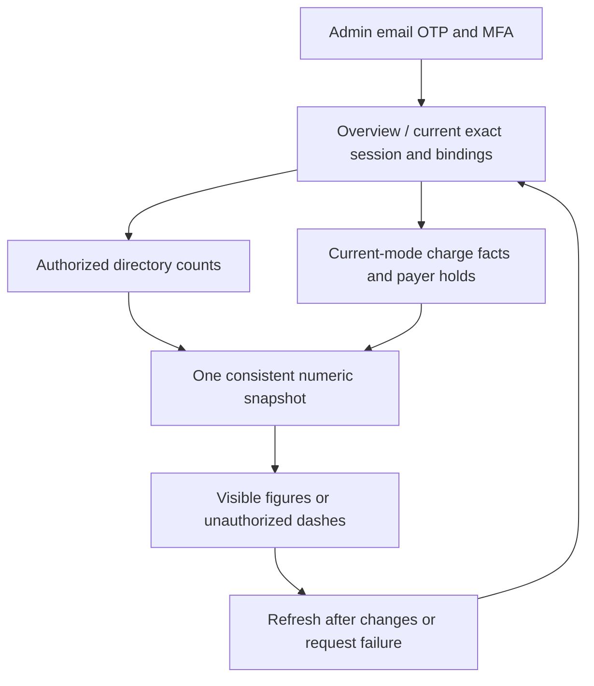
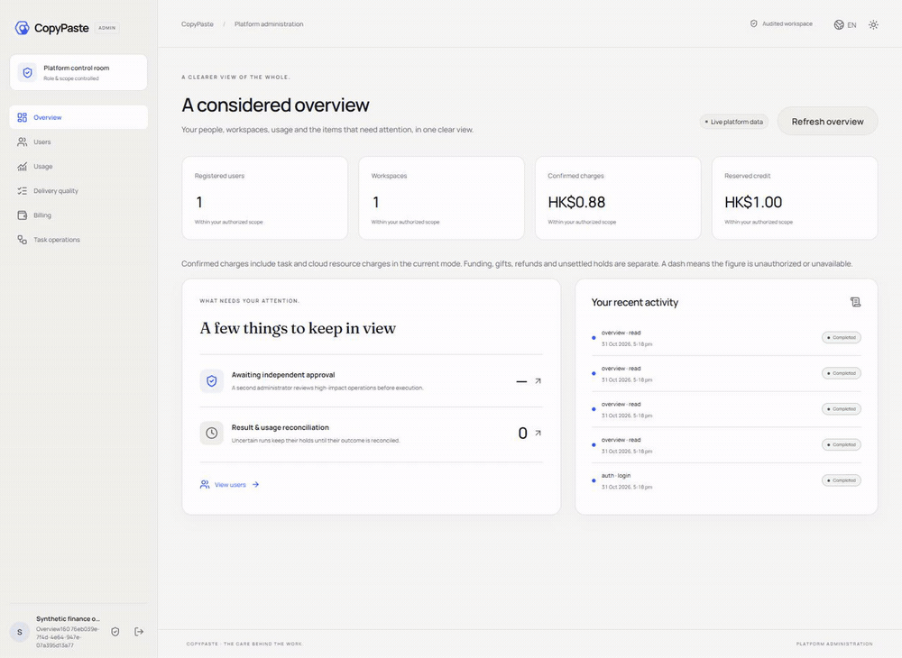

# 160 · 管理總覽的準確數字 / Accurate Admin overview

舊總覽對全域用戶允許直接計全平台人數，未套明確企業拒絕；只授專案的人數又可能漏算。預留只查企業wallet，遺漏個人付款帳戶；扣費只加tasks欄位，漏掉沒有普通task的雲端資源。頁面在請求失敗、data不存在時又可能將金額格式化成零。此修復沿用既有目錄與付款帳戶的ReadScope，回應原有summary/activity結構不變，無資料庫遷移。

The former aggregate path differed from the canonical user/account scopes, omitted personal holds and resource charges, and could render unavailable money as zero. The corrected endpoint reuses the same ReadScope, retains its response shape and schema155, and executes all numeric subqueries in one database statement. Current MFA/session authority is checked after the shared access lock; field grants remain independent. Directory identities retain their existing scope; task and monetary figures use the current simulated/configured mode.

| 數字 / Figure | 來源與範圍 / Source and scope |
| --- | --- |
| users | 完整用戶目錄的可讀主體，去重；無users.read為null |
| tenants | overview.read的企業或專案可見企業 |
| tasks / reconciling | 目前模式及usage.read / execution.read的專案任務 |
| charged_micros | 目前模式的charge帳本；按任務/雲端會話的執行企業及專案套usage.read，非充值或退款淨額 |
| reserved_micros | 目前模式、billing.read可完整閱讀的個人/企業wallet；專案拒絕不洩漏整體餘額 |

使用：登入獨立Admin，查看總覽；確認扣費說明位於卡片下方。「重新載入總覽」重新請求現行數字。缺少欄位權限或連線失敗時顯示破折號，避免把未取得資料當作零。英文及繁中均可用。總覽使用與詳細資料相同的近期MFA規則；MFA過期須重新登入。

Nine real SQL/HTTP checks cover identity/strict queries, denied and project-only directory counts, real personal/enterprise holds and settlements, mode isolation, real control-plane cloud charge facts, field denial and two actual lock-wait revocation races. Three actual browser journeys cover MFA login, network failure/recovery, current field revocation and language switching. Synthetic node acknowledgements do not start or qualify a physical cloud computer. Broad regression is intentionally omitted; full original scopes stay open. This source correction is not inside the sealed v0.1.0-rc.2 ZIP.

[MP4](../assets/admin-overview-160/workmate-admin-overview-160-01-current-permission-overview.mp4) · [Evidence](../quality/admin-overview-checkpoint-160.json) · [Remaining full scopes](../quality/remaining-work-stage160.md)
