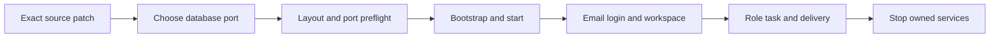

# 162 · 提前检查并保留冻结包 / Early checks and frozen delivery

源码启动的布局和配置检查之后、固定运行时准备和依赖安装之前，依次独占探测127.0.0.1的4310/4317/4318/4319及所选数据库端口，每次立即关闭自己的监听。占用时保留其他应用并提前退出；可用性是此刻观察，真正启动仍保留原有检查。

The built-in Node preflight runs before dependency installation. The exact six-file addon validates original hashes and links, uses owned bare Git metadata with raw LF bytes, refuses customer source conflicts, and is idempotent. Existing configuration, data and runtime binaries are not destinations. Cloud operator Codex settings stay independent; the demo explicitly selects its supplied pinned runtime.

[中英完整步骤 / Bilingual instructions](../releases/v0.1.0-rc.3-onboarding-162.md) · [9项实际检查](../quality/onboarding-checkpoint-162.json) · [原编号待项](../quality/remaining-work-stage162.md)
