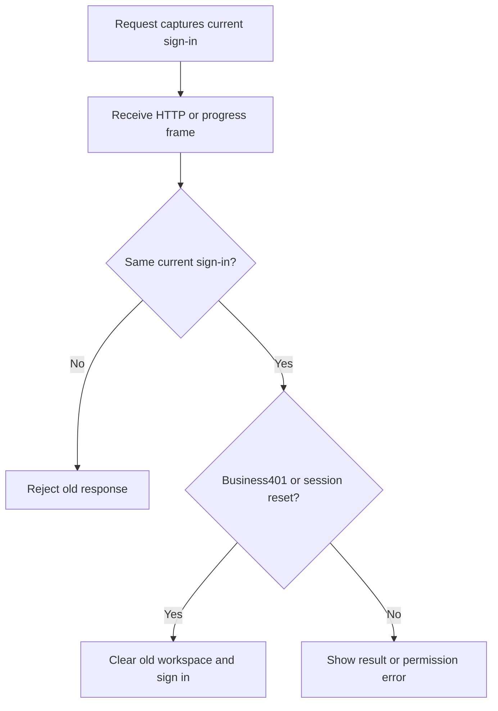

# 163 · 登录失效与旧响应 / Session expiry and old responses

独立的广告文件导入、报告、证据、品牌版本选择和清理记录未被原业务路径清单覆盖，导致401可能只显示请求错误；HTML401可能被当作普通响应格式错误。当前所有业务接口默认按会话保护处理，仅明确的公开内容/角色目录、登录交换及准确的OAuth跳转链接例外。权限不足403保留当前登录。

Web and Desktop renderer requests now protect business routes by default. Explicit public reads, sign-in exchanges and the state-bound OAuth launcher retain their own failure semantics. Every request, including a pending sign-in challenge/verification, checks the captured session generation before accepting its response or changing CSRF state. Admin uses the same unconditional stale-response fence. Writes are never automatically repeated.

进度流在读取每批数据后核对登录代次。真实HTTP401和服务端的登录失效reset清除旧工作台；403只停止该进度视图。旧登录的数据、错误和延迟刷新不能覆盖新登录；关闭视图继续取消其读取。Desktop保留本机Codex和明确授权，Extension保持原生右侧栏及云端执行。

使用：从Web登录并使用任务或广告业务；当前会话被撤销后重新登录。旧请求提示登录已变更时重新载入视图；已提交的付费操作应先查收结果，不自动重复。构建命令沿用各仓README：Web/Admin为 `npm run build`，Desktop为 `npm run build`。当前源码已经修复；原rc.3冻结包与标签保持，此源码修复尚未重新冻结进安装包。

Validation:28 Node test results cover real loopback HTTP failures and races, public exceptions, permission403 and a controlled native bridge. Seven build/check commands cover the current Web, Admin and Desktop renderer. Three actual Web journeys use email OTP, native PostgreSQL revocation, a real SSE reset and the independently authenticated dataset-import endpoint. No model requests, production providers, installed Desktop/Extension qualification or broad historical suite.

The first failed expectation used200 instead of the canonical202 challenge response. The next attempt correctly hit the two-per-minute email challenge limit; another preserved attempt observed a concurrent request ending the old session first. The final check uses a separate customer and isolates the target import request without changing rate limits or production policy. Original failed records/media remain intact.

[MP4](../assets/session-boundary-163/workmate-session-boundary-163-04-session-revocation-to-signin.mp4) · [实际证据](../quality/session-boundary-checkpoint-163.json) · [原编号完整待项](../quality/remaining-work-stage163.md)
