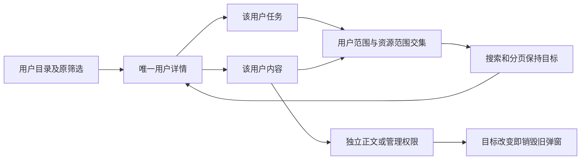

# 166 · 用户任务与内容的管理闭环

对应 [需求27](../requirements/27-admin-user-resource-context.md)、REQ-084 和 REQ-090。本增量在当前源码分支继续，已发布 rc.5 的压缩包及标签保持不变。

## 用户操作

从用户详情点“查看用户任务”或“查看用户内容”；列表顶部显示实际用户与归属口径。搜索、分页、刷新继续携带用户 ID；“返回用户详情”恢复原目录条件，“全部获授权记录”明确退出用户筛选。资源记录按类型计算，同名文件资产及云目录项各有独立身份。

切换用户时管理页整体以新目标重新挂载，清空旧行、正文、变更弹窗与预览。目标查询失败时保留条件，不退回全量列表。用户视图不附带全站删除队列、项目导出及其他用户的计划面板。

## 接口与归属

```http
GET /v1/admin/execution?user_id=<uuid>&search=<text>&page=1&page_size=50
GET /v1/admin/content?user_id=<uuid>&search=<text>&page=1&page_size=50
```

可与原 `tenant_id` 求交集。用户条件不支持的旧集合明确返回 400，空值和无效 UUID 亦返回 400。

后台先通过独立管理员身份，再在事务中获取当前权限锁、近期 MFA 和当前会话。使用现有用户目录谓词检查目标是否可见，资源 SQL 同时满足 `admin.users.read` 与 `admin.execution.read` / `admin.content.read` 的当前企业/项目范围，显式拒绝优先。不可见和不存在目标统一 404，权限不足或 MFA 过期返回 403。

任务使用 `created_by`。内容联合查询的二十个分支在各自资源表内按创建者过滤，不新增正文或作者字段到原 DTO。品牌使用 `brand_profile_versions.version=1` 的作者；后续客户/管理员编辑不转移原创建者身份。旧 `/brand` 创建接口补传当前事务 actor，使其首版能记录实际作者。历史无作者资料不补造归属，系统目录项仍可在全站授权范围查看。没有修改任何历史迁移，当前 schema 仍为 155。

正文、下载与所有写操作继续走原资源的独立权限、当前范围、生命周期和审计逻辑。用户过滤响应 `Cache-Control: no-store`，读取审计带目标用户与 `created_by` 口径。分页同时间记录再按 ID 倒序，保证静态集合的稳定顺序；不声称 offset 分页是跨并发变动的快照。



## 本轮检查范围

八项真实原生 SQL/API 检查覆盖独立身份、MFA、用户及资源权限交集、跨企业、同企业不同创建者、品牌首版作者、未知作者、静态稳定翻页、搜索、正文/下载拒绝、审计及即时撤权。实际 Admin 浏览器旅程另验证用户入口、搜索/刷新、原条件返回、正文、同文档换目标及无效目标。原始检查、失败记录与执行脚本逐版本保留；完整结果见本轮质量回执。

不重复全量历史回归；不变的 Web、Desktop、Extension 和固定 Codex 使用原冻结基线，不重新声称原生安装或专业业务验收。AI/媒体/广告/支付继续使用已授权假数据，正式服务及完整生产验收保持原范围。

The branch increment connects existing user, task and content management with creator attribution and the intersection of current user/resource scopes. It retains separate body/download/write authority, fresh MFA, original-author facts, scoped navigation and immediate dialog teardown. No migration or frozen release bytes are changed. Focused current checks do not substitute for whole-product professional or production acceptance.
