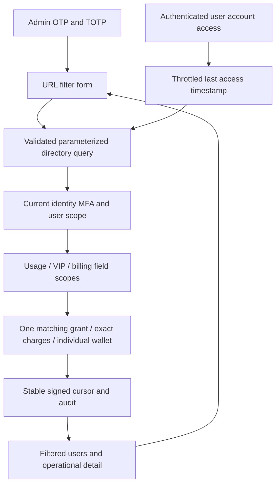

# 168 · 用户目录组合筛选实现

当前源码增量独立于已冻结的 v0.1.0。只更新 Backend、Admin、Delivery 和中央文档；其余客户端沿用原冻结提交。不移动标签、不覆盖发行资产。

## 结构 / Architecture

`admin-directory-operational.ts` 负责输入约束，日期采用带时区 ISO8601、区间下含上不含；费用使用最多30位规范整数字符串，拒绝浮点、负数、指数和错误组合。`admin-directory.ts` 在现有权限锁和近期 MFA 事务中拼装参数化 SQL，再应用稳定游标，所有筛选参与游标签名。响应禁止缓存。

角色和待对账按任务建立时间、确认费用按账目时间过滤；两者日期语义在界面说明。金额过滤的查询同时选择其精确汇总，以同一语句快照作为本次显示值。无法读取费用范围的用户不被当作零费用匹配。

VIP 条件共用一个 EXISTS，避免从甲授予取方案、乙授予取到期日。`entitlement_access` 同时包含规范授予与历史来源，当前替代/撤销会投影为实际状态。已过期暂停授予按到期分类；有效条件仍检验当前账户、企业和成员资格，明确拒绝不会被个人授予绕过。

额度只读表达式与 `billingAccount` 到期处理后的余额一致：先排除资金来源无法覆盖记录余额的账户，再扣除到期资金中未预留部分。债务已经体现在余额，不重复扣除。不同主体及 simulated/configured_services 不混算，目录查询不触发到期账目写入。

`auth.ts` 在会话、audience、联邦身份和 CSRF 均有效后才记录普通用户访问；更新再次校验当前用户/会话/联邦版本，每分钟最多一次。Admin 身份不会替用户更新访问记录。OTP 首次建号记录来源，历史账户重新登录只更新登录/访问，不伪造原注册来源。联邦登录沿用实际成功登录时点，不生成推测来源。

Admin 表单分组呈现日期、VIP、费用/角色和独立账户额度。HKD 输入通过 BigInt 转换微单位；刷新通过 URL 恢复输入，进入详情/资源页后返回保留所有扩展条件。无字段权限时禁用相应表单，服务端仍独立拒绝请求。无法推断的值明确为未知。

## 安装与范围 / Deployment and scope

完整 SQL 历史推进至156；API/Worker 启动检查匹配版本。156增加可空来源/访问字段和目录索引，不回填历史事实。部署步骤及默认契约兼容见 [需求约束](../requirements/28-admin-directory-operational-filters.md)。这是源码分支增量，冻结 ZIP 仍为 v0.1.0/schema155。

仅运行本改动相关的原生数据库/API、当前 Backend/Admin 构建和真实 Admin 浏览器旅程，不重跑全部历史回归。所有业务样本均明确为合成数据，不使用 Docker/WSL/虚拟机，不请求外部模型。原始尝试和回执保留；检查结果及媒体来源以 [回执](../quality/admin-directory-filters-168.json) 为准。

English: This source increment adds scoped operational filters and optional DTO fields, exact confirmed-charge/account calculations, truthful unknowns and throttled authenticated access timestamps. Signed pagination and current independent Admin MFA remain mandatory. Schema156 and matching services are required; frozen v0.1.0/schema155 is preserved. Focused native SQL/API and real-browser results are recorded separately; original whole-acceptance scopes remain open.
