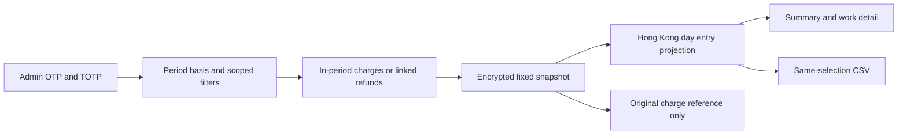

# 172 · 入帳期間消耗 / Posting-period implementation

新增可選 `time_basis=ledger_posted_at`。省略仍為 `work_created_at`，解析時不插入default欄位，保留原請求重放識別。資料庫仍為156，沒有新增遷移。

The optional posting basis is additive; omitted input remains omitted for old replay fingerprints. Schema156 is unchanged.

## 資料處理 / Data flow

1. 單SQL中的工作候選先套當前資料模式、權限／拒絕與全部用戶條件，再以實際期間內扣費或來源已連結的消耗退款選工作；工作建立時間不限制入帳模式。
2. 對選中工作保留全部原扣費來源供退款連結，但匯總扣費和退款分別再以各自入帳時間限制。退款須為同付款帳戶的 `billing.refund` credit compensation，來源為consume及原charge。
3. 保存同一加密五分鐘快照。十進位字串與BigInt計算全部金額，包含負淨消耗；不使用浮點港幣累計。
4. 香港日分組和日選擇先投影該日的ledger/refund陣列，再重新計算金額。所有摘要、工作明細及CSV共用同一選擇函式。
5. 預留額度在入帳匯總為null且標記 `outside_posted_activity`；當前預留另列 `current_holds`。未決狀態及操作用量明確是快照時／工作累計背景，不當作期間新增事實。
6. 詳情接受嚴格的group_by/group_key可選成對參數；無參數保留舊行為。前端傳遞目前組別，離開範圍回404。

One SQL capture selects scoped works by charge/refund posting dates and retains original charge provenance independently of period sums. Daily projection is shared by summary/detail/export. Exact money, separate current holds and explicit lifetime units prevent repeated or fabricated period totals. Optional strict detail selection preserves the original empty-query route.

## 兼容與限制 / Compatibility and limits

舊建立期間與CSV欄位保留；入帳CSV另加期間／組別／口徑欄位，null預留輸出空值，負數沿用防試算表公式的文字保護。未知實際供應商成本仍為null/not_recorded且需獨立權限。能力／模型只選用過該操作的工作，不分攤工作售價。工作上限先於操作條件，保守超限拒絕而非截斷。

Creation cohorts and their original CSV columns remain. Posting CSV adds period/selection/basis context, empty null holds and existing formula protection for negative values. Actual supplier cost remains unknown. Capability/model filters select works, not fee allocation. Candidate bounds precede operation filtering and conservatively reject excess.

原生測試使用獨立一次性資料庫；歷史帳目在插入時明確指定合成日期，保留既有append-only保護，不回寫不可變帳目時間。另使用真實業務退款控制器驗證新舊快照差異。歷史合成帳目不代表外部付款或歷史結算驗收。

Tests use owned disposable native databases. Historical synthetic entries receive dates on insertion without bypassing append-only guards. The canonical refund controller separately verifies snapshot immutability. Historical report fixtures do not claim payment or historical-settlement qualification.

定向構建及實際瀏覽器結果在完成後記入 [本輪證據](../quality/admin-posting-period-172.json)。省略全量歷史回歸；不得把此項的有限結果宣稱為整體102項完成。v0.1.1原包和所有凍結標籤保持。

Focused build/native/browser evidence is recorded separately after execution; broad historical regression is omitted. This bounded increment does not close all102 original requirements. Frozen v0.1.1 assets/tags remain unchanged.
