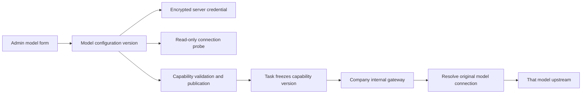

# 按模型绑定上游 / Model-bound upstream implementation

后台入口：[模型能力](https://agent-dashboard.copypaste.hk/catalog?view=capabilities)。新增模型的同一表单包含 API Base URL、密码型 API Key、内网访问选项、模型别名、推理强度及费率。上游基础地址示例 `https://company-gateway.example/v1`；文字调用使用 `/responses`，地址不得填成具体操作端点。

The model form owns the API URL and key. Save a draft, test its connection, run capability validation and use the existing independent publication approval. Saving does not publish it or replace running work.

`capability_model_connections` 一行对应一个不可变模型配置版本。公开 definition 只含连接 ID、URL、密钥已配置状态及网络范围；AES-256-GCM 密文只有 `cp_control` 可读。保存操作使用密钥的服务器 HMAC 绑定幂等请求，操作记录、重放结果及审计不存入明文密钥。

The server resolves the connection through `capabilityVersionId` for actual work, and through the validation identity for model qualification. Text, input counting, image generation/editing, video and audio continue through the single internal AI request entry point. The key remains on the server. The declared model and operation are checked against the frozen release. Missing explicit connections cannot fall back to environment credentials.

网络请求检查全部 DNS 地址，并将连接固定至检查后的地址；禁止跟随重定向传递密钥。公开服务要求 HTTPS；内网 HTTP 需管理员明确开启，回环及元数据地址在实际服务中禁止。连接测试最多读取 1 MiB 模型列表，设置 12 秒时限，只返回受控状态，不回显上游错误体或响应密钥。

Actual work keeps the original budget, authorization, accounting and tool restrictions. The server resolver is not client input. Published model readiness is read from the current verified capability head, rather than requiring a shared environment URL/key. Legacy versions preserve their original environment configuration; the new Admin form requires an explicit connection or explicit key retention.

部署增量 `/opt/workmate/overlays/model-connections-178/`；只切换 Workmate API 和独立代理，数据库前向迁移至 157。现有凭据和 `/root/cfg/workmate/app.env` 不改写。配置备份为 `/root/cfg/workmate/model-connections-178-backup/`。迁移后不得直接启动仅支持 schema156 的旧 API；回退前端须继续使用兼容 schema157 的 API。

Validation uses two separate actual HTTP fixture upstreams and isolated native PostgreSQL, plus existing gateway/schema checks. These checks do not qualify a real supplier, model reasoning quality or professional marketing output. No real vendor key is supplied by this deployment.
