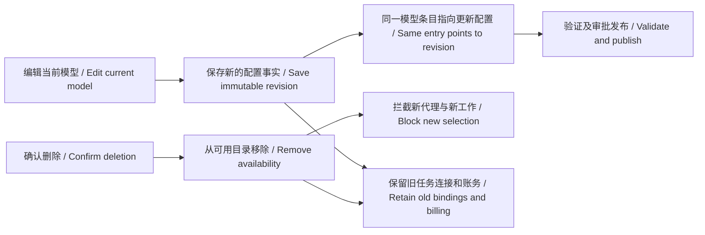
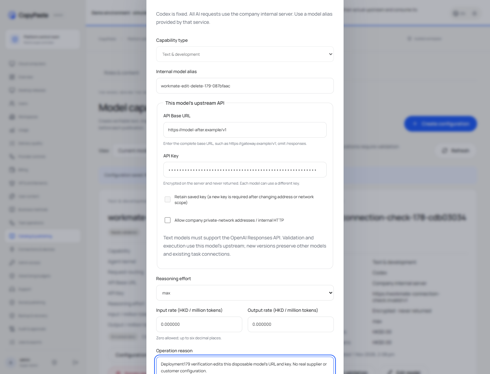

# 模型编辑和删除 / Model editing and deletion

入口：[模型能力](https://agent-dashboard.copypaste.hk/catalog?view=capabilities)。在已有模型上点击 **编辑模型 / Edit model**，修改 API Base URL、API Key、模型别名或费率，然后点击 **保存更改 / Save changes**。已有 Key 不回显，输入框可直接填写新 Key；填写后会自动取消保留旧 Key。更换地址或内网范围需要填写新 Key。能力类型保持原类型，其他类型使用新增模型。

Click **Delete model**, review the impact and confirm. The model leaves **Current models** and appears under **Deleted models**. **Configuration history** retains earlier revisions. Deleted/historical model configurations do not offer configuration mutation controls. Existing validation cancellation/accounting cleanup, where relevant, remains separate from model editing.

Migration158 adds `capability_model_entries` and `capability_model_revisions`. A stable management identity points at the current immutable `capability_releases` row. Editing appends a new configuration and encrypted connection, then atomically advances that identity. Existing rows receive management identities without rewriting their definitions. Default list pagination returns one current revision per entry; explicit history/deleted views retain original facts.

- `POST /v1/admin/capability-releases/:id/edits` accepts the document, connection, `expected_version` and `expected_revision`. Permission: `admin.catalog.draft`.
- `POST /v1/admin/capability-releases/:id/deletions` requires the expected versions, exact model confirmation and reason. Permission: `admin.catalog.publish`.
- Both use the existing fresh administrator authority, idempotent replay and audit paths. Key material is HMAC-bound in operation/replay identities and encrypted in the connection table.

Management writes hold the exclusive capability-head transaction lock. New model selection takes the matching shared lock. Deleted published heads are filtered from `current_internal_capabilities`; `Catalog.currentCapabilities` also removes their profile from its initial fallback map. New agent confirmation and new top-level task binding reject deleted model capability versions. Existing task resolution and original published-version history remain intact. Legacy shared capability identities remain selectable while an undeleted model still owns the same validated capability.

并发修改返回 `MODEL_VERSION_CHANGED`；删除条目拒绝验证、连接测试及重新发布。保存编辑配置会撤下列表中的旧修订，但不会把未验证的新连接自动用于客户工作。客户仍按当前已发布能力运行，直到管理员发布更改；删除模型则立即移除未来可用性。

部署覆盖层 `/opt/workmate/overlays/model-management-179/`，数据库前向迁移至158；仅更新 Workmate 自有服务。原环境、登录凭据、其他服务、冻结版本保留。迁移后的前端回退必须继续使用兼容 schema158 的 API。

核查使用独立原生 PostgreSQL、两个本地真实 HTTP 上游、管理员权限及实际正式后台操作。21 项后端检查包括本轮10项和此前11项连接检查；另有3项表单检查。供应商真实模型质量不在本轮核查范围内。

[实际录制 / Actual recording](../assets/model-management-179/179-model-management.mp4) · [需求 / Requirements](../requirements/179-model-management.md) · [变更 / Changes](../changes/179-model-management.md) · [核查 / Evidence](../quality/model-management-179.json)
