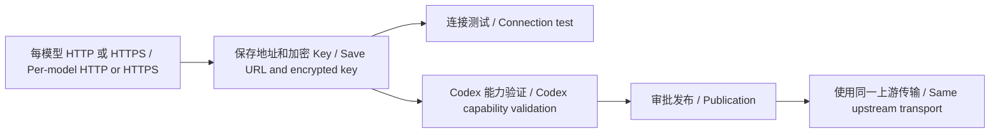
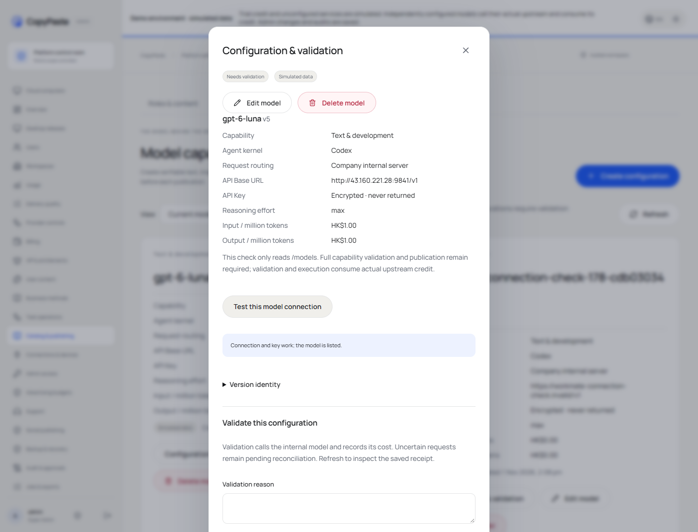

# 每模型 HTTP 上游 / Per-model HTTP upstreams

在 [模型能力](https://agent-dashboard.copypaste.hk/catalog?view=capabilities) 编辑模型，填入完整 API 基础地址，例如 `http://gateway.example:9841/v1`。公网上游不需要勾选“允许公司内网地址”。保存后点击连接测试；文字模型完整验证和发布仍沿用原流程。

Edit the model in [Model capabilities](https://agent-dashboard.copypaste.hk/catalog?view=capabilities), enter its complete API base URL, save and test the connection. Public HTTP needs no private-network override. Full text capability validation and publication keep their existing workflow.

移除 `normalizedModelURL` 的 HTTP 拒绝条件，以及 `modelConnectionFetch` 的公网 HTTP 拒绝条件。后者同时服务 `/models`、能力验证和正式执行，因此不存在连接测试专用的绕过路径。HTTP 使用原生 HTTP 客户端，HTTPS 使用原生 HTTPS 客户端。后台基础地址提示和内网选项同步说明两种协议均受支持。

Both the save-time normalizer and the shared request transport accept HTTP. Connection tests, capability verification and inference use that same transport. HTTP and HTTPS retain their corresponding native clients. Other URL/address checks retain their original scope.

本轮无数据库迁移，schema158 保持。服务器覆盖层 `/opt/workmate/overlays/model-http-180/`，仅切换 Workmate API 和现有反代静态目录。原模型配置、加密 Key、环境及登录凭据保留。

No migration is required. Schema158, configured models and credentials stay unchanged. The overlay updates the owned API and Admin assets. Existing task bindings keep their original model configuration.

[需求 / Requirements](../requirements/180-model-http.md) · [变更 / Changes](../changes/180-model-http.md) · [限定核查 / Bounded evidence](../quality/model-http-180.json)

