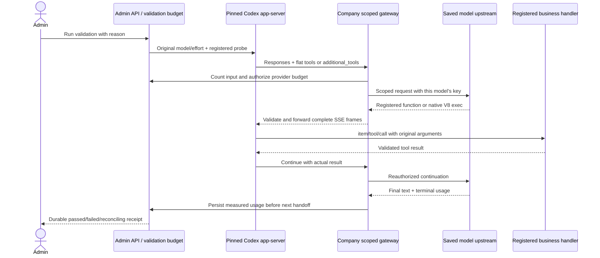
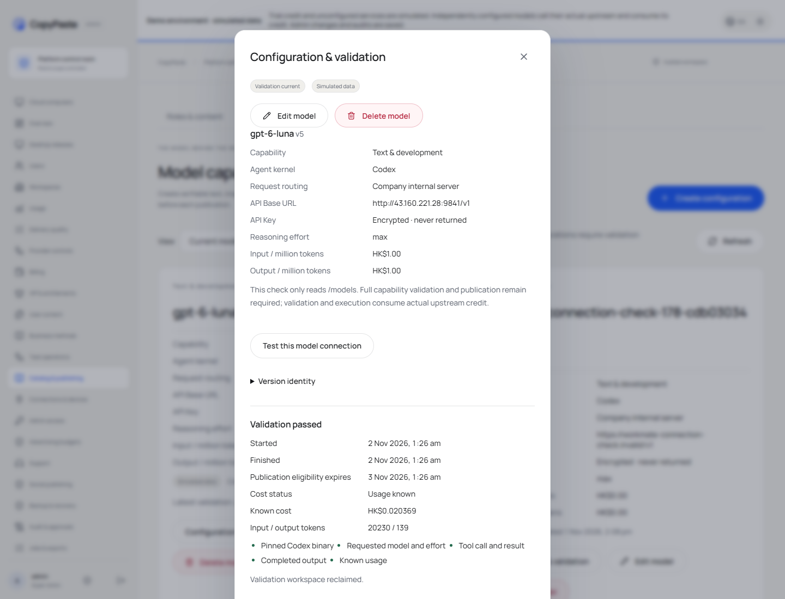

# Codex 工具协议及后台验证 / Codex tools and Admin validation

后台入口：模型能力 → 当前模型 → 配置與驗證。API 地址与 API Key 继续随每个模型配置保存；连接测试确认接口认证和模型列表，执行验证确认完整 Agent 流程。修复没有替换当前上游、模型、密钥或推理强度。

Open Model capabilities → the current model → Configuration & validation. The API base URL and API key remain attached to that model. Test connection checks authentication/model availability; Run validation verifies the complete agent flow. The repair preserves the saved upstream, model, key and effort.

## 根因与处理 / Cause and implementation

固定版本 `0.163.0-alpha.11` 在 `gpt-6-luna` 上使用 `input[].type=additional_tools` 宣告 `functions.exec`。这是 Codex 原生的隔离 V8 工具编排入口。原网关只检查顶层 `tools`，并在响应中拒绝这种 `custom_tool_call`，导致合法工具编排中断。先前只看到 `exec` 的拒绝名称不足以判定它是非法系统命令。

For this model the pinned runtime advertises its isolated V8 orchestrator in `additional_tools`. The old gateway examined only top-level declarations and rejected its custom tool call. The rejected name alone did not establish an unauthorized OS command.

- `cloud-tool-contract.ts` 识别固定语法、任务注册表、合法 namespace，以及匹配的原生编排和等待调用。发给模型的工具说明由当前任务注册表生成；移除云端没有处理器的提问和调度声明。普通 function 工具保留兼容，不能从模型声明中推导权限。
- SSE 转发按完整帧检查工具种类、namespace、item ID 和 call ID，绑定参数片段；不允许未声明工具、跨 namespace 调用、孤立片段或同 ID 更换调用身份。原生 V8 执行业务编排，服务端继续使用既有 `item/tool/call` 参数验证和授权；没有新增操作系统执行接口。
- Runtime 将安全、固定的网关错误代码带回验证结果。验证只保存固定代码和派发状态，不保存上游原始错误、提示词、参数或密钥。取消被拒绝的流前先保存真实失败代码；不完整或费用不明的请求仍待对账。
- 后台允许独立的文字验证重试，并解释旧笼统失败记录缺少具体原因。旧记录保持原状态；音视频及运行中的控制保持原有服务端检查。
- 每模型公网上游 HTTP 同时适用于生产推理入口。历史环境网关的单独 HTTPS 规则与每模型连接分开，已有地址和私网开关不变。

The shared adapter validates both declarations and complete response frames, binds call identity, and keeps business authorization at the original server handler. Native V8 performs orchestration; no OS execution endpoint is added. Runtime failures retain safe codes through billing and the Admin receipt. Text retries create separate budgeted records without altering old uncertain spending. Model-specific public HTTP also works at the production inference entry; legacy environment gateway policy remains separate.

## 历史请求占位恢复 / Historical hold recovery

真实后台重试还发现两条历史不确定请求（一次 HTTP400 的计数请求及一次旧工具调用中断）占满了初始策略的两个管理员／验证名额，返回 `AI_REQUEST_ACTOR_CAPACITY`。本轮对**尚无后台自定义发布的 bootstrap 策略**新增不可变的策略版本：管理员和验证总名额由2调整为4，保留旧请求占用的2个名额，恢复2个可用名额。原费用策略、金额上限、其他并发与频率设置不变；旧请求的状态、金额和占位均不改写。恢复脚本若发现已有后台发布策略或历史记录不匹配会停止，不覆盖管理员策略。

Production retry also exposed two historical uncertain requests consuming both bootstrap administrator/verification slots. A new immutable version of the **unpublished bootstrap limits** raises those two ceilings from2 to4, retaining both old holds and restoring two usable slots. Budget amounts, other concurrency/rate controls and all old request/cost records remain unchanged. The deployment recovery refuses to override an independently published Admin policy or a different historical state. Its before/after receipt is stored under `/root/cfg/workmate/validation-headroom-181.sanitized.json`.

## 原生上下文预算 / Native context budgeting

正式重试还发现上游计数接口返回5,218输入 tokens，终结用量实际为10,032，触发旧版 `INPUT_COUNT_MISMATCH`。该次实际费用10,106 HKD micros 已保留，不能抹掉违规或改为零费用。

迁移159为**通过固定工具契约验证的云端原生 code mode**增加 `serialized_ceiling` 预留方式：服务端从完整归一化请求的字节数与上游计数取较大值，派发前按原费率预留该输入上限及输出上限的费用。计数凭证仍绑定原始请求 hash、操作、模型、用户及发布；最终只按实际用量结算。实际输入超过预留上限、输出超过上限或费用超过预留金额，仍然记录违规并阻止后续结算。普通请求与旧分配继续使用原精确计数规则。

Production retry exposed an upstream undercount:5,218 estimated versus10,032 measured input tokens. The original10,106 HKD-micros charge and violation remain intact. Migration159 adds a server-derived `serialized_ceiling` only for validated native cloud code mode. Before dispatch, it reserves the larger of complete normalized request bytes and the upstream count at the frozen input rate, plus the output allowance. Count proof, request hash and original authority remain mandatory. Measured usage is charged; exceeding the input, output or monetary allowance still fails. The byte allowance is a conservative budgeting boundary, not a claim that the upstream estimate is exact; hidden upstream context can still exceed it. Existing allocations retain exact-count behavior.

部署前通过原生工具在 `/root/cfg/workmate/model-tool-contract-181-v3-backup/` 保存本次迁移涉及的函数定义及分配、违规原始记录私有快照，并对模型连接、发布、未知占位与违规记录做前后 hash 核对。schema159 是向前升级，必须使用匹配的新 API，不能自动退回 schema158 程序或还原数据库覆盖新业务记录。

A private snapshot of the affected function definitions and original allocation/violation rows and hash-only before/after checks protect model connections, releases, unknown holds and violations. Schema159 is forward-only and requires its matching API; deployment does not automatically downgrade the database or start a schema158 binary against it.

实际正式后台回执 `b8c8c28a-1df1-4ef7-af55-91d9d51b4bcc` 已通过全部五项检查。两个真实模型请求均返回 HTTP200，输入合计20,230、输出139 tokens，实际费用20,369 HKD micros；预留方式均为 `serialized_ceiling`，本次没有预算违规。部署仍使用演示业务数据上下文，因此页面显示 Simulated data；本次模型验证确实使用保存的外部上游与密钥，并非模拟模型结果。该结果不代替整个产品的生产验收。

The real Admin receipt passed all five checks. Two real model requests returned HTTP200 with20,230 input and139 output tokens, costing20,369 HKD micros, using pre-funded serialized ceilings with no violation. Business data remains in the demo context shown by the Simulated data badge; this validation actually used the saved external upstream and key. This focused result does not establish whole-product production acceptance.

## 部署与核查 / Deployment and checks

部署目录为 `/opt/workmate/overlays/model-tool-contract-181-v3/`，API 使用排序在旧配置之后的 `zzzzz-model-tool-contract-181-v3.conf`；Web/Admin 由原有高位端口反代。数据库通过增量迁移升级为 schema159；已备份本次迁移涉及的函数定义及分配、违规原始记录，并保留既有精确计数记录与违规记录。`/root/cfg/workmate/` 保存原环境与凭据备份、部署指南和脱敏部署回执；密钥内容不进入 Git、截图或报告。

The additive overlay adds schema159 while preserving existing ports and historical allocations. The late-sorting API drop-in selects the new code. Existing environment/credential backups and sanitized deployment metadata remain under `/root/cfg/workmate/`; secrets are excluded from Git and captures.

针对性检查覆盖旧协议、真实原生 Codex 业务工具往返、未声明调用与片段、错误归因、生产 HTTP 推理、数据库预算/费用约束、后台重试和错误解释。实际后台验证及媒体以[本轮回执](../quality/model-tool-contract-181.json)为准。早期失败的检查与浏览器尝试单独保留，不将连接检查或本轮修复等同完整产品验收。

Focused checks cover legacy/new tool contracts, a real native business round trip, unauthorized frames, failure attribution, production HTTP inference, database billing/budgets and Admin retry/error behavior. The [stage receipt](../quality/model-tool-contract-181.json) records actual production validation and media. Earlier failed attempts remain separate; this repair does not establish complete product acceptance.

[交互录像 / Interaction video](../assets/model-tool-contract-181/181-model-tool-contract.mp4)
