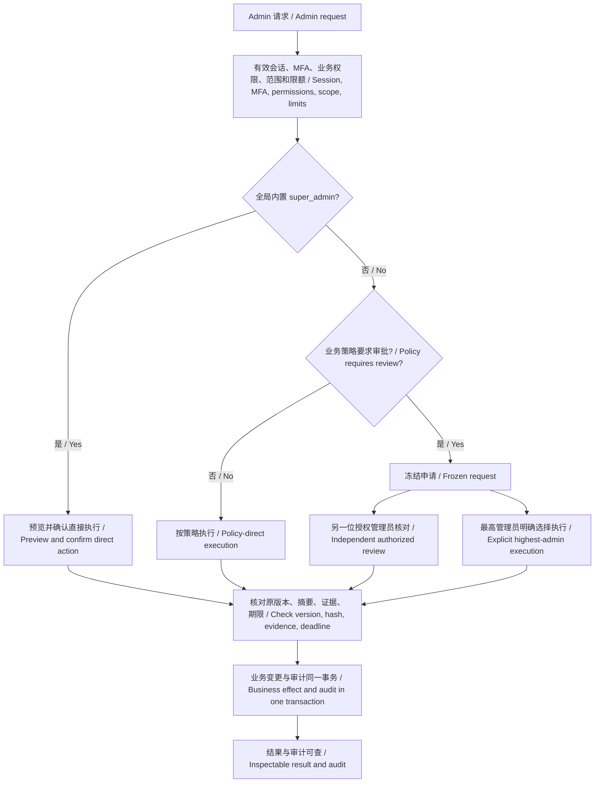
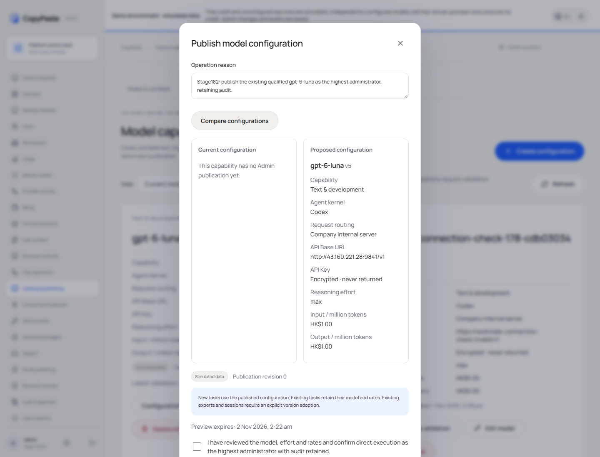
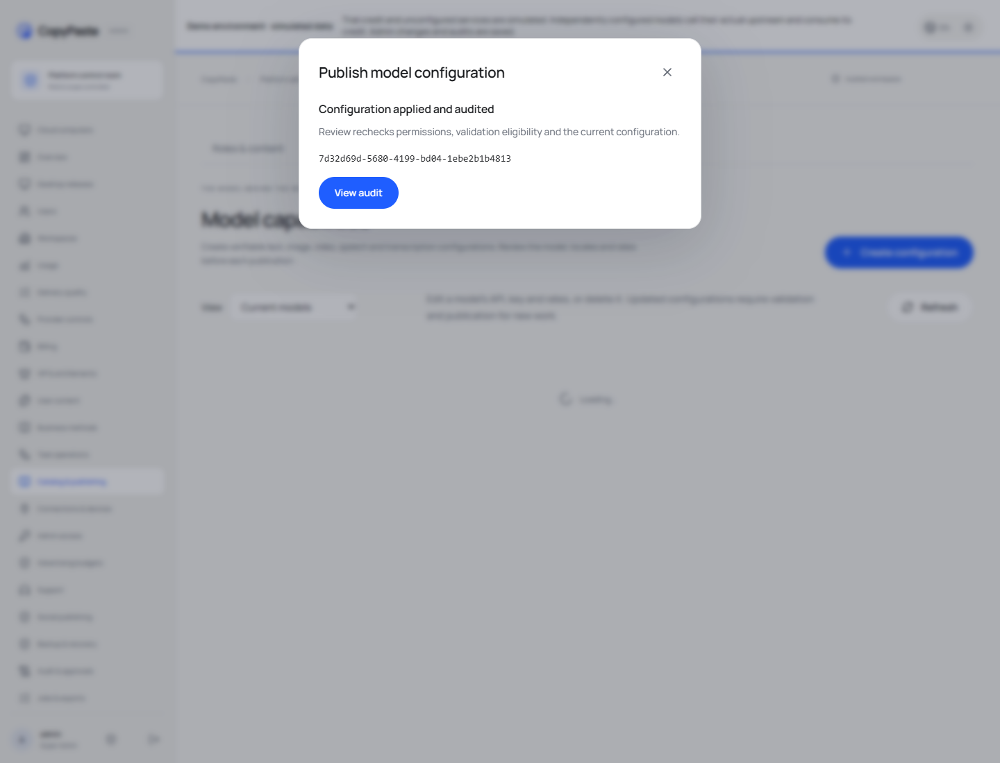
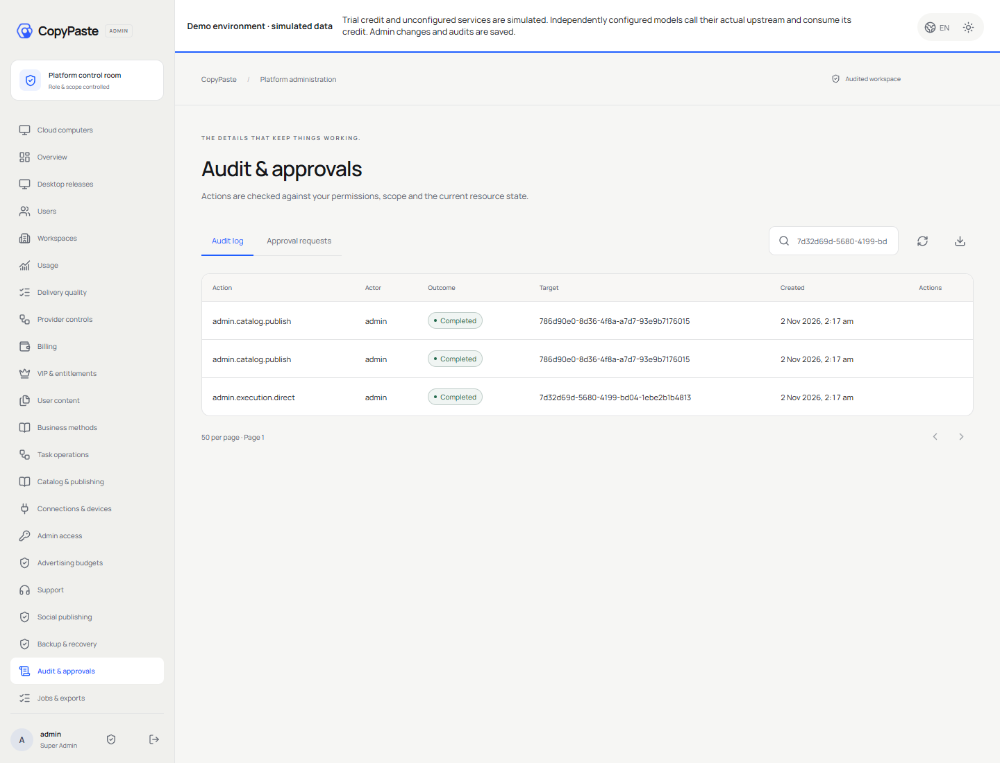

# 最高管理员执行策略 / Highest-administrator execution policy

本次将“最高管理员可直接执行，其他角色按策略审批，完整保留审计”落实到 Admin 页面、API、业务执行器与数据库。原有模型接口、加密 API Key、Codex 内核与费用核算继续使用现有实现。

This change implements highest-administrator direct execution, policy-based review for other roles, and complete audit retention across the Admin UI, APIs, business executors and database. Existing model connections, encrypted API keys, Codex execution and accounting continue to use their existing implementations.

## 执行逻辑 / Execution logic



## 后端与数据库 / Backend and database

`src/admin-execution-policy.ts` 统一读取最高管理员身份，使用近期 MFA 的有效会话启用仅限当前数据库事务的执行上下文。`src/admin-approval-decision.ts` 统一提交审批决定；原有各业务执行器继续核对原目标、版本、策略与证据。API 中的 `highest_admin` 与 `can_direct_execute` 仅用于页面展示；客户端不能靠传入这些值获取权限。

追加迁移160，不修改已应用迁移。数据库从有效角色、会话与 MFA 推导 `super_admin_direct`。普通决定继续为 `independent_review`。既有操作默认标为 `legacy`，不反写过去的操作者与审批模式。支付、退款与供应商／音频确认事实也保存真实执行模式；原始证据和账务检查保留。

数据库事务内记录 `admin.execution.direct`；审计写入失败将撤销同一事务的业务效果。已有业务审计继续保留。幂等重放不重复入账、发布或写入直接执行事实。

The central policy reads current role identity and binds direct execution to a live session with recent MFA in the current database transaction. Frozen business executors retain their existing target, version, policy and evidence checks. Browser flags are display hints, not authorization.

Additive migration160 derives direct execution from live server context. Ordinary decisions retain independent-review attribution; prior operations retain legacy attribution. Provider/audio and payment/refund confirmation facts record the actual execution mode without weakening original evidence or accounting checks. Direct-execution audit and business effects commit atomically; an audit failure rolls back the effect. Idempotency prevents repeated effects.

## 页面 / Admin UI

模型预览明确显示“确认直接执行”；成功后显示已执行并提供审计入口。现有待审批详情为最高管理员提供直接执行选择；普通申请人继续看到另一位管理员审批提示。费用、支付、退款及供应商管理同步使用新的角色规则。

Model previews offer **Confirm direct execution**, then show the applied result and an audit link. Existing pending requests offer direct execution to the highest administrator. Ordinary requesters retain independent-review messages. Financial, payment, refund and provider controls follow the same role policy.

## 部署与核查 / Deployment and qualification

部署使用原生 Linux 服务和追加数据库迁移；保留 `/root/cfg/workmate/` 中已有密钥和凭据，以及其他运行服务。升级前保存私有配置与迁移对象备份，并核对历史模型、操作、审批和费用事实摘要。迁移160须搭配对应 API；不自动降级数据库。

Focused checks cover highest/global identity, copied and scoped roles, ordinary self-review rejection, existing pending requests, frozen versions/hashes, current MFA, explicit denies, expiry, transactional audit failure, database access, model publication/rollback, provider policy, high-value credit and payment evidence. Run from the backend with its configured native test environment:

```powershell
npm run test:admin-execution
```

早期失败的测试尝试按版本保留；当前使用 `highest-admin-direct-182-v2`、`highest-financial-direct-182-v2`，以及 provider/capability 的 V1。旧审批用例中的“所有 super_admin 均须另一人审批”属于此前需求，不作为本次新规则的验收标准。未执行全产品回归测试。

Earlier unsuccessful fixture attempts are retained with their original bytes. Current acceptance uses the V2 core/financial fixtures and V1 provider/capability fixtures. Legacy assertions requiring independent review for every global super administrator describe the previous policy. This focused change does not constitute full-product regression acceptance.

实际部署、测试和页面证据 / Actual deployment, test and UI evidence：[核查记录](../quality/highest-admin-direct-182.json)。








