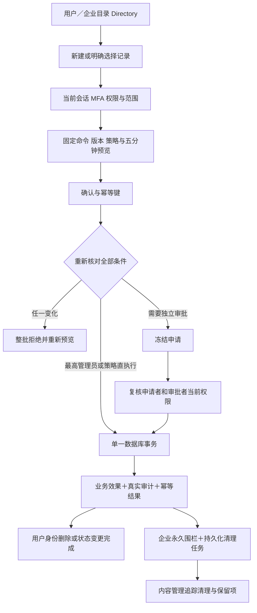
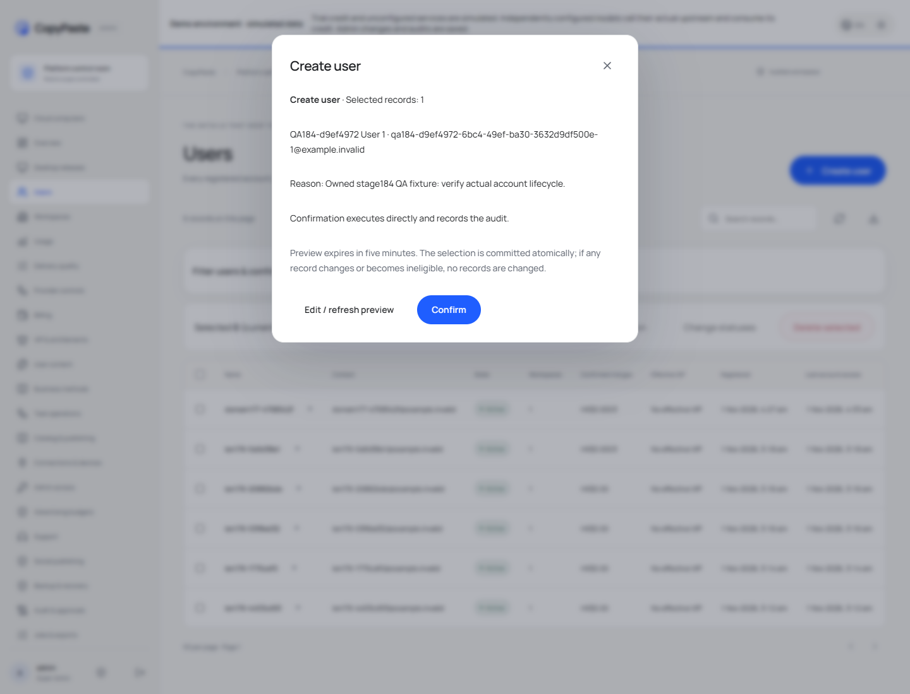
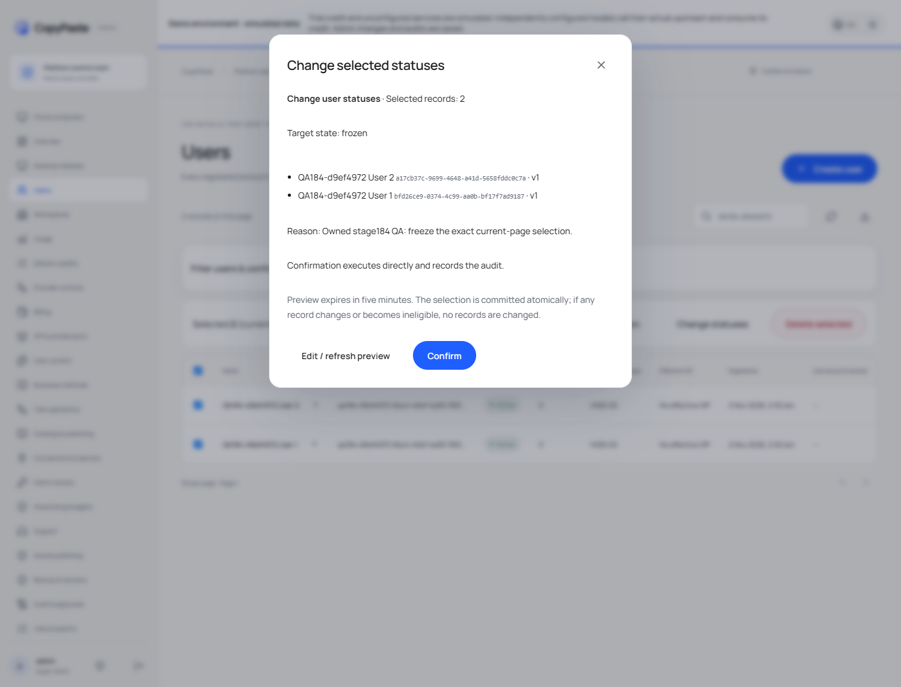
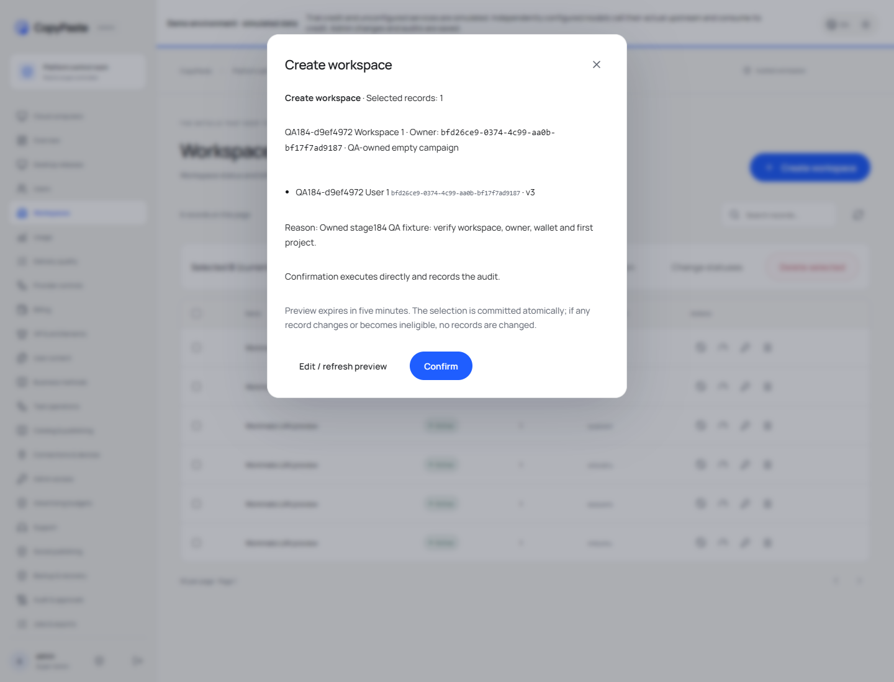
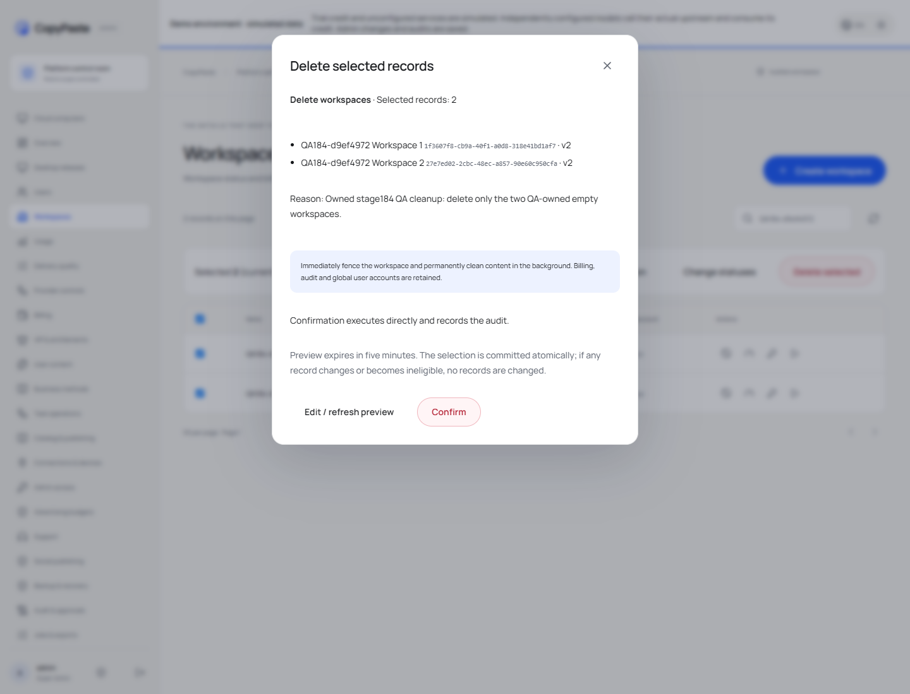
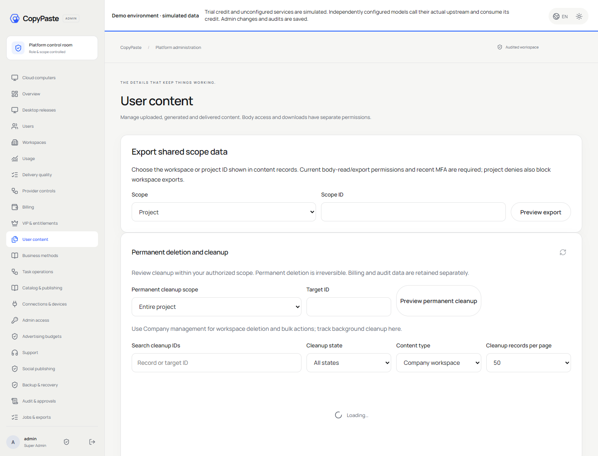

# 管理目录生命周期 / Administrative directory lifecycle

用户与企业列表统一使用 `admin-directory-lifecycle.ts` 的事务执行器，前端使用 `directory-actions.tsx`。新建、单条删除和批量状态/删除共用预览协议，避免单条与批量实现两套权限或账户规则。

## 使用 / Usage

1. 在后台进入用户管理或企业管理。右上角“新建”建立一般用户或完整企业；企业须选择现有有效擁有人及首个项目名称。
2. 勾选明确记录，使用批量变更状态或批量删除；单条删除也使用相同窗口。选择限当前页，改变目录上下文后清空。
3. 填写原因，删除须输入准确数量并确认保留范围。点击预览，核对记录、目标状态、策略与影响，再确认提交。
4. 最高管理员直接执行；其他角色依据当前策略进入独立审批。已接受的企业删除可在内容管理的清理记录中追踪，直至清理结束。

Open Users or Company management. Create an ordinary user or a workspace with an explicit active owner and first project. Select rows on the current page for a status change or deletion; selection never silently spans pages. Enter a reason, acknowledge deletion/retention where required, preview and confirm. Highest administrators execute directly; other roles follow independent review. Follow workspace cleanup in Content management after acceptance.

## 接口 / API

`POST /v1/admin/directory/preview` 接受严格的判别联合命令：`users.create`、`tenants.create`、`users.status`、`tenants.status`、`users.delete`、`tenants.delete`。新建用户为 `email/display_name/reason`；企业为 `name/owner_id/project_name/reason`。状态和删除为 `targets: [{id,version}]`，数量1–100，不允许重复 ID。状态额外提供 `state`，删除提供 `acknowledge_retention: true`。

`POST /v1/admin/directory/commands` 接受 `{preview_id,payload_hash}`，并要求当前管理员会话、CSRF 与 `Idempotency-Key`。响应202的 `state` 为 `succeeded` 或 `pending_approval`；该新端口在原有操作 DTO 之外返回 `result.items/total/acceptance/cleanup`，不改变已有严格审批 DTO。企业结果为 `deleting` 且包含 `deletion_job_id`，代表已接受并进入后台清理，而非宣称物理内容已经清理结束。

Preview accepts a strict command union and explicit `{id,version}` targets. Confirmation binds the saved preview and SHA256 command digest to the current actor and an idempotency key. A successful workspace deletion returns durable job IDs and `deleting`; completed acceptance and completed content cleanup are distinct states. Existing strict approval response contracts remain unchanged.

## 权限和锁 / Authority and locking

四个新权限：`admin.users.create`、`admin.users.delete`、`admin.tenants.create`、`admin.tenants.delete`。用户账户操作要求全局权限，并检查所有关联企业/项目的重叠 deny；企业操作核对整个企业及其项目 deny。批量总数必须适配每个适用授权的 `max_batch`。读权限、写权限、会话和 MFA 在提交及审批执行时重新核对，原申请者已失权则不能继续执行。

执行遵循管理授权锁、按序用户授权锁、按序企业成员锁及目标行锁。预览绑定完整命令、策略版本及目标事实；提交前重新计算。记录状态变化与后台任务入队均为数据库操作，所选记录在单一事务内原子接受，无外部模型请求。任一异常或审计失败回滚全部业务效果；大型内容清理由既有持久化清理执行器分批完成，保留未知费用和对账边界。

Current permissions, overlapping denies, MFA and batch limits are enforced again at commit/review. Ordered authority/member/row locks protect lifecycle changes. Atomic acceptance includes audit and durable erasure admission; external cleanup is performed by the existing persisted worker, with financial uncertainty retained.

## 数据与部署 / Data and deployment

追加迁移161，API严格要求相同 schema。`users.deleted_at` 为不可逆终态；数据库触发器禁止将已删除账户重新启用或恢复联系资料。删除保留 ID 供账务、共享内容及历史审计引用。来源扩展为 `admin`，目录提供相应筛选。普通目录隐藏已删除用户和已申请永久清理的企业。

原生执行相关检查：在 `dev/copypaste-delivery` 使用 Node 运行 `scripts/test-admin-directory-lifecycle-184-v3.mjs`，无需本地虚拟化。生产后端为 `/opt/workmate/overlays/admin-directory-lifecycle-184-v1/backend`，后台静态资源为 `/opt/workmate/overlays/admin-directory-ui-184-v2/admin/dist`；高位端口及公共域名保持当前部署配置。配置和凭据原样保存在服务器 `/root/cfg/workmate/`，不进入 Git。

The forward-only schema161 migration requires its matching API. Run the focused suite through the owned native PostgreSQL wrapper above. Production credentials stay in the private server configuration directory; this change preserves the saved per-model API/key configuration and historical unsettled holds.

## 页面与操作记录 / Actual captures

[完整交互录屏 / Full recording](../assets/admin-directory-lifecycle-184/184-admin-directory-lifecycle.mp4)
