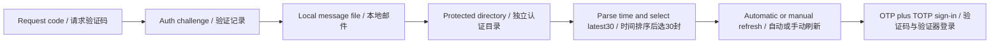
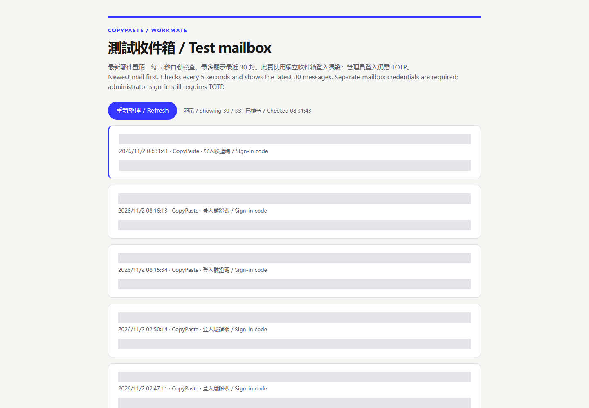

# 测试收件箱修复与使用 / Test mailbox implementation and use

本轮线上问题是收件箱页面的日期排序错误。Nginx 目录返回 `Sun, 01 Nov 2026 ... GMT`、`Mon, 02 Nov 2026 ... GMT`。旧页面用 `b.mtime.localeCompare(a.mtime)` 排序并截取30封，导致星期日的旧邮件优先于星期一的新邮件。现场共32封邮件，用户两次新验证码分别排在第31、32位；12条最近验证码记录均有对应的本地邮件文件。

The live failure was inbox ordering. Nginx returns RFC dates, and lexical sorting placed older Sunday messages before new Monday messages. Applying the30-message limit then hid both new codes at positions31 and32 out of32 messages. All12 inspected recent challenges had matching local message files.

修复位于 `dev/copypaste-delivery/deploy/operator-mailbox/index.html`：先用 `Date.parse` 比较时间，再截取30封；同时间按文件名稳定排序。最多6个并行请求读取邮件，保留最近邮件缓存，避免每5秒重复读取所有正文。页面隐藏时暂停定时检查，返回时立即检查；同一时间只允许一轮读取，失败时保留旧内容，并显示错误及重试状态。所有邮件字段以 `textContent` 写入页面。

The standalone delivery page parses dates before limiting results, uses a stable filename tie break, caps reads at six concurrent requests and caches the selected messages. Polling pauses while hidden and resumes on return. Only one refresh can run at a time. Failures preserve existing content and show an error. Mail fields use `textContent`.

使用方式 / Usage:

1. 在用户端或后台登录页要求验证码。Request a code from the user or administrator sign-in page.
2. 打开[测试收件箱](https://agent-dashboard.copypaste.hk/ops/mailbox/)，输入既有独立收件箱凭证。Open the test mailbox using its existing operator credentials.
3. 查看置顶的新邮件，核对收件人和时间。页面会自动检查，也可按“重新整理 / Refresh”。Read the newest message and check its recipient and date; automatic and manual refresh are available.
4. 输入新验证码；后台继续要求既有 TOTP。旧验证码有效期不因收件箱排序修复而延长，过期时重新要求一封。Enter the new code and, for Admin, the existing TOTP. This repair does not extend code expiry; request a new code if necessary.

部署使用 `scripts/install-operator-mailbox-185-v1.sh`，上传页面及其 SHA-256 后原子替换两份既有静态页面。旧页面保存在服务器 `/root/cfg/workmate/operator-mailbox-185-v1/`。部署没有修改 Nginx 路由、API配置、用户凭证、数据库或模型配置，也不需要重启服务。未来完整重新部署应使用仓库内这份页面，不能恢复历史176阶段部署脚本中的旧内嵌页面。

Deployment uploads the HTML and SHA-256, then atomically replaces the two existing static page files. Previous bytes are backed up under `/root/cfg/workmate/operator-mailbox-185-v1/`. Routing, API configuration, credentials, database and model settings are unchanged; no service restart is required. Future full deployments must use this canonical page rather than the obsolete inline stage176 page.

公网 Cloudflare 会补充 `no-cache` 和统计脚本。验收确认 `no-store` 指令存在，并仅移除已识别的 Cloudflare 统计脚本后比较源码散列；服务器直接返回的页面与上传源码字节一致。Cloudflare adds a cache directive and analytics script. Qualification checks the `no-store` token and removes only the identified analytics injection for comparison; origin bytes match the uploaded source exactly.

回归入口为 `scripts/test-operator-mailbox-185-v1.mjs`；最终公网验收为 `scripts/qualify-operator-mailbox-185-v4.mjs`。原始失败诊断及检查脚本保留，范围与结果见[证据](../quality/test-mailbox-185.json)。Regression and final public qualification have separate receipts; original attempts are retained in the evidence record.

