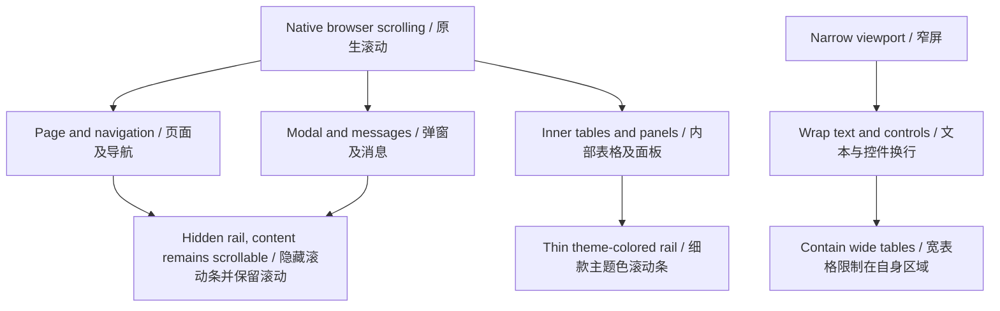
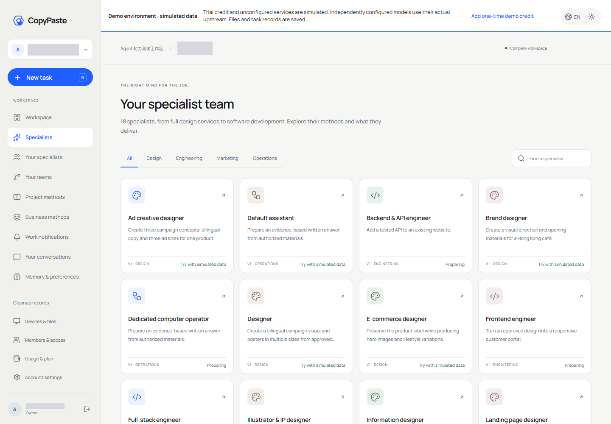
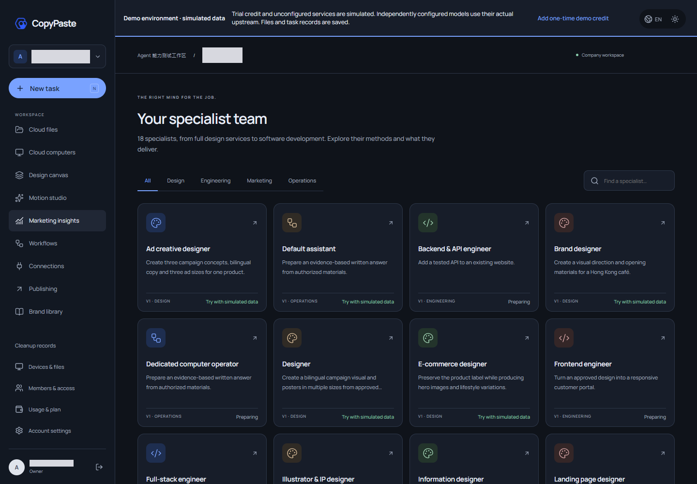
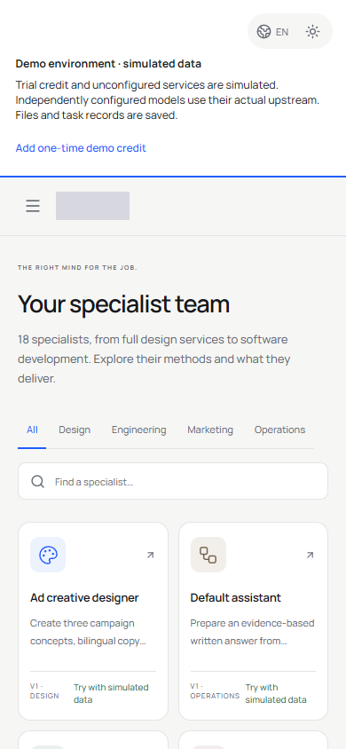
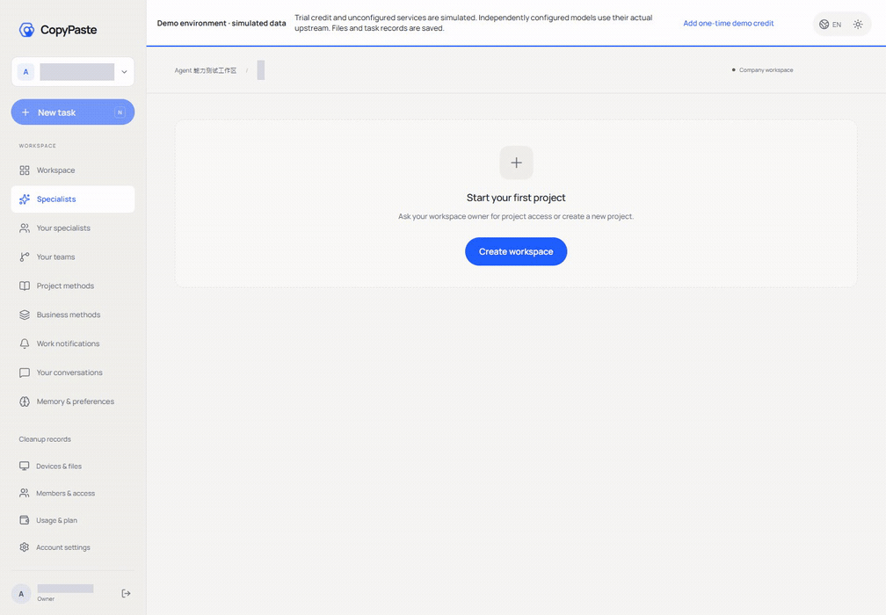
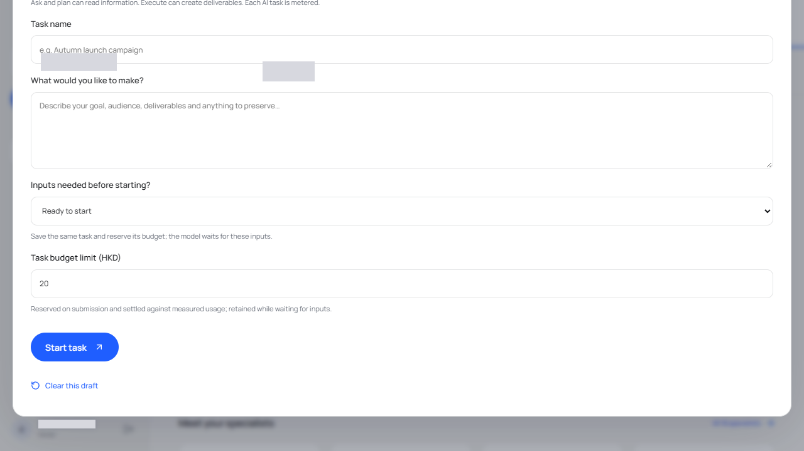

# Web 滚动样式与布局 / Web scrolling and layout

已部署至 [Web](https://agent.copypaste.hk)。统一规则位于 Web 仓库 `src/scroll-surfaces.css`，由 `src/main.tsx` 在原 `style.css` 后导入。现有品牌色、字体、组件和主题继续作为视觉来源。

The update is deployed to [Web](https://agent.copypaste.hk). The Web repository imports `src/scroll-surfaces.css` immediately after its existing stylesheet in `src/main.tsx`. Existing brand colors, typography, components and theme tokens remain the visual source.

## 使用方式 / Usage

页面、侧栏、对话和弹窗外层不显示滚动条。鼠标滚轮、触控板和手机滑动继续浏览长内容；键盘沿用浏览器原生焦点与滚动行为。侧栏导航可以独立滚动，底部账户入口保持可访问。宽表格可在表格范围内左右滚动，不会拉宽整个页面。必要的内部面板或输入区使用相同细款样式。

Page, sidebar, conversation and modal outer rails are hidden. Wheel, trackpad and touch gestures continue to browse long content; keyboard behavior follows native browser focus and scrolling. Navigation scrolls independently and keeps account controls accessible. Wide tables scroll horizontally within their container without widening the page. Necessary inner panels and input regions share the thin-rail style.

## 实现细则 / Implementation

| 规则 / Rule | 实现 / Implementation |
| --- | --- |
| 通用滚动条 / Shared rails | 标准 `scrollbar-width: thin` 与 `scrollbar-color`；WebKit 提供 6px 轨道、圆角滑块和品牌蓝悬停色 / Standard thin/color properties with a 6px WebKit fallback, rounded thumbs and a brand-blue hover color. |
| 颜色 / Color | 滑块从 `--muted` 以 42% 混合透明色，悬停从 `--blue` 以 68% 混合；使用原主题变量 / Thumb mixes existing muted color at 42%; hover mixes existing blue at 68%, both against transparency. |
| 无可见外层滚动条 / Hidden outer rails | `scrollbar-width: none` 与 WebKit 隐藏规则覆盖 `html/body/#root/.sidebar/.sidebar nav/.modal-backdrop/.message-stack`，没有禁止纵向滚动 / Both standard and WebKit rules hide rails without disabling vertical scrolling. |
| 侧栏 / Sidebar | 使用 `100dvh` 并提供 `100vh` 回退，导航可收缩，入口不被压扁，横向内容裁切 / Dynamic viewport height with a fallback, shrinkable navigation and nonshrinking controls. |
| 横向布局 / Horizontal layout | 主布局、卡片、弹窗与表格外层设置 `min-width: 0` 和最大宽度；标题、筛选与标签换行 / Allow layout children to shrink and wrap controls. |
| 长内容 / Long content | 主要区域的 `pre` 和 `textarea` 自动换行；宽表格继续使用已有 `.table-scroll` 容器 / Wrap long preformatted/input text and keep existing table containers horizontally scrollable. |
| 强制色彩 / Forced colors | 滚动条颜色回退至浏览器 `auto` / Let the browser choose accessible scrollbar colors. |

## 验证与媒体 / Validation and media

`npm run build` 已通过 TypeScript 检查与 Vite 构建。部署包包含 42 个静态文件；服务器提供的首页和样式已与打包文件逐项核对。现有大体积 chunk 提示仍为构建警告。

TypeScript and Vite passed through `npm run build`. The deployment contains 42 static files; the served index and styles match the archive. The existing large-chunk notice remains a build warning.

最终实际页面检查通过 10 项：1440px 桌面、390px 手机、主页面及导航滚轮、浅深色主题、文件/用量/设置/连接/分析页面、手机导航与成员页、内部宽表格、长弹窗及脚本错误检查。表格实测容器 348px、内容 677px，可滚动至 329px；页面本身宽度保持 390px。超长文本额外采用临时 DOM 压力内容检查，检查后立即移除；未模拟 API 响应。

Ten final browser checks cover desktop/mobile layout, independent wheel scrolling, light/dark styles, related read-only business pages, mobile navigation, the member table, a long modal and script errors. The actual mobile table has a 348px container with 677px content and reaches scrollLeft 329px while page width stays 390px. A temporary synthetic DOM-only long-text stress sample was removed immediately; API responses were real.

浏览器核验使用已部署服务的内网 HTTP 地址和真实测试用户 OTP。测试上下文只在自身内存中适配内网 Cookie 传输，服务器 Cookie、安全设置和认证逻辑未修改。工作站到公网 Web 的 HTTPS 路由间歇超时，因此本轮不宣称完整公网 HTTPS 页面旅程通过，也未验证 Safari/Firefox 实机。所有自建浏览器上下文与实例均关闭，测试会话已登出，无模型调用。

Browser verification used the actual deployed LAN HTTP service and a real existing test-user OTP. Only the private browser context adapted cookie transport in memory; server security/authentication stayed unchanged. Intermittent workstation-to-public-Web TLS timeouts prevented a full public HTTPS journey claim. Safari and Firefox were not physically tested. Owned browser contexts/instances were closed and QA sessions signed out; no model calls were made.

截图中的账户选择器已遮蔽。GIF 仅导出角色页实际主区域与导航滚轮片段；完整录像及含账户信息的成员截图保持私有。V1 初次 7 项检查和 V2 最终 10 项检查分别保留原回执，不能将其累加为 17 项独立验收。

Account selectors are masked. The GIF exports only actual role-page/main-navigation wheel interaction; the complete recording and member screenshot remain private. Original V1 seven-check and final V2 ten-check receipts are preserved separately, not summed into 17 distinct acceptance checks.

## 部署与回滚 / Deployment and rollback

- 新 Web 静态目录 / New Web root: `/opt/workmate/overlays/web-scroll-187-v1/web/dist`.
- 包 SHA256 / Archive SHA256: `3b7abb0139e980e7abec401c47dbf7222a40b215ece0f4f5407146e1f93ab5ff`.
- 原 Nginx 配置备份 / Original configuration: `/root/cfg/workmate/web-scroll-187-v1/nginx.before.conf`.
- 恢复备份至 `/opt/workmate/nginx/nginx.conf`，使用既有 Nginx 校验命令检查，再重载 `workmate-lan-proxy.service`，可回到原阶段184 Web 目录。Restore that configuration, validate it with the existing Nginx invocation, then reload the owned proxy unit to return to the prior stage184 Web root.
- 本轮只修改 Nginx 的 Web 静态根目录；API、数据库、后台与受保护收件箱路由未修改。既有配置及凭证哈希、服务主 PID、数据库 schema 161 均保持。Only the Web static root changed; other routes, protected configuration/credentials, master service PIDs and schema 161 were preserved.

实际执行工具位于独立 delivery 仓库 `scripts/*web-scroll*187*`。本轮源码、媒体和回执哈希见[限定证据](../quality/web-scroll-surfaces-187.json)。

Execution tools are in the delivery repository under `scripts/*web-scroll*187*`. See [bounded evidence](../quality/web-scroll-surfaces-187.json) for source, media and receipt hashes.
