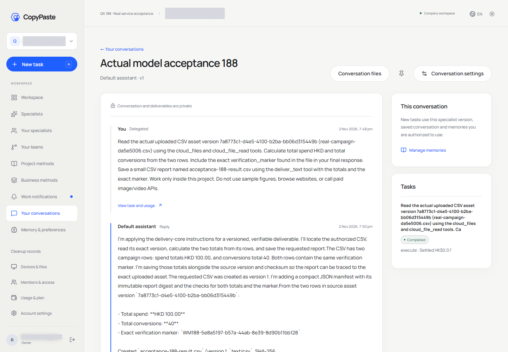
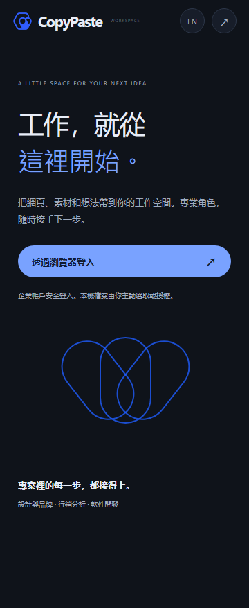
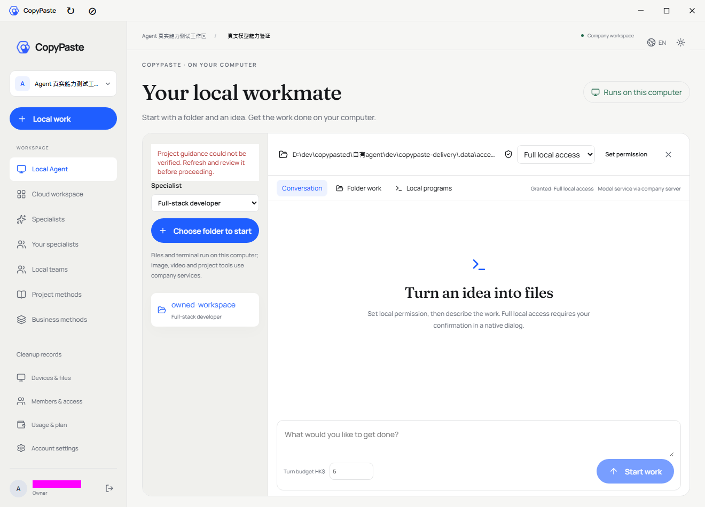
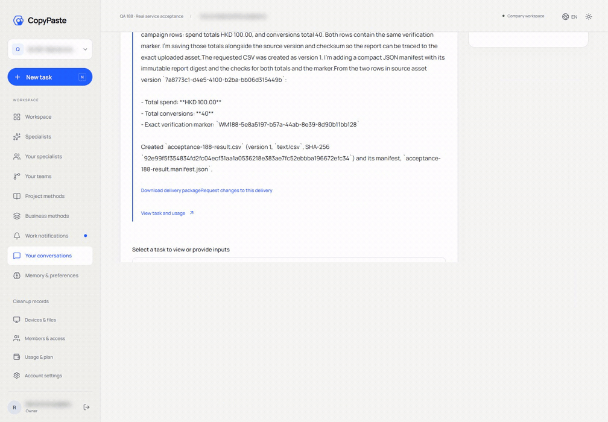

# 188 · 线上测试、修复与部署

2026-11-02，最终部署为 `real-services-188-v8`，数据库版本161。用户端为 <https://agent.copypaste.hk>，后台为 <https://agent-dashboard.copypaste.hk>，API 为 <https://ai-api.copypaste.hk>。这是已上线但仍有验收缺口的版本。

## 当前可确认的流程

|编号|范围|真实结果|证据边界|
|---|---|---|---|
|1|Web 登录、文件分析与交付|OTP、真实企业／项目、上传、云端 Codex 读取随机标记、计算100元和40次转化、生成与下载CSV、核对散列与实际扣费通过|原任务费用 HK$0.068230；后续下载未新建模型任务|
|2|Extension|真实工具栏点击打开浏览器原生右侧 Side Panel、真实 PKCE、文件上传、云端 Codex 生成结果与CSV下载通过|原任务费用 HK$0.068028；浏览器宽度1464→1078，侧栏360像素无横向溢出|
|3|后台|新建2名用户及2家企业、幂等重放、重复邮箱拒绝、批量冻结恢复、过期版本整批拒绝、唯一拥有人保护、模型新增编辑删除、独立Key替换与掩码、VIP授予撤销、测试数据删除通过|最高管理员操作保留直接执行审计；普通角色审批另有回归|
|4|Desktop 外壳与权限|真实安装版登录、无边框、无Electron菜单、目录选择、完整本机权限的警告确认通过|最终真实模型复验未通过，不以外壳通过代替本机任务闭环|
|5|Desktop 内核兼容|固定Codex 0.163.0-alpha.11在本机实际执行命令、读取输入、写入结果，并调用已注册的企业工具桥接通过|上游为明确标记的协议夹具，不是供应商真实模型验收|
|6|最终服务器状态|Web63070、后台63071、API入口63072与应用63073均返回200，真实模式健康；数据库与专用代理进程保留，候选服务停止|证明源站健康；公网仍存在间歇超时|

## 本轮修复

1. 服务切换到 `DEMO_MODE=false`，会话只返回当前真实模式的企业成员关系。保留原模拟历史与账务引用；原测试账号得到真实项目及 HK$100,000 测试信用额度，该额度不是付款或充值。
2. 网关先按任务固定模型解析其独立 URL／Key，取消对重复全局 Key 的错误前置依赖。密钥仍由既有加密连接存储管理，客户端不持有供应商Key。
3. 专用Nginx运行用户为workmate，临时目录却属于nobody且权限0700，大型原生Codex请求在到达API前失败。修正五个明确目录的属主并固定专用配置用户，验证配置与读写后重载；未改动无关Nginx服务。
4. 永久清理共用项目配置时，补上既有内容清除上下文，避免数据库历史保护触发500；重复新删除返回409，原幂等重放仍保留。
5. 固定Codex为对象映射补上空 `properties`。现使用与实际原生请求一致的可信结构投影，仍以完整业务结构验证效果，修复云端工作流被误判 `registered_schema`。
6. 对识别为GPT的模型，原生Codex在 `additional_tools` 中声明exec／wait。补上固定Lark格式检查、重复／外来声明拒绝和有声明才允许响应的绑定；去除无独立授权的协作／控制声明。企业工具仍走原任务及权限检查，本机操作仍由本机权限控制。原生工具命名 `copypaste.asset_text_read` 映射到 `tools.copypaste__asset_text_read`。
7. 保存有界的网关拒绝原因和未来生图HTTP原因；不保存Key、完整原始提示词或供应商错误正文。未知计费不冒充成功或零费用。

## 测试记录

|检查|结果|说明|
|---|---|---|
|原始全量后端|1936项：1834通过、101失败、1跳过|完整运行约117分钟；原日志与101项编号列表保留，未重写成通过|
|Web / Admin / Desktop 单元检查|28/28、20/20、263/263通过|各客户端构建通过；不是所有功能的真实供应商验收|
|Extension 当前单元检查|89/89通过|原始88/89失败也保留；修正与当前会话规则不一致的旧夹具|
|现行管理／审批／费用相关夹具|100/100通过|普通角色复制权限但不冒充最高管理员，最高管理员直接执行另有专门检查|
|共用项目配置清理|22/22通过|包含永久清理与重复删除冲突|
|视频验证／生成任务／通知／套餐当前夹具|71/71通过|测试供应商协议／业务逻辑，非真实视频服务能力|
|云端工作流／网关／项目配置|37/37通过|真实固定Codex进程配合明确协议夹具|
|最终exec网关／当前测试发现检查|43/43通过|包括未声明exec、异命名空间、改写语法、重绑定与权限边界；原始私有日志已绑定散列|
|实际本机命令／文件／企业工具桥接|通过|两次协议响应、一条实际企业工具调用；不是供应商实测|

这些检查有重叠，不能相加当作新的全量通过数。音频／能力管理的补充检查曾在原全量任务关闭其数据库时中断，原136项中68项通过、68项失败作为受环境中断限制的记录保留；其前63项连续通过，剩余商业夹具随后在独立生命周期数据库完成71项。没有再次运行全部1936项。原始失败还涉及原生文档转换、渲染环境、暂停／持久化语义、旧升级夹具及其他历史审批预期，完整编号见[原始失败列表](../quality/live-acceptance-188/original-failures.json)。

## 尚未通过的项目

|编号|缺口|当前处理|
|---|---|---|
|G01|真实生图403|资格保持未发布；原请求费用未知记录保留，未盲目重试或假报成功|
|G02|真实视频、语音生成与转写|没有可用凭据，未取得真实验收|
|G03|Google Ads／Analytics与Meta授权和外部发布|没有真实OAuth授权；CSV分析通过不等于平台拉取或发布通过|
|G04|正式邮件投递|按用户要求保留受保护的测试收件箱；未配置SMTP|
|G05|Desktop真实模型完整本机任务|三次修复前原请求仍为费用待核对；最终修复后复验因公网连接失败停在准备阶段；本机协议及权限通过不能替代真实模型闭环|
|G06|公网稳定性|从本机和服务器均观察到Cloudflare不同入口交替超时；某次Web的172入口正常而104超时，后续后台104正常而172超时，API两个入口也曾超时。源站保持健康，尚未定位／修复外层转发问题|
|G07|全量回归剩余失败|旧规则夹具已通过版本副本校正，若干真实环境及语义差异仍需继续修复与复核；没有全量通过证明|
|G08|生产环境运行配置|当前 `NODE_ENV=development`、`DEV_MAILBOX=true`，不能称为正式邮件与生产配置完整验收|

三个Desktop未知供应商请求保留其原请求、预留及审计，当前客户账务未确认扣费；这不等于供应商成本为零。图片请求另有一条未知计费记录。测试QA的一日Pro授予带到期时间且不自动续期，没有虚构付款。独立QA企业、文件与结果用于回查；临时管理目录测试的2名用户和2家企业已按正式接口删除。

## 部署与回滚

最终包 `workmate-real-services-188-v8.zip`，SHA-256为 `71c6a0614392b7df072c5b8e19bbfb680f6b763a25bd66f2a68014e085e1f6a5`。源站 `/opt/workmate/overlays/real-services-188-v8/backend`，主服务 `workmate-api.service`，最高优先级覆盖文件为14个z前缀的 `zzzzzzzzzzzzzz-real-services-188-v8.conf`。数据库161无新迁移，既有模型加密Key与配置保留。候选服务使用63079验证后已停止，公开端口不变。

原v8安装第一次因已停止并被systemd回收的v7候选服务不存在而中止，未切换线上API；随后恢复脚本验证已解包的每个文件散列并继续候选验证和切换，最终源站检查通过。不要直接重复执行一次性安装脚本。回滚时恢复已验证的上一服务覆盖文件并重载、重启本应用，再检查健康与模式；未知费用、用户数据、数据库和Key都不能随代码回滚删除。大请求临时目录修复应保留。

配置／部署说明按要求明文存于服务器 `/root/cfg/workmate/live-acceptance-188/deployment-note-v2.txt`；现有密码仍在受限的原配置文件中，未导入Git。备份、原始日志、录屏与私有会话文件留在本地受控`.data`及服务器cfg，公开证据仅保留安全字段、散列和测试记录。自建浏览器、SSH、CONNECT代理及临时原生PostgreSQL均已关闭，禁止本地虚拟化。

## 实际画面

GIF为真实已完成任务的2.2秒录像节选，不是新模型推理录像；本轮后台截图只捕捉到加载画面，因此没有将其冒充成功页面。既有后台截图在各端README历史184章节保留。

## English acceptance statement

Real text service, Web file delivery, the native Extension Side Panel and actual admin operations are verified. The backend fixes are deployed as188-v8 with source-bound receipts. Recognized GPT native exec/wait is now scoped and validated; pinned local Codex performs actual command/file and company-tool operations against an explicitly synthetic protocol fixture. Final real-supplier Desktop acceptance was blocked by public connectivity and remains unqualified. Image403, missing video/audio/OAuth/SMTP, development mailbox configuration and the original full-regression failures remain explicit gaps. Original failures, unknown-cost holds and immutable release history were preserved. This document is not a full-product acceptance certificate.
