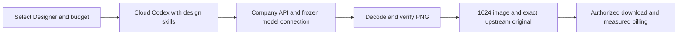
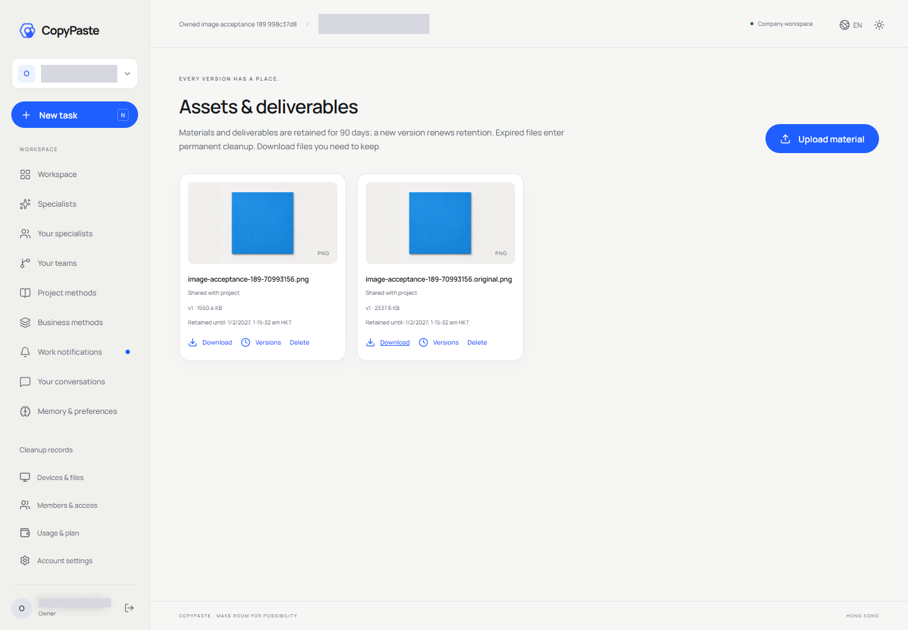
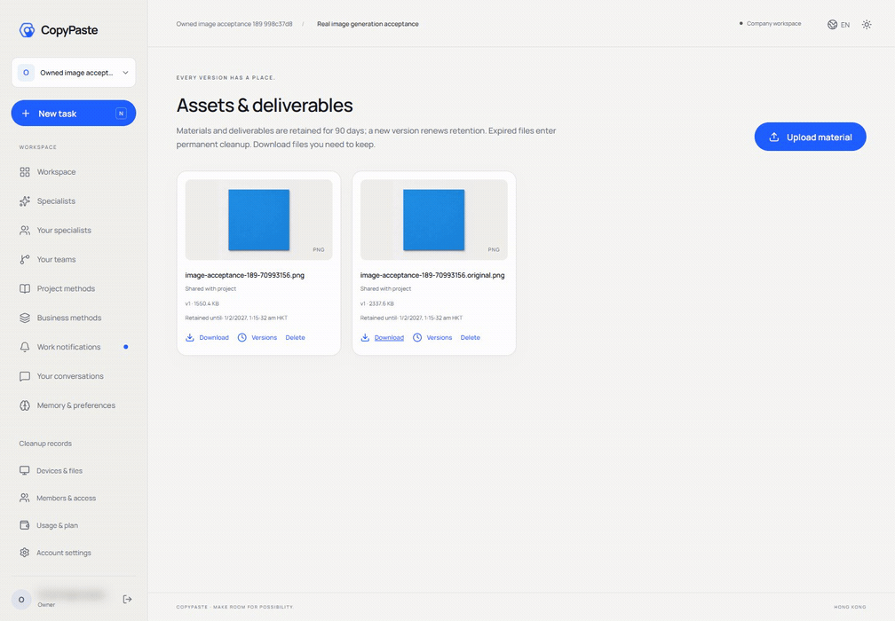
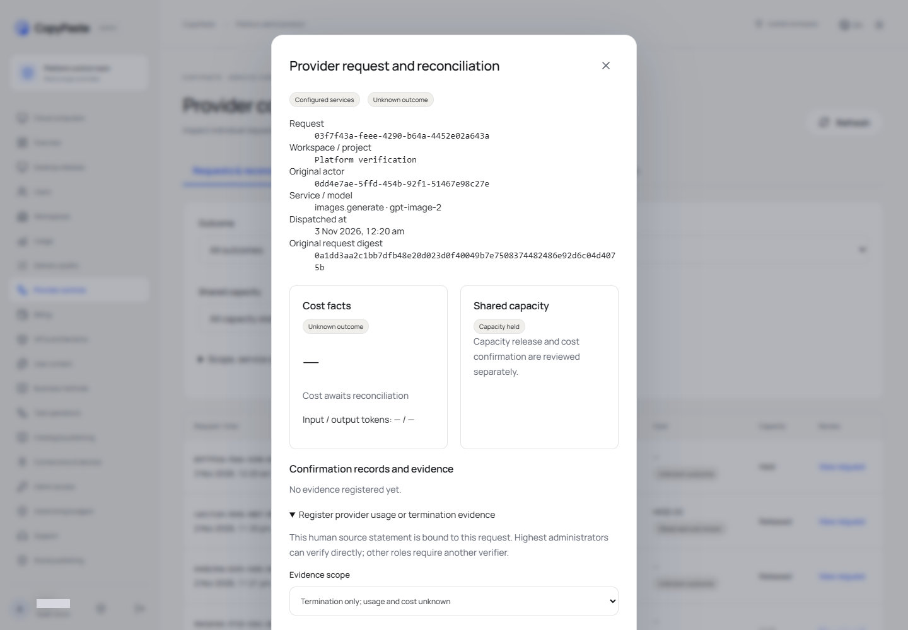
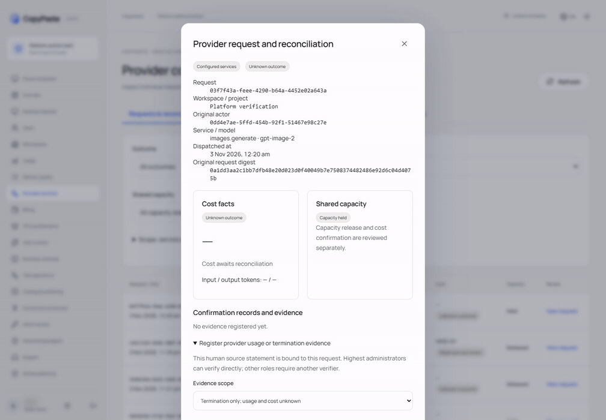

# 189 · 真实生图、问题修复与上线验收

当前后端为`real-services-189-v5`，数据库版本161；后台使用`admin-termination-189-v1`。Web为<https://agent.copypaste.hk>，后台为<https://agent-dashboard.copypaste.hk>，API为<https://ai-api.copypaste.hk>。保留历史原始记录，本文覆盖188的当前图片状态，不改写其失败历史。

## 已完成的真实闭环

1. `gpt-image-2`与当前文字模型使用相同上游与密钥，实际生成和编辑均HTTP200且完成解码。验证`a6be2e00-fb44-4915-b5bb-2145454421d4`、发布`0fcb3c37-14e8-4000-a318-d9ab02040453`。公司两次图片计量合计HK$0.02；公司费率不代表已核对供应商发票。
2. 真实Web设计师任务`76ee4703-63d0-4524-8269-ab55d3192970`，邮箱验证→独立企业／项目→执行模式和HK$5预算→云端固定Codex→一次图片生成→项目文件→实际下载和SHA-256检查通过，实际公司扣费HK$0.039961。不是后台探测或模拟图片。
3. 上游返回1254×1254，标准图1024×1024；上游原图保存为独立`.original.png`授权项目文件，下载散列和来源完全一致。原图及标准图沿用原任务隐私、保留与权限规则，只计一次生图费用。
4. 后台供应商证据可选择完整用量／发票或“仅确认终止”。实际公共页面4项检查通过。4条历史失败请求只释放有终止证明的并发占用，原状态与费用仍unknown，财务预留未释放。

## 本轮问题与实现

|编号|实际原因|修复与边界|
|---|---|---|
|F01|上游曾以分组未启用图片拒绝；复测现已返回真实图片|保留403及未知费用历史，按用户指示复测后发布gpt-image-2|
|F02|图片返回1254平方，原验证要求精确1024，导致HTTP200仍验证失败|完整有界解码后按比例缩小；拒绝损坏、非平方、低于1024或超过2048的输入，保留精确上游原图|
|F03|后台验证已走逐模型连接，但任务图片工具仍要求旧全局URL／Key|前置条件允许已安装的模型连接解析器，实际网关继续绑定原任务与冻结图片版本，不向客户端暴露Key|
|F04|图片工具失败后原生模型结束文字回复，任务被标为成功|记录固定IMAGE_TOOL_FAILED码；同一轮同一图片工具恢复成功可清除失败，未恢复则返回failed并传递业务错误码；保留已发生文字费用|
|F05|旧测试工作区被两条待核对Desktop任务占满|取消尚未开始且零费用的旧验收任务，新建独立QA工作区、HK$10信用及一天Pro；不改全局并发，不清除旧费用|
|F06|浏览器无限JavaScript阻塞协议等待超时|对协议和预览步骤执行可取消时限，并保留原生进程关闭、所属配置回收检查|
|F07|Windows连接器临时端口、原生Office首次启动、复杂可信工具结构投影导致检查失败|使用可用原生端口、一次有界新配置重试、可信结构投影；仍以业务结构验证最终参数|
|F08|旧夹具仍预期最高管理员必须找他人审批，或沿用旧暂停／版本语义|保留原件，新版本显式使用普通角色验证独立审批，最高管理员直接执行另有检查；暂停按现有已计量边界处理|
|F09|Desktop公网读取出现瞬时断线|0.7.3仅对无请求体的只读请求在网络TypeError后重试一次；写入、已有响应与取消不重放|

原始失败任务`7f7e4447-bae5-4148-a78a-811043c7b67b`当时只发生文字调用HK$0.029082，没有图片文件，仍保留原始succeeded状态作为反例，不能当作生图通过证明。后续修复由新的真实任务验证，不重写已结算历史。

## 检查与证据

后端完整运行1950项：1949通过、1失败；该浏览器超时问题随后14/14复验通过。Web28/28、后台20/20、Extension89/89、Desktop269/269及全部构建通过。图片适配48/48、逐模型图片／原图保存与测试发现36/36、真实本机协议下的生图失败／恢复2/2分别通过，不能相加当作新全量结果。

188原101项失败中，99项同标题在本轮当前套件通过，另2项暂停用例按当前“已计量边界暂停”合同更新并通过，见[逐项映射](../quality/live-acceptance-189/prior-101-failure-mapping.json)。这不代表旧断言在旧实现上通过，也不改写原日志。本轮完整运行仍保留1项失败原结果，源代码变更后采用针对性检查而未再次执行两小时全量。[完整机器记录](../quality/live-acceptance-189.json)含所有本地失败尝试的状态和原回执散列；原始私有异常、会话和录屏保留在受控`.data`。

逐模型图片测试首次错误改变了已冻结的网关URL指纹，产生1项夹具失败；修正版保持原URL，仅移除全局Key以验证独立模型连接，原失败保留。早期终止证据测试的版本／夹具初始化错误、缺少录屏FFmpeg和外网超时也按原样记录。

## 使用与配置

管理员进入模型能力，编辑模型自己的URL、API Key、模型别名和公司费率，执行真实验证后发布。用户验证邮箱并选择企业、项目，在设计师角色执行模式中填写用途、尺寸和预算，完成后从文件页下载主图和原图。图片编辑使用当前有权限的固定版本源图，仍走同一已发布图片模型。主图或原图被撤销时应由实际文件访问规则拒绝，不能绕过文件权限。供应商费用待核对时只提交确知的证据；“仅确认终止”不等于确认零费用。

## 部署与回滚

包`workmate-real-services-189-v5.zip` SHA-256 `4616896b50b077d268bd2925486ef4bef772bdcb5dc9d273114a0e1f77a43e99`，源站`/opt/workmate/overlays/real-services-189-v5/backend`。19个z前缀服务覆盖文件`zzzzzzzzzzzzzzzzzzz-real-services-189-v5.conf`。候选63079已停止，正式高位端口Web63070、后台63071、API入口63072、应用环回63073全部健康。数据库和专用代理进程、既有密码、app.env、模型加密Key及历史费用保留，没有新SQL迁移。

代码回滚使用上一189-v4覆盖，在无运行任务时切换；不删除用户数据、图片发布、未知费用、预算预留或原图。一次性打包／安装脚本不可盲目重放。明文部署说明与私有QA账户记录保存在服务器`/root/cfg/workmate/live-189-v5/deployment-note-*.txt`，权限0600；本轮QA使用OTP，没有创建密码，测试Pro到期不自动续费。已冻结安装包及134条远端基线引用保护仍有效。

## 尚未完成的真实验收

Desktop真实供应商本机任务曾出现供应商连接中断及读取失败，虽然本机权限／原生工具协议和269项检查通过，仍不能宣称本机业务全部闭环。外层公网转发仍间歇超时；源站健康不等于已修复公网链路。视频、语音／转写、Google与Meta授权缺少真实配置，SMTP按要求仍使用受保护测试收件箱；Linux原生云端程序／浏览器／Office执行器尚未取得生产资质。0.7.3只有开发构建与目录包，没有新的已签名安装器和更新渠道发布。上述缺口不被本轮图片通过覆盖。

## 实际画面与录屏

所有素材来自实际页面；GIF仅为原录像的短节选。Web素材在其他端README重复引用时仍标为Web证据，不能当作Desktop或Extension生图验收。

## English statement

Real generation, editing and a public Web Designer delivery/download completed withgpt-image-2. Per-model connection admission, strict image decoding/normalization with exact-original preservation, unknown-cost termination evidence and unrecovered image-tool status handling are deployed. The original1950-test run retains1949 passes and one deadline failure, separately repaired and rechecked14/14. Client checks/builds passed; separate runs are not summed. Actual supplier-backed Desktop completion, edge reliability, external integrations, production mail and Linux native execution remain unqualified. This is not full-product acceptance.
