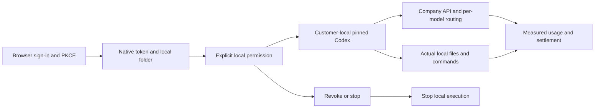
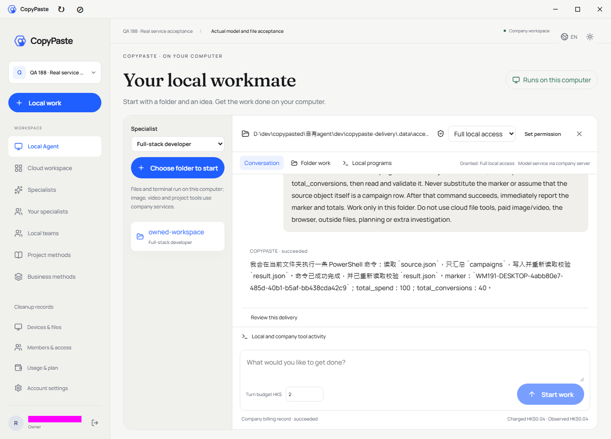
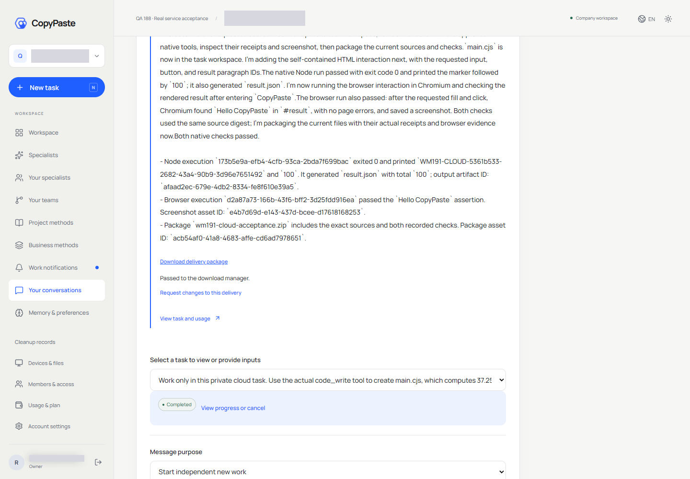

# 191 · 本机与云端执行、错误及容量修复 / Native execution and capacity repair

2026-11-03（Asia/Taipei）。02、03、04、05、07取得本轮修复及限定范围证据；12按用户指示移出。最终Desktop使用安装包默认公司HTTPS地址，经原始CONNECT通道访问真实域名，TLS证书、请求、模型结果及账务未替换；浏览器PKCE同样使用正式HTTPS域名。本次真实闭环通过，但单次验收不等于长期公网稳定性保证，190的01继续保留。 后端native-repair-191-v4、schema162已上线。Desktop0.7.4为新的未签名手动安装构建，实际测试使用其同一ASAR与固定原生运行时。此记录取代190中对应五项的旧状态，旧报告和失败回执原样保留。

|编号|修复和最终结果|验证范围|
|---|---|---|
|02|真实本机Codex完成读取、PowerShell计算、写文件、回读验证及公司结算HK$0.035144|任务`8a979c59-d778-47a2-90eb-a44c45f981d2`；总spend=100、conversions=40，随机marker保持一致；随后撤销权限|
|03|finish接受有界错误码；本地保存/重启恢复原始原因，UI优先显示本机原因|真实固定Codex断流1/1；控制器74/74；服务端错误/幂等/权限检查40/40|
|04|Linux原生Node24/API/SQLite执行可用，具备隔离和输出清单|Linux实际8/8中的相关项；真实用户任务还运行Node并生成结果|
|05|Linux原生Chromium预览/填写/点击/断言/截图及资源清理|真实云任务`f6acc29f-0a98-4150-bf8f-0a48b3e52f82`及实际下载；云任务费用HK$0.126067|
|07|结束状态与财务待对账分开；有终止证据才释放容量|原两条任务不再占名额，三条旧QA请求capacity_held=false，费用仍unknown；同一原受阻企业成功运行新任务|
|12|用户明确移出本轮|新的安装包仍为未签名手动安装；不声称完成受信签名或自动更新|

## 使用逻辑与操作边界

Desktop：登录按钮打开浏览器，邮箱登录后完成S256 PKCE；本机保存独立原生会话。选企业/项目/角色和本机文件夹，主动确认完整本机权限；本机固定Codex使用本机命令和文件，公司API承担模型接入与账务。完整权限不是云端文件桥接。撤销、停止、退出或账户变化即时切断本机权限；新的任务不自动获得授权。

长模型流曾因未锚定正则在不完整SSE长行上反复扫描而阻塞Node事件循环，使API和续租同时超时。现改为跨数据块保存游标的逐字节扫描，保留UTF-8原始字节、CR/LF边界、工具校验、事件大小限制及终态前用量持久化。实际256KiB碎片长行的完整转发和耗时上限加入回归，网关24/24通过。

周期心跳每10秒续租；它使用本地账户epoch和服务端完整鉴权，避免非必要的远程身份读取阻塞续租。单次周期请求最多8秒，连接丢失只允许在上次服务端确认的有效租期内再试一次。服务器拒绝、撤销和过期不能重试或复活任务。本机工具每次仍执行原有在线授权，付费推理、命令和任务写入不自动重放。合法且仍有效的推理请求也续租，不能续回已过期、取消或结束的执行。

错误码`LOCAL_CODEX_STREAM_DISCONNECTED`、`LOCAL_CODEX_TURN_FAILED`及`LOCAL_COMPANY_API_UNAVAILABLE`保留具体本机原因。finish严格验证错误格式，成功结果不能附错误；原始报告和散列用于幂等比较。未知用量继续显示财务待对账，本机原始原因独立保存；旧未上报的错误不补造。

Web/Extension：授权上传的文件进入云端工作区；云端Codex写源码、调用程序/浏览器工具、依据实际回执打包，用户下载交付文件。实际云任务包含同一源码散列的Node执行和Chromium交互；独立下载核对执行JSON、浏览器JSON、PNG及ZIP散列，并实际点击“Download delivery package”。Extension仍为原生右侧Side Panel，本轮未重新运行其全套测试。

下图来自实际Web下载交互录像，缩放并固定遮蔽身份标签；不是Desktop或Extension交互录像。

## Linux原生执行与部署

批准环境：Linux x64、Node24.22.2、Playwright1.64.1/Chromium1248、bubblewrap0.6.1。运行器及301份浏览器文件固定散列；安装命令为后端`npm run setup:cloud-native-linux`。它验证合同所指定的二进制并生成本地运行器清单，不能只安装浏览器而跳过服务边界。

使用独立systemd服务的Delegate=yes委派自身cgroup；Python启动器把控制进程与每项任务的执行子组分开。每项任务独立user/mount/pid/ipc/uts/network命名空间，清空环境、无capabilities、只开放自己的工作目录；程序采用Node权限及seccomp。禁止访问宿主网络/公司密钥/其他工作区和启动未批准子进程。程序内存512MB/pids32，浏览器1GB/pids128，均受CPU限制；Chromium保留原生renderer沙箱，不使用no-sandbox。

timeout、取消、父进程消失均只终止所属任务组。清理必须取得匹配的执行ID/边界、宿主停止且job_empty=true；Windows沿用已核对Job名称的回执契约。无法证明清理安全时保留受控诊断，不删除未知活跃目录。已移除早期试验创建的全局cgroup单元，最终使用服务自身委派。

当前应用路径`/opt/workmate/overlays/native-repair-191-v4/backend`；候选端口63079验证后，仅在无正在运行客户任务时切换API63073。原63070/63071/63072入口和三个正式域名不变，app.env/migration.env逐字节不变，数据库及代理进程未重启。服务仍为非root、NoNewPrivileges、ProtectSystem=strict、PrivateTmp；仅放行自己的数据/日志和自身cgroup。

schema162为新增容量判定函数，不删任务、不改余额/费率、不抹财务预留。迁移前已备份实际数据库至服务器`/root/cfg/workmate/native-191/activation-v1/`。代码回退可切回schema162兼容的native-repair-191-v3（保留旧SSE性能问题，仅应急回退）或先前v2；更早189回退须使用已准备的rollback-schema162兼容副本，不能直接使用要求schema161的旧程序，也不能覆盖运行中新数据恢复旧库。

## 待对账与容量

`task_occupies_execution_slot`以真实已存储任务验证完整行身份，普通角色不能伪造行查询其他企业。只有本机终止报告已有finished_at、无有效租期且没有仍持有容量的供应商/视频/语音/工具/设备操作，待对账任务才能退出执行占用。父团队、GEO、业务方案和计划额度统一使用此规则。

三条旧QA请求通过实际后台OTP+TOTP、终止证据注册、预览和最高管理员直接执行`ai.capacity.release`，保留不可变审计。证据仅证明公司传输及本机执行已终止，操作者为自动化维护方；没有冒充独立供应商回调/账单，也没有断言供应商计算已停止或费用为零。未知用量、金额和原财务预留继续待真实账单核对。

## 验证与已知范围

|本轮检查|结果|说明|
|---|---|---|
|后端错误/容量/续租/权限/终止策略|40/40|最终相关构建通过|
|Windows云程序/浏览器兼容及清理|38/38|最初33/38的清理失败已修复，初始记录保留|
|模型网关与碎片长流|24/24|256KiB长行逐字节一致、性能上限、既有工具和计费规则|
|Desktop控制器|74/74|含撤销/停止/退出、无响应心跳、一次有界续期与拒绝/过期不重试|
|实际固定Codex断流|1/1|真实二进制配合自有断流端点，恰好一次推理请求，无付费重放|
|Linux原生环境|8/8|真实程序、测试失败、无限循环超时、Chromium交互、API、SQLite、宿主访问拒绝与无限页面停止|
|公司真实云任务与下载|通过|HK$0.126067；ZIP、原生JSON回执、PNG及同源散列独立核对|
|公司真实Desktop任务|通过|最终ASAR `cb9b28293fcb2e0f93850201408990c5aaf7f8bfc80f31b5b4ddd59affc6e321`；HK$0.035144，本机随机输入、输出和服务端账目交叉核对|

最初真实本机任务有一次已完成业务和扣费，但验收脚本在回调页使用错误来源读取任务而失败；之后的网络、续租、Windows清理、本机输入结构误解和验收脚本撤权后过早读取界面状态等失败均保留为失败。最终测试明确输入结构并核对随机marker及独立预期值，不能用模型自报“断言通过”替代结果核查。schema迁移初次诊断曾错误使用受RLS影响的OWNER视角；最终使用CONTROL视角验证实际三条请求。

云端真实用户任务在191-v2运行；最终191-v4保留同一Linux运行器散列，并在v4已部署源码重跑8项原生验证。v3追加本机推理续租和Windows回执清理，v4修复长模型流导致的事件循环阻塞。没有把定向结果当作全产品1950项新全量通过。公网仍有间歇超时；Web真实端测经自有SSH CONNECT访问真实域名，TLS、证书、来源和响应保持原样。最终Desktop使用安装包默认公司HTTPS地址，经原始CONNECT通道访问真实域名，TLS证书、请求、模型结果及账务未替换；浏览器PKCE同样使用正式HTTPS域名。本次真实闭环通过，但单次验收不等于长期公网稳定性保证，190的01继续保留。Office/Linux限制、视频/语音、Google/Meta、全专业交付矩阵与正式运行配置仍按190原项记录。

诊断过程记录：关闭一次CPU采样时，调试表达式的动态导入触发未处理异常，导致API自动重启一次，当时自有测试任务已终止；数据库和代理未重启。该诊断路径已停用、危险历史脚本不发布。随后v4经候选实例验证再上线，调试端口关闭；最终只用只读就绪探测和实际任务复核。原始事件单独保留，未把该中断归因于用户配置。

无本地Docker、WSL或VM；本轮自建浏览器、Electron、CONNECT和源站转发结束后关闭。公司上游Key/用户密码/OTP/TOTP不进入公开报告。

[机器证据](../quality/191-selected-repairs.json) · [安装包SHA256](../quality/191-desktop-artifacts.json) · [Desktop手动下载](https://github.com/copypasteltd/workmate/releases/tag/desktop-v0.7.4) · [需求范围](../requirements/191-selected-repairs.md)

## English

Selected issues02/03/04/05/07 are repaired and verified within the stated scope. Item12 was explicitly removed. Desktop0.7.4 runs pinned Codex on the customer's computer, with browser PKCE, explicit/revocable local access, actual file/PowerShell work and measured settlement. Original native failures survive settlement and journal reload. Only periodic, non-billable renewal may retry once inside the last confirmed lease; denials, revocation and expiration stop execution. Paid inference and native commands are never replayed.

Linux cloud execution uses native Node and Chromium behind per-task namespaces, seccomp, native renderer sandbox and delegated cgroup limits. Actual Web execution produced checked sources, receipts, a screenshot and downloaded packages. Schema162 separates ended native execution occupancy from unresolved finances. Three named old QA requests had capacity released through the authenticated audited admin workflow; their cost and financial reservations remain unknown. Credentials, database/proxy processes and historical releases were preserved.

The final Desktop uses the installer default company HTTPS origin through raw CONNECT forwarding, preserving end-to-end TLS verification, requests, model output and accounting. Browser PKCE uses the canonical HTTPS domain. This real workflow passed; a single acceptance does not establish long-term public-route reliability, so issue01 remains open. Fresh suites are40/40 backend,24/24 streaming gateway,38/38 Windows cloud compatibility,74/74 Desktop controller,1/1 actual native disconnect and8/8 actual Linux checks on deployedv4, plus real cloud/download and final-build Desktop business workflows. These are separate scopes, not a new whole-product regression. Original failures remain recorded. Ordinary public reliability and other190 items are not declared complete. The installer is unsigned and manual; trusted signing and automatic update qualification are excluded.

最终补充：本轮失败QA另1条请求也经后台终止证据和审计释放容量。最后只读复核两个自有QA企业：8条待对账本机任务均不占执行名额，仍持有供应商容量的请求为0，本机任务组无残留进程；4条已释放请求费用均仍unknown，原财务预留保留。

Final observation: one additional failed QA request had capacity released through the same audited evidence workflow. Both owned QA workspaces have zero held provider requests and zero occupied execution slots; eight native tasks retain reconciliation state, unknown fees and original reservations. No native task process remains.
