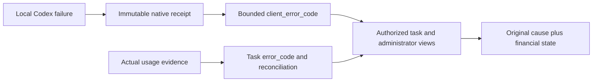

# 192 · 独立本机诊断与上线方案 / Independent native diagnostics

实际旧任务 `dddcb494-42f4-4d29-80bd-9c4bd4141176` 的原始报告含 `LOCAL_CODEX_TURN_FAILED`，但用户与后台响应只有 `USAGE_RECONCILIATION_REQUIRED`。新增 `desktop-errors.ts` 统一边界验证与固定SQL投影；任务RLS和后台/支援权限仍决定可见范围。两种原因在原页面同时展示，React仅渲染受限字符串，支援视图不扩大正文权限。

JS正则的美元锚点允许匹配尾换行之前的位置。上报和读取均增加精确空白/长度限制；SQL读取另拒绝所有空白。原报告、幂等散列、费用预留、原任务版本不改写。历史未上报错误保持null。

运行环境保持schema162、固定Codex和Linux原生隔离边界，无新增数据库迁移。Backend切换至 `/opt/workmate/overlays/native-recheck-192-v1/backend`；Web/Admin切换至同一目录的 `web/dist` 与 `admin/dist`。候选63079先验证，无运行客户任务时切API63073；63070/63071/63072和正式域名保持原入口。静态部署等待精确新HTML哈希生效，避免把优雅重载期间的旧工作进程误判为发布失败。

回滚：在无运行任务后移除192的API覆盖，恢复191-v4代码；从 `/root/cfg/workmate/native-192/static-v2/nginx.before.conf` 恢复本项目代理配置并校验/重载。两版均要求schema162；不恢复旧数据库、不回退账务、不改公司模型密钥。配置字节相同，数据库和代理主进程未重启。

Desktop0.7.4二进制和旧tag/release未替换。上线前完整Desktop流程通过；上线后任务630ce1e9-b6f2-4e3d-a386-3ad619bcccf9实际完成并结算HK$0.055477。验收包装器拒绝Windows PowerShell带BOM的JSON，原失败回执保留；独立只读复核对原始字节、源marker、100/40汇总、命令事件、API状态及实际金额核验通过，没有重新请求模型或执行命令。未来包装器192-v2只在读取时忽略起始UTF-8 BOM。v1回执中的backend_checkpoint沿用模板标签，192部署前后服务路径及新client_error_code响应独立证明实际上线版本。

The native cause is independent diagnostic metadata, not a financial decision. Deployment uses schema162-compatible code/static overlays, preserves credential bytes, and keeps original reservation and billing facts. Direct Chromium customer/admin views passed; Python direct public requests still received403, so public-client consistency remains a limitation.
