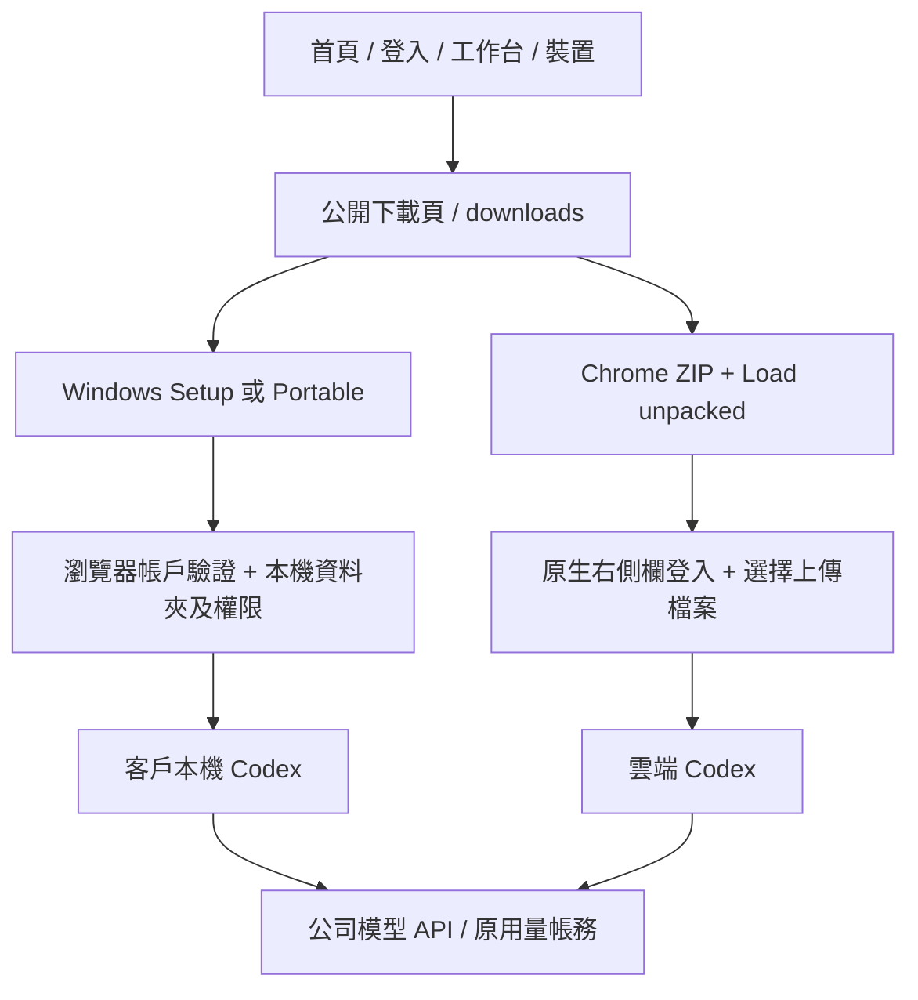

# 產品分發實現 / Product distribution implementation

原問題：現有安裝包在 GitHub，Web 未建立下載頁和導航。舊 Nginx `/downloads/` 目錄別名亦攔截 SPA，直接訪問帶斜線路徑返回 403。修正為公開 `/downloads` 頁、`/downloads/` 規範跳轉，以及獨立的 `/downloads/releases/193/` 檔案目錄。

Web 的 `contracts/product-downloads.json` 綁定版本、原檔大小及 SHA-256；頁面不推測下載地址，不以登入 token、Blob 或後台代理傳輸公開安裝包。原 Desktop 0.7.4 位元組保持不變；擴展 0.5.4 由目前 dist 建包，根目錄包含 manifest.json，保留 public key、原生 sidePanel 和正式 API 地址，排除 source maps。

上線：`prepare-public-downloads-193-v1.py` 校驗原 Desktop、建擴展 ZIP/清單；`upload-public-downloads-193-v1.py` 僅上傳 Web 靜態包及四個公開檔案；最終 `deploy-public-downloads-193-v3.sh` 校驗伺服器檔案、備份配置、測試 Nginx 並平滑 reload。Web 根為 `/opt/workmate/overlays/product-downloads-193-v3/web/dist`；檔案為 `/opt/workmate/downloads/releases/193/`。受保護備份在 `/root/cfg/workmate/downloads-193-v3/`，不隨安裝包分發。

回滾：以受保護的 nginx.conf.before 恢復原配置，使用既有 `/opt/workmate/nginx/` prefix 測試後 reload。保留原 Web/後台目錄、舊安裝包、服務、資料庫和 env。不要重播原失敗 V1/V2。

The public page and versioned files use separate routes. Existing Desktop bytes remain unchanged; the current extension is packaged as a manual-install ZIP with its stable extension ID. Four public files are served as attachments with immutable versioned caching, HEAD and Range support. Missing files remain 404 and listing remains disabled. Only the proxy is gracefully reloaded; existing API/database service identities, restart counts and configuration bytes are verified unchanged. V1/V2 deployment attempts failed before any server mutation and are retained; V3 accounts for the host's older Python and the original uploaded bundle name.
