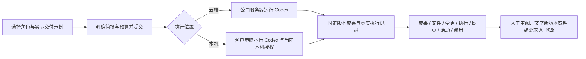
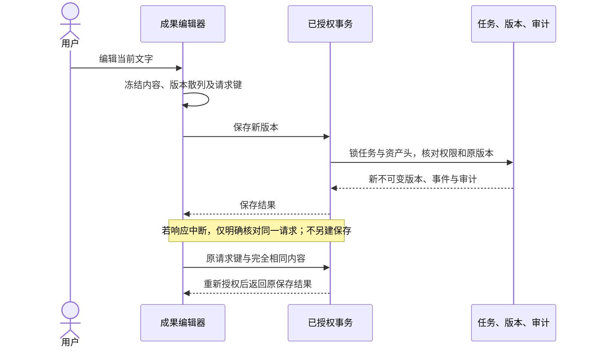

# 196 · 任务审阅与真实执行上下文 / Task review and execution context

本轮先完成全部产品代码包，再进入六端构建、统一类型检查、整批回归及真实 HTTPS/安装包联调。整轮失败记录按版本保留，修复后重跑整批；最终证据以 quality/integrated-round-196 为准。此文描述实现约束，不代替测试结果。

## 一项工作的连续使用

新建工作时，角色提示来自当前项目可使用的真实模板，展示交付格式、可选示例和依赖状态。点击示例只填入简报；提交时仍执行角色授权、方案、预算、模型等检查。依赖可用不代表客户已经认可专业质量，角色数量从目录计算。

任务成果统一提供成果、文件、变更、执行、网页、活动和费用七个标签。键盘左右键、Home/End 在标签间移动。Web 与 Desktop 共享成果审阅界面，但 Desktop 原生视图读取本机会话的事件，不将本机操作交给云端重新执行。Extension 仍为原生右侧 Side Panel，文件上传和云端任务使用原有边界。

## 云端文字编辑、比较与权限

新增路径统一位于 `/v1/tenants/:tenant/projects/:project/tasks/:task/workspace`：GET `/versions`、GET `/compare`、GET `/editor`、POST `/edit`。继承登录、租户、项目、私有任务及内容来源权限。响应为 private/no-store。读原文件后重新授权；受审查、过期、抹除、失效来源不能借旧版本或缓存继续访问。

只编辑已成功的云端执行任务；需要项目写权限，计划模式与 Desktop 原稿不在此写入。当前文件必须属于当前任务交付；历史候选只含同一资产可见的早期版本，以及授权且散列仍匹配的原交付。不能用任意 UUID 读取另一个项目或私有任务的历史。

编辑上限为 256 KiB UTF-8，拒绝二进制、无效编码、孤立代理字符及 NUL。保存保持原 UTF-8 BOM 与一致的 CRLF/LF；混合换行只读。较大文件、Office/PDF、图片等继续使用原件下载、预览或完整 AI 修改，不静默转码。

POST 校验资产版本 UUID、任务版本、交付 SHA-256、原文件 SHA-256 与内容。任务和资产头在事务中锁定，保存新资产版本、递增任务版本、写任务事件及审计；旧文件字节保持原样。相同内容为无变化，人工编辑不调用模型、不建 AI 任务、不添加模型费用。旧的交付认可随新版本失效，需重新审阅。

未确定保存使用当前分页面向用户、租户、项目、任务与资产隔离的暂存记录，明文只保存在该分页及内存；退出登录清理。界面冻结待核对内容，不自动重新发送。明确的版本或权限失败保留用户可见的文字，要求重新检查当前交付；损坏暂存停止自动恢复。浏览器禁止暂存时明确说明刷新风险。

差异为有界的逐行精确比较，按行显示新增、移除、未改动和折叠区间；HTML/脚本按文字呈现。超过 20,000 行或一百万比较单元时返回摘要与下载入口。比较额外显示 BOM/换行变化，不把字节变化藏在文字归一化之后。

## 真实程序、网页与本机文件

云端记录接口新增 `view=all|terminal|browser`；过滤条件在 SQL 分页和游标查询之前应用。网页只取 `browser_preview`，执行排除网页记录，防止仅筛选第一页后错误地显示空白。既有权限、来源散列、输出下载和截图完整性检查沿用。

Desktop 主控为新运行事件加上真实公司任务 ID，子工作也使用实际子任务 ID。界面只聚合明确绑定当前任务的命令、增量/最终输出、文件变更、图片以及浏览器工具事件。早期无绑定记录仍留在原活动，不能猜测它属于哪个任务。命令输出和记录数量有显示上限，失败与退出码保留，不把无截图的工具事件描述成实际网页预览。

新增 `result.preview` 原生调用，使用已有受信窗口与 IPC 参数白名单。主进程读取当前本机授权，规范化工作区与文件路径，检查工作区边界、撤权、有效期、身份/授权修订和读取前后文件一致性。普通权限只读工作区内；客户明确授予 full-access 后可读取范围外文件。预览最多 4 MiB 图片或 256 KiB UTF-8 文字，返回实际字节散列。数据不经该调用上传，不执行文件；撤权后拒绝预览。

本机预览明确标注为“目前本机内容”，可能与执行当时的历史差异不同。系统不宣称文件系统前后核对等同于操作系统隔离。Desktop 继续无边框、无 Electron 菜单；不改变 Codex 在客户电脑运行的要求。

## English implementation contract

The entire implementation batch precedes integrated validation. Actual role templates explain deliverables and explicitly selectable examples. The same task presents results, files, pinned changes, execution, browser, activity and usage. Cloud views filter records before pagination; native Desktop views use controller-bound local task events.

Authorized manual UTF-8 edits create immutable versions under task/delivery/file optimistic locks, preserving originals and formatting. They do not start AI or add model charges. Pending saves retain one frozen request per actor/project/task/asset; an explicit retry reuses that exact request after current authorization. Source withdrawal prevents cached access. Unsupported formats and bounded comparisons remain explicit.

The native preview IPC independently rechecks the active local grant, canonical workspace/file boundary, owner epoch, expiry and read consistency. It returns current local text/image bytes and their digest without upload. Full local access requires the existing explicit customer grant. Historical changes and current previews are distinguished. Full professional qualification, external service credentials and the entire OS/production compatibility matrix still require their own acceptance evidence.
