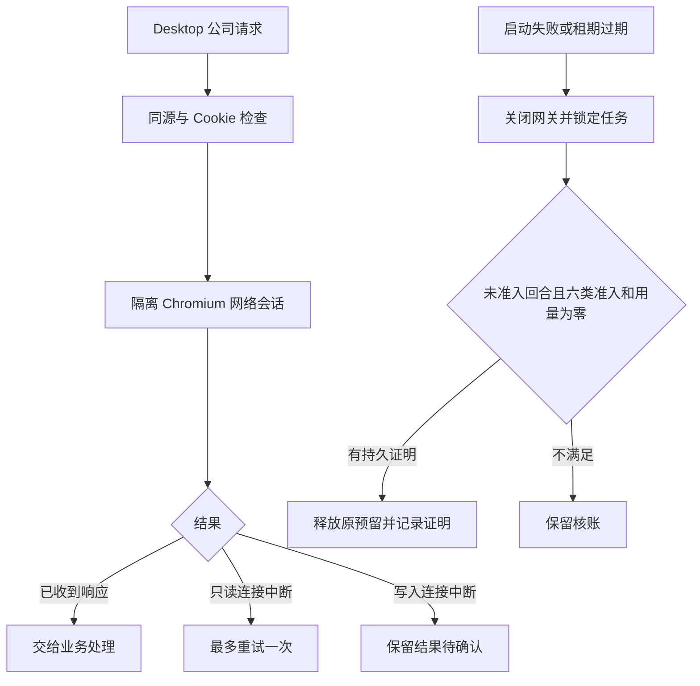

# 连接恢复与本机结果审阅：第 197 轮

本轮先完成 197-01 至 197-06 的整批代码，再统一构建与验证。截图复核发现的 197-07 耗时问题也先完成所有受影响位置的整批修正，再统一复验。原始 32 组／102 条要求继续保留，验证结果和正式验收范围分别记录。

Desktop 主进程使用独立、仅驻内存的 Electron Session。Chromium 网络栈能够使用系统代理配置；与 Node fetch 的区别见 [Electron net 文档](https://www.electronjs.org/docs/latest/api/net)。使用 `session.fromPartition` 的非持久分区、关闭缓存、`credentials: omit`、禁止 Cookie 请求头、固定公司同源、`redirect: error`，并绕过自定义协议处理器。凭据仍由主进程持有，渲染页不获得 Session 或 Token。参考 [Electron Session 文档](https://www.electronjs.org/docs/latest/api/session#sesfetchinput-init)。

统一传输层识别一组明确的 Chromium 连接错误。只有无请求体的 GET／HEAD／OPTIONS 可以重试一次；收到 HTTP 响应即停止自动重试。POST／PATCH／PUT／DELETE 失败保留“结果待确认”，不尝试另一条传输通道重发。既有登录授权码交换的原键重试约定保持不变。内部超时转换为稳定错误，调用方撤销保留原取消语义。

本机心跳属于无模型费用的租期维护，只有最后确认的租期尚未到期、账号及授权仍有效时，才可以在独立期限内重试一次。该例外不适用于模型、命令、公司工具或业务写入。远端身份接口不可用不再被误报为本地账号变更。

服务端自动核销仅适用于既有启动协议中的 `preparing` 状态。调用方先关闭公司工具／推理网关并持有任务与执行记录锁，再使用 SQL 持久证明核对当前任务、所有者、fencing token、启动次数和六类零准入记录；同时要求服务端费用与 token 均明确为零。客户端 unknown、失联或启动报错不能直接作为零费用依据。已准入执行回合仍保留待核账状态。启动阶段伪报 completed 不会产生成功结果或可交付文本。

执行页默认折叠指令与输出，退出码、失败／停止状态及截断提示保持可见。仅根据原始任务绑定事件生成记录；没有时间数据时不生成虚构耗时。当前本机文件预览继续重新验证账号、会话、实际路径和权限。Web 旧的重复软件检查面板移除，任务工作台内的执行入口继续提供原能力。

197-07 的服务端耗时优先采用有效的宿主测量；Linux 回执未提供该字段时，使用原回执规范 ISO 起止时间计算。缺失、逆序或非法时间返回 null，不能捏造为零。Web 与 Desktop 的软件检查和创意矩阵均拒绝缺失、负数、非有限值及非法耗时。

六端构建、Desktop 主进程／渲染类型检查以及 528 项相关回归已通过，后端为风险相关的选定用例，未声称完整历史矩阵重跑。最初 519 项批次和所有失败尝试仍保留；最终代码哈希清单明确注明是在复验及下载目录更新后观察，未冒称测试前快照。

最终服务器使用 `integrated-197-v2`，schema163，运行文件 2,699 个均经逐项回读。候选就绪及无活动任务检查后切换，原公司密钥、数据库及代理主进程保持。Windows Setup／Portable0.7.8、Extension0.5.6 的不可变公开路径为 `/downloads/releases/19702/`；完整公开下载均完成大小及 SHA-256 核对。原197及更早下载保持。首次带后缀的候选目录不符合既定数字目录规则，失败日志保留，按原规则修正后最终 Web 构建及两个目录检查通过。

真实 Desktop0.7.7 已完成公司 PKCE、私人文件往返、明确完整本机授权、本机 Codex 命令和文件任务、实际 HK$0.035904 结算、当前文件预览及撤权。最终0.7.8 完成真实登录和耗时显示差异复验，并逐字节验证包内全部主进程 JavaScript及原生运行时与该真实本机闭环相同；未声称0.7.8额外重跑付费任务。Extension 使用实际工具栏和原生右侧栏；Web 最终截图等待实际执行行加载后检查，覆盖七标签键盘及四档宽度。后台重新登录复查就绪状态及不可变审计证据。

实际证据、媒体、原失败及完整开放范围见 [本轮交付报告](../quality/integrated-round-197/README.md)。依照既有授权普通推送七个仓库的组件分支及 docs/main，远端回读保存于交付仓库的私有发布回执。视频、语音、广告平台真实授权、专业成果和完整生产／兼容验收仍开放；测试邮箱保留，受信 Windows 签名按要求排除。
