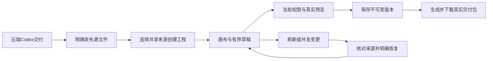

# 199 · 直接设计编辑与交付协议

浏览器与Desktop渲染层共用同一交互模型；Desktop保持本机Codex和原生权限模型。选取已交付、明确发布的共享矢量／简报来源，创建工程后可选择、拖动、缩放、方向键微调、对齐、复制图层及撤销重做。文字、图片与形状编辑受既有几何、字体、品牌和证据约束，未保存输入由真实服务器渲染器预览。

POST /v1/tenants/:tenant/projects/:project/editable-projects/:id/draft-preview要求expected_version、source_version及input，page默认1。读取当前项目权限、当前头、可用原版本与固定共享素材，重新校验输入；返回最大960px PNG、字节数及SHA-256、输入哈希、工程与版本标识。Cache-Control:no-store；不产生工程版本、资产、幂等回执、模型调用或账务写入。沿用有界渲染队列，每用户1／全局2并发，每用户4／全局16等待。客户端防抖450ms，并用取消、序号与完整请求签名拒绝迟到预览；草稿变化后不显示旧图。

变换限制在画布和描边边界，图表保留最小360×230，矩形圆角受缩放约束。撤销最多30步并受2MB序列化上限约束。会话草稿按用户／企业／项目／工程存储，保留原版本与所见服务器头，8小时、2MB、最多8份；退出清理，存储拒绝和损坏安全处理。刷新或切换后明确恢复，版本变化时需先确认；恢复前服务端复查来源，保存仍使用原幂等／版本协议。结果不明的操作保留原请求，不自动创建新任务。交付只针对当前已保存版本。

真实云端链路揭示私人任务来源发布时丢失类型。本轮发布前验证实际JSON、schema、kind、data_mode和规范化输入哈希，只复制设计类型和schema到新共享版本；原出版来源链继续记录，私人任务／会话与执行绑定不复制。设计工具也会标记普通manifest，其实际schema不匹配时仍是普通文件。已有不完整发布版本保持不变，用户可从原文件重新明确发布；不偷偷改写旧版本或重新生成收费内容。

生产任务控制锁不变。受控测试运行器只对工具尚未获准执行的TASK_CONTROL_CHANGING/409使用同一参数及请求键进行最多7次25ms重试；暂停、结果未知及上游错误均不因此重试。

[需求](../requirements/199-direct-design-editing-round.md) · [证据及边界](../quality/integrated-round-199/README.md)

English: Web and Desktop implement the same constrained direct-editing model, authorized deterministic unsaved previews, bounded account/scope-specific session drafts, explicit conflict recovery and immutable saved delivery. Publication preserves only validated source classification and original provenance, without transferring private execution bindings. The real cloud task is reconciled once; subsequent editing never invokes another model. Production locking and Desktop local Codex remain unchanged. Selected regression and transport-assisted journeys do not establish full professional or production acceptance.
