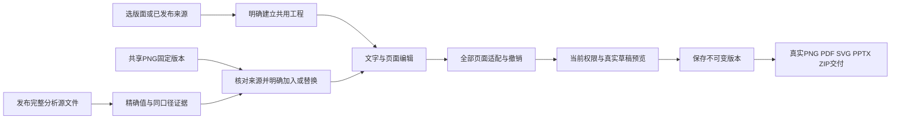

# 200 · 从版面到可核对交付 / Layout to verifiable delivery

设计工作区保留从专员来源和完整工程包接续，并新增六种可直接创建的矢量／简报版面。版面提供中英文字起点，不捏造客户图片或业务数据。建立共用工程需要明确确认，沿用create幂等键、原请求查询、审计、不可变版本和确定性渲染。Web与Desktop显式合并共享渲染代码；Desktop的本机Codex、原生权限、无边框与无菜单保持原约束。

GET editable-projects/templates返回版面目录。POST editable-projects在原来源参数之外，接受严格的name、template_id、locale、confirm_project_sharing=true；两类参数不能混用。模板创建同样经过真实字体、内容和几何校验，不直接写未经渲染验证的工程。

GET editable-projects/resources?kind=image|chart&q=&cursor=列出当前项目共用、当前环境、未过期、未隔离且来源仍有效的当前固定版本，每页20条。图片仅PNG且不超过10MiB；分析／导入证据仅结构化JSON且不超过4MiB。GET resources/:version?sha256=&offset=要求精确摘要，重新检查共享权限、实际字节数及SHA-256。图片真实解码并返回480×320有校验的预览；图表每页64条，最多12800条来源证据。响应no-store；授权文件在读取期间保持来源锁，不把私人任务目录当共用素材。

图表证据保留精确字符串和缺失原因，series_key来自服务器规范化口径。客户端最多选八条同口径值；保存和预览仍由服务器复查。口径包含指标、单位、来源、帐户、币种、时区、粒度、归因与转化定义、期间、维度字段及未核实来源标识。当前条形图只支持有界非负值；不支持的负变化值保留在原分析，合法花费／曝光等不再被整份来源中的负变化连带阻断。云端设计工具与手工工程使用同一口径函数。

明确发布analysis.source.json前，核对原文件字节、schema、环境、计算摘要、渲染绑定和有界证据结构。只复制analysis_role_schema与calculation_sha256分类，保留publication_origin_version_id与原来源链；不复制私人任务、会话、执行权限或任意metadata。分析修订读取也使用相同的完整性检查。普通带标签的manifest不被错误分类。旧出版版本保持不可变，用户从原文件重新明确发布即可产生新的可复用版本。

页面可新增同尺寸空白页，继续沿用已有的复制、删除和排序。整份作品尺寸在256–1920整数像素内调整：先复制全部页面，再按比例适配图层、字体、圆角和描边。文字12–180px、描边≤24px、图表≥360×230及所有边界必须全部成立；任一页面不满足时整次拒绝，原草稿不被部分修改。成功适配纳入同一撤销、会话草稿和不可变保存协议。保存bodyLimit与草稿预览统一为2500000字节，最终渲染仍检查实际字形／排版。

验证采用完整代码批次完成后的六端统一构建、当前相关回归及实际界面旅程。明确模拟数据与真实上游任务的区别；当前变更不要求再次调用收费模型。首次测试若因本机数据库恢复或驱动选择器失败，保留原记录，再统一调试复验。最终实测结果和公网下载边界见质量目录，不以代码完成替代原102项专业／生产验收。

English: Six editable starters use the existing authorized/idempotent create and immutable-version contracts. Fixed shared image/calculation resources are freshly authorized and checked by exact bytes/hash; previews and evidence pages are bounded and not cached. Validated analysis publication retains only source classification and original provenance, without private execution bindings. Nonnegative compatible chart facts remain usable when the original calculation also contains signed changes. Whole-document resizing is atomic, respects readability/geometry constraints and participates in undo/drafts. Existing server rendering and native local Desktop Codex remain authoritative. Evidence distinguishes simulated functional fixtures, actual deployed journeys, public transport and complete professional/production acceptance.

最后整批调试补充：预览接口的saved=false表示预览操作不写版本，不等于工程存在未保存修改。Web／Desktop画布状态与替代说明改为读取实际dirty状态，保存后显示所保存版本号，编辑后才显示未保存；原预览／权限／保存契约保持。四份共享渲染文件完成后再全端构建和两端回归，未变后端与其他端凭实际源码摘要沿用本轮原测试。
