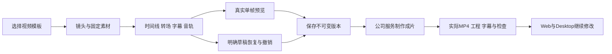

# 201 · 模板视频制作实现约束

在现有 video-projects API 上新增 templates、resources 和 draft-preview 三个路由。预览只读当前有权素材，不建立资产、不调用模型、不写费用；已有工程预览必须绑定 expected_version。响应 no-store，最多处理当前画面、前一画面和标志 PNG 的真实像素；音频仅在正式渲染时完整解码与核验。

transition 为可选分镜字段，仅支持 crossfade／slide-left，1–45整数帧且不超过该镜头一半，首镜头不得使用。缺失字段保持原序列化、摘要和 cuts-2 profile；实际带转场使用 cuts-3。预览与编码使用同一画面函数；转场内逐帧绘制，静止区间仍使用同卷硬链接节省空间。编码预算、取消、音轨、实际全帧解码和输出检查保持。

编辑逻辑采用完整工程纯函数和整次校验。时间线调整先创建副本，按镜头 key 映射时长和字幕端点，保证非重叠、非空和连续全覆盖；复制镜头时为字幕建立新 key，移除镜头时移除其归属字幕。变帧率按有理数映射绝对时间并校验精度、音轨入点及边界。拒绝后原工程不变。

草稿以用户 id、企业／项目和工程 id 分区，8小时、8份、2MB上限；新增视频草稿也绑定请求幂等键，恢复前显示原版本。显式登出清除；过期会话保留给原用户重新登入，响应仍经当前会话隔离。Web／Desktop UI 显式同步，不运行 renderer:sync。

完整批次完成后记录源码清单，再统一构建六端、相关服务／权限／渲染／包恢复和客户端测试。失败与整批修正另存，不重写已执行脚本与历史回执。真实服务、模拟夹具与专业／生产验收分别记录。

部署时必须同时提供应用服务账户可执行的原生 FFmpeg 和 FFprobe。单帧 PNG 预览不依赖编码器，不能以它或 AI 就绪端点代替视频保存／成片验收。本轮线上首次保存因缺少二进制而正确拒绝；补齐 Ubuntu 签名软件包后，需按实际服务账户运行两者并检查渲染 profile，再验收完整保存、MP4 编码／完整解码、下载与 Desktop 原工程接续。保留原凭证、数据库和代理；不修改无关软件源或重启原服务。
