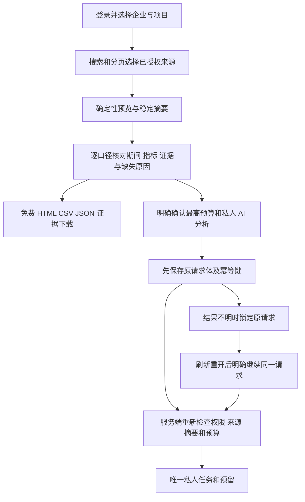

# 202 · 营销证据复核、授权交付与请求恢复

本轮覆盖当前项目的数据集和私人分析报告历史、确定性复核、精确指标、文件交付，以及付费创建结果不明后的原请求继续。全部产品代码、边界控制和计划用例先成批实现，再统一构建／类型检查、测试及真实客户端联调。原始102条需求和32组验收范围持续保留。

`analysis-review.ts` 规范化计算规格，使用稳定计算引用及 SHA-256 摘要。下载与付费创建均重新查询当前权限和当前来源；客户端摘要只能检测变化，不能授予访问权限。过期摘要返回409 `ANALYSIS_PREVIEW_CHANGED`，付费任务在校验后才入队；原幂等键的合法重放继续返回原任务。

数据集／私人报告历史使用受当前权限约束的搜索与游标分页，保留数据库微秒时间及主键排序，游标绑定身份、企业、项目与查询。默认客户端每页20条；API分页不再以100个数据集／50份报告作为完整历史。每次读取继续执行当前访问控制，游标只描述位置。搜索按字面处理，不能借 `%`／`_` 越权扩展查询。

复核组件逐个展示独立币种／时区／账号／业务范围。本期与比较期只在同一口径内并列展示，不把未知当零，不混合不同单位。精确十进制运算避免大额指标经过 JavaScript 浮点舍入；展开指标可核对原始精度、公式、来源行、对应期间与缺失原因。支持筛选、排序及全部口径分页；重叠或不等长期间明确说明。

证据导出为确定性 HTML／CSV／JSON，完整保留所有口径和固定来源，不创建 AI 任务或费用。HTML 转义且禁止脚本／外部请求，CSV 防公式注入，内容最多8MiB并附响应长度及 SHA-256。Web 逐块有界读取且保持会话隔离。Desktop 仅为精确的当前项目导出路由开放有界 POST；主进程验证请求、身份代次、完整摘要后，经原生保存对话框原子保存，不开放任意 POST 下载或任意文件路径。撤换会话会中止写入。

实际原生验收发现，公网 HTML 被插入367字节统计脚本而原摘要未变，原生完整性检查因而正确拒绝保存；同一来源的 CSV／JSON 字节一致。整批修正仅在应用响应中为下载或带摘要的 HTML 保留原缓存指令并追加 `no-transform`，覆盖同类 SEO／资源 HTML 下载。继续保留原始字节、长度、摘要、权限检查及失败回执，不通过关闭校验或修改反代解决。[Cloudflare 官方说明](https://developers.cloudflare.com/web-analytics/faq/)支持该响应指令；修复效果须以最终真实客户端字节复验为准。

付费请求先在按使用者／企业／项目分区的会话存储中持久化原始请求体和幂等键。保存失败时不发出付费请求。连接中断、5xx 或会话变化后保留未知状态并锁定编辑；刷新、重开只允许明确继续原请求，不自动重发，不通过过期自动生成新键。明确失败后才解除锁定并要求重新复核；登出清理当前会话状态。

Web／Desktop 使用相同复核和恢复逻辑；Desktop 保留客户本机 Codex、可授予及撤销的完整权限、无边框及无 Electron 菜单。Extension 保持原生右 SidePanel、明确选文件后读取上传、云端 Codex。所有 AI 请求使用公司 API；每个模型的上游 URL／key／别名／费率仍在 Admin 配置。

服务器发布遵守本轮新增的网络限制：沿用现有端口、既有下载 alias 和静态入口，只切换 Workmate 应用及其目录。不得改写或重载 Nginx，不修改 DNS／路由／防火墙／系统代理。记录发布前后配置文件和实时路由／规则／防火墙指纹；保留上版应用目录和下载包，继续核对原凭证以及数据库／代理进程。

构建、各次失败与整批修正、相关断言的准确来源、实际隔离和正式 Web／最终 Desktop、内外网完整下载、网络指纹及全部原始需求见[本轮交付回执](../quality/integrated-round-202/README.md)。视频／语音及 Google／Meta 实际配置、全角色专业样本、完整机器／大文件／长稳／容量／灾备与 WorkBuddy 同题盲测保留原范围。

English: Complete source implementation precedes integrated verification. Current-authority search/cursors, stable deterministic review digests, exact evidence and bounded HTML/CSV/JSON exports connect to an explicitly authorized private AI request. Persist the exact request/key before submission; unknown outcomes lock editing and resume only by explicit replay of that original request. Native saving verifies current session and content hashes. Deploy only the owned application using existing ports/static/download paths; preserve all server network settings. The linked report identifies actual evidence, retained failures and remaining original acceptance.
