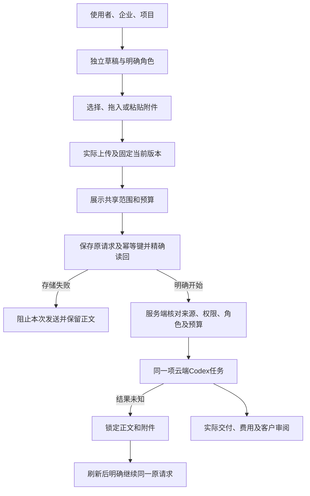

# 203 · 专业角色输入、付费请求和原生运行时

Web新工作使用已有公司云端Codex任务入口。Desktop继续在客户本机执行Codex，原生登录、权限、程序运行、撤销和文件保存实现不因共享复核组件调整而被替换。Extension继续使用Chrome原生右侧Side Panel；本轮不重打其无产品变更的0.5.7ZIP。

`work-attachments.ts`只接收至多20个不同的版本标识、素材标识和显示名；这些信息不授予权限。新工作只选用项目共享素材的当前版本。服务端仍在创建和执行前核对当前版本、企业／项目、保留期限、来源状态与角色工具权利，不自动换用后续版本。常规私人会话保持既有私人附件范围。

上传队列变化同步阻止提交。新工作组件按使用者／企业／项目重新挂载，提交准备和发送前再次检查范围。已经提交但响应未知时，固定保存原正文、预算、来源及幂等键，禁止编辑后悄悄另收费。明确验证拒绝可修正；网络及未知结果保持原提交。浏览器存储异常或写后读回不一致时，发送前即阻止；不得把内存缓存描述为可跨刷新恢复的安全付费依据。

共用复核弹窗通过明确的`wide`尺寸获得空间，普通弹窗保持标准尺寸。双轨标签不拆字；筛选器和证据块依据自身容器宽度重排。文档不以源码选择器检查替代实际布局、双主题、双语和原生导出证据。

真实角色测试发现，历史应用发布把`backend/.data/cloud-program-host-linux`及`cloud-browser-host-linux`保留为符号链接，而原生完整性检查要求实际目录。修正只将这两个应用目录替换为原已核验文件的精确副本，保存原链接与目标。沙箱、cgroup、安全策略、服务器网络和其他业务均不因此调整。后续后端发布必须保留真实目录，核对当前发布根目录下的清单、host/source/profile和文件摘要；旧发布的成功记录不能代替新路径的实际执行。

真实角色样本覆盖12类，每次新任务预算HK$5；原始失败与关联修正的实际费用分别保留，不将12类误写为最多12次付费调用。原已终结但工具失败的样本单独保留，新修正任务通过父任务关联。方案并发上限保持原样，明确未获准的原提交可保留原内容／键后顺序运行；修改了简报则使用新键，未知请求不得自动重发。等待时区的原信息设计任务通过正常输入接口补充QA作者确认的Asia/Hong_Kong，沿原已计量检查点继续；最后一项回答按既有策略自动排队，不新建替代任务。原始服务端runtime／Skill绑定、事务工具回执、真实文件内容及费用用于核查。模型声称“通过”不是执行证据；这些样本不能自动记为管理员专业角色验收或客户设计签收。

本轮脚本入口：正常产品用例使用Web／Desktop的`scripts/run-current-tests-203-v1.mjs`及各仓库既有测试入口。统一构建验证结果以Delivery的`.data/integrated-203-v2/verification.json`为准；原并发超时保留在v1，不删除失败用例。隔离界面最终驱动为`qualify-specialist-intake-203-v5.mjs`，真实线上／最终原生界面为`qualify-live-marketing-review-203-v4.mjs`；两者不能互相代替。真实角色最终补充入口为`qualify-specialist-roles-203-v4.py`：仅继续原输入检查点、修正已终结失败和此前明确未获准的样例，不重复八项已通过角色。早期v1/v2/v3和诊断脚本作为历史证据保留，禁止用其旧入口重写原始结果或重复付费。各报告均保留明确范围、当前结果和未通过项。

部署继续使用现有端口、静态目录入口和通用下载映射。Web通过自己的静态文件链接切换更新，不写入或重载Nginx，不改DNS／hosts／路由／防火墙／代理。应用运行时目录、发布包和Web都保留回退依据。发布前后核对原9份网络配置、实时路由／规则、原凭证以及数据库／代理进程。详细证据以[本轮核查](../quality/integrated-round-203/README.md)为准。

English: Specialist/default-assistant intake now uses explicit pinned shared attachments, actor/tenant/project-bound drafts and exact durable request/key readback before paid dispatch. Unknown outcomes retain the original request across reload; storage failure blocks dispatch. Desktop's local execution and native authority remain distinct. Wide evidence dialogs respond to their container width. Native cloud runtime folders are materialized from exact previously verified bytes instead of forbidden symlinks, retaining their original security checks and rollback links. Controlled real role samples prove their stated functional execution and files only, with bounded original fees; they do not certify professional customer quality. Application-only deployment preserves all server networking and original acceptance scope.
