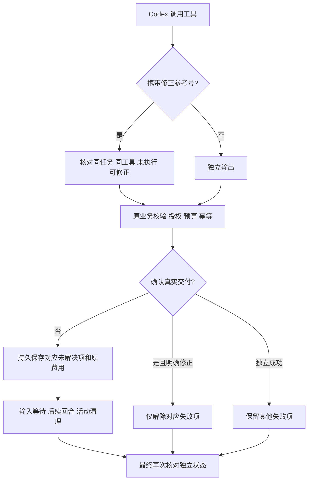

# 逐次调用交付实现 / Call-scoped outcomes

本轮先盘点全部 102 条需求、32 组开放范围及六端源代码标记，再冻结产品代码、用例和部署方案，统一构建与调试。原始失败、已执行脚本和已应用迁移保留原字节。

云端使用 `RuntimeToolLedger`，以失败调用 `failure_ref` 表示未完成义务。模型可在明确未执行的校验失败后，使用 `_workmate_repair_of` 指向该任务、同工具的原义务。运行层先验证关联并移除此控制字段，再交给原业务校验与幂等逻辑。正常的独立输出不解除任何义务。控制字段不进入业务参数摘要或费用授权。

修正参考号错误时，若该工具已有待处理项，只写入安全的 `runtime.tool.repair_rejected` 诊断，不凭空增加另一份输出义务；向 Codex 返回的候选参考号仅来自当前任务、同一工具、明确未执行且可修正的项，并限制数量。没有既存项的无效控制参数仍属于执行前校验失败。结果未知的原调用不能降级为可修正项，修改参数也不能重复创建同工具的另一笔未知操作；查询原作业与收据的工具仍按原规则使用。

schema166 新增受 RLS 约束的 `task_tool_outcomes`。活动事件与状态更新在同一事务内提交；失败修正继续同一义务，成功仅解除精确关联项。历史事件按升级前的语义导入最后未解决项，不回写历史任务状态或费用。活动清理不删除此独立状态。客户只能读取当前有权访问任务的安全元数据。

任务查询和成果工作区返回同一 SQL 快照内的失败摘要与事件位置。SSE 携带独立 `activity_id`；继续使用原 `seq` 接续流，显示及摘要比较使用数据库活动身份，避免与 Desktop 分页混用。界面最多展示四项，并标明其余数量；读取有界摘要不取原参数、密钥或原始错误。

音视频业务边界和云运行层均核对真实完成状态。原生 Desktop 也在报告公司工具完成前独立核对；本机 Codex、授权、原生登录和无边框实现保持各自原生路径。本轮并未宣称原生全部本机工具已获得新的逐项持久恢复协议。

New cloud checkpoints pin outcome protocol2 and decorated server-owned tool declarations. Legacy checkpoints keep their original declaration fingerprint; no old native thread is silently rebound to different Skills or business tools. Recovery controls are validated before business execution and never grant permissions or spending authority.

A rejected correction reference records a diagnostic without inventing an extra output when an original obligation already exists. Bounded correction candidates belong only to the current task and tool. Unknown outcomes remain monotonic and block another same-tool operation even with changed arguments; existing status/receipt tools remain available. Duplicate failed call identities are idempotent in memory and PostgreSQL.

The forward migration adds metadata only. Application activation backs up the existing database with the already installed PostgreSQL18 client, proves candidate readiness and retains an application fallback compatible with the additive schema. Server network files, live route/firewall rules, existing credentials and database/proxy processes must match their recorded baseline. No DNS, proxy, firewall or tunnel changes are authorized.

当前验证与部署结论以 [205 轮回执](../quality/integrated-round-205/README.md) 为准；本说明不预先宣称测试通过或上线完成。
