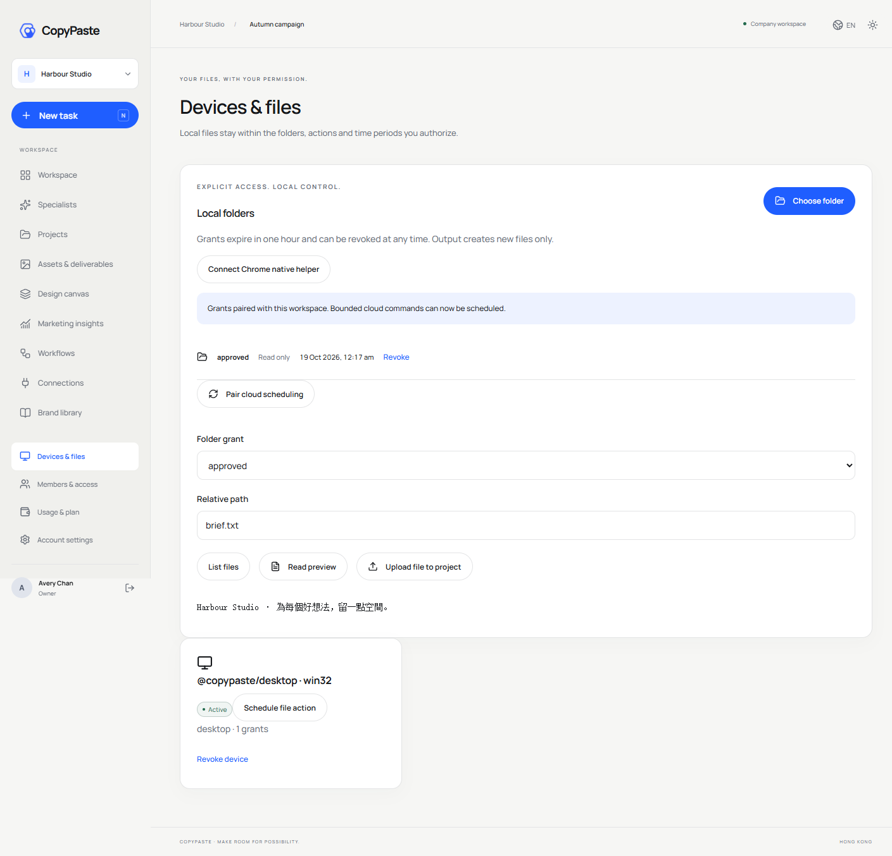
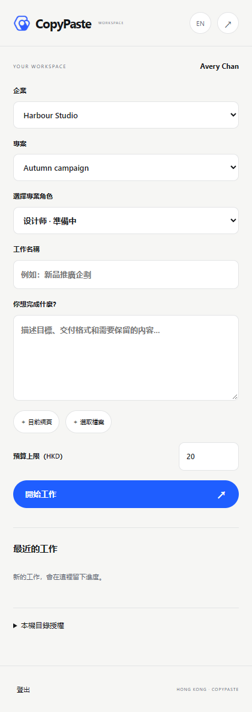

# 产品实现验收与交付记录

<!-- extension-folder-stage119 -->
Extension 0.5.1 新增独立浏览器资料夹核对、私人会话可恢复上传及相对路径索引；客户另按发送后才调度云端 Codex。发布使用 V2 切片 proof 核查及八分支非强推。详见 [方案](../technical/119-extension-selected-folders.md) 与 [准确证据](../quality/extension-folder-checkpoint.json)。

<!-- native-pairing-stage118 -->
Desktop 0.7.1 已加入持久配对、精确创建重试、先于创建的退休、旧设备失败停止、账户迟到响应隔离及未知设备的卸载清理。SQL128 为向前迁移；完整产品、公司签名安装版本及真实模型验收继续保留。详见 [实现方案](../technical/118-recoverable-native-pairings.md) 与 [准确证据](../quality/native-pairing-checkpoint.json)。

<!-- desktop-removal-stage117 -->
Desktop 0.7.0 已接通原生确认、本机 Codex／文件／程序／浏览器撤权、设备签名云端断开、Host 退出与注册归属检查、可选安全缓存清理、Windows 卸载钩子及重新 PKCE 登录。离线与未验证结果保留加密待发回执。公司签名已安装产品卸载／升级和原始完整产品验收仍未证明。详见 [实现方案](../technical/117-desktop-removal.md) 与 [准确证据](../quality/desktop-removal-checkpoint.json)。

阶段 88 当前增量：客户本机批准的固定程序、结构化参数、原生进程树及停止/撤销、父进程退出清理、原费用回执；浏览器普通打开与弹窗统一每任务三页/每执行器两个活动上下文，实际销毁后释放、复用前清除存储；会话等待不锁住其他会话的新建和操作。68 项打包 Desktop、114 项 Desktop 单元、18 项原生 Codex、184 项客户端、91 项相关后端及 6 项严格声明检查通过。模型和部分原生对话框决定为明确假数据；完整产品、至少十二个合格角色及 G01–G10 仍未验收。 见[方案及边界](../technical/88-approved-local-programs.md)。当前源码和已发布版本分别以本阶段检查点、最终提交及远程回执为准；下文保留历史阶段原范围。

**阶段 87 历史范围：** Desktop 目录监听、稳定快照、持久批量队列、原轮次客户回答、实际应用重启后暂停、原线程/固定版本继续、独立费用和预算/撤销已有限定验证。57 项打包 Desktop、91 项 Desktop 单元、161 项客户端单元通过；原 50/69 项保留。紧凑摘要分行及页面 Home/End 修复已核对；输入框保留光标操作。全部 14 个运行素材/许可证保留，仓库媒体不进入运行 ASAR。本阶段不新增 API/SQL；沿用阶段 86 未变化后端/Web/Admin/Extension 的历史 1023/25/36/14 范围，不宣称完整套件重跑。REQ-040/042 更新部分，原 102 项为 86 部分／16 未证明完整／0 完整验收；至少十二个专业角色和 G01–G10 继续开放。见[当前方案与精确证据](../technical/87-desktop-folder-work.md)。

下文保留原规范和各阶段历史记录；历史「当前」及阶段专用命令仅解释其原始回执。新发布流程使用本阶段检查点、文档/媒体核对和提交清单。

**阶段 86 历史基线：** 共享配置草稿/精确预览/不可变发布、新工作固定版本、旧任务保留原版或原先无配置状态，已在实际 Web、原生侧栏及本机 Codex 核对。本机三次执行采用 v3/v3/v4，资料工具与本地原字节、各自费用结算均检查。侧栏聊天附件先建立本人私有会话，分片校验与精确恢复回执不回退共享；同项目另一编辑者不能列出、下载、读取版本或访问私有会话。独立 Admin 正文/费用权限与隔离/恢复/永久擦除继续生效。平台 1023（保留原 1001）、核心 25、兼容 36、客户端 139、实际 Web/Admin/侧栏 14、打包 Desktop 50 分别通过，选定源码精确相符。SQL103 增量保留 SQL001–102 和四份历史契约；487 配置路由加 1 条条件 demo 路由。REQ-065 更新为部分验证，原 102 项为 84 部分／18 未证明完整／0 完整验收，G01–G10 和其余全部差异保留。假模型证据不代表真实专业质量。见[当前方案与限定证据](../technical/86-shared-project-guidance-and-private-chat.md)。

以下保留既有规范及历史记录；阶段专属命令仅解释当时回执，当前增量以前述方案、检查点和发布流程为准。 Existing specifications and historical records follow. Stage-specific commands explain their original receipts; the current increment uses the guidance, checkpoint and publication flow above.

**阶段 85 历史基线：** 原任务中的音频提案需原客户以当前登录会话独立确认精确内容和公司报价；默认不勾选，权利依据/用途为空。模型与 Admin 不能代签。拒绝、截止、停止及撤权阻断派发，撤回阻断交付但保留真实或未知费用。新增 SQL102，保留 SQL001–101、四份已发布契约及旧角色/Skill。平台 1001（全部原 988 用例保留）、核心 56、兼容 80、客户端 124、真实 Web/Admin/原生侧栏 13、打包 Desktop 41 分别通过；全部选定源码摘要精确相符。Desktop 保持客户本机 Codex、主动可撤销全权限、无边框/菜单，无可见纵横滚动条，保留滚轮/键盘/末项焦点及真实进度。原生右侧栏保持云端 Codex 和获准文件上传。真实声音/粤语质量、后台音频发行和未知 POST 外部证据结算仍保留；原 102 REQ/102 TC 为 83 部分／19 未证明／0 完整验收，G01–G10 不变。见[当前方案与限定证据](../technical/85-audio-rights-and-administration.md)。

**阶段 84 历史基线：** 公司内部配音/文件转写、原始音讯和真实字幕时间、无 AI 的版本修订、共享预算与未知费用保留、来源门控及独立后台正文/费用权限已在明确假数据下局部核对。平台 988 项保留原 968 项，音频/网关 43、兼容 80、客户端 124、真实 Web/Admin/原生侧栏 10、打包本机 Desktop 40 项分别通过。新增 SQL101，SQL001–100 和两份原 OpenAPI 保持。Desktop 本机 Codex、可撤销全权限、无边框/菜单、无可见纵横滚动条，保留真实滚动、键盘、缩放后焦点与真实进度。原生侧栏继续云端 Codex 与获准文件上传。真实音质、独立人工声音授权、音频能力后台发行及未知 POST 专属对账仍待补齐；原 102 REQ/102 TC 保持 83 部分／19 未证明／0 完整验收，G01–G10 保留。见[方案与限定证据](../technical/84-internal-audio-production.md)。

**阶段 83 历史基线：** 固定 GEO 问句和完整 Agent/skills 配置、独立 Codex 重复运行、私有原始回答与真实 JSON、人工消费者样本单独声明及后台来源治理已局部核对。平台 968 项保留原 946 项，专项 22、客户端 124、真实 Web/Admin/原生右侧栏 13、打包本机 Desktop 37 项分别通过。SQL100 新增，SQL001–099 与原 OpenAPI 保持。Desktop 本机 Codex、主动可撤销全权限、无边框/菜单、无可见纵横滚动条，保留滚动/键盘/真实进度；GEO 明确在浏览器打开，本机 GEO 协议仍待实现。原 102 REQ/102 TC 保持 83 部分／19 未证明／0 完整验收，G01–G10 保留。见[当前方案及证据](../technical/83-reproducible-geo-observations.md)。

**阶段 82 历史基线：** 精确素材版本与用户明确确认的广告级身份、独立口径反馈、实际 JSON 下载／模型读取继承来源、撤销和保留期清理已局部核对。平台 946 项保留原 929 项，专项 17、兼容 43、真实 Web 4、打包 Desktop 36 项分别通过；SQL099 新增，SQL001–098 及原 OpenAPI 保持。Desktop 本机 Codex、无边框、无可见纵横滚动条，保留实际滚动／键盘／真实进度；原生 Side Panel 为云端 Codex 和文件上传。102 REQ/102 TC 保持 83 部分／19 未证明／0 完整验收，G01–G10 保留。见[当前方案及证据](../technical/82-confirmed-creative-feedback.md)。

**阶段 81 历史基线：** 后台视频模型不可变配置、16 案例异步验证、原作业恢复、费用核对、独立审批、发布及回滚已在明确假服务和真实 MP4 下验证。平台 929 项（原 912 项保留）、兼容 106、契约 7、真实后台页面 7 项分别通过；新增 SQL098，SQL001–097 与两份原 OpenAPI 保持。Desktop 本机 Codex、无边框、隐藏纵横滚动条并保留滚动／键盘／真实进度；原生侧栏仍是云端 Agent。102 REQ/102 TC 保持 83 部分／19 未证明／0 完整验收，G01–G10 保留。见[当前方案及证据](../technical/81-managed-video-capability-releases.md)。

**阶段 80 历史基线：** 生成式视频原作业、共享预算与未知费用保留、取消/对账、真实 MP4 和三端预览；Desktop 设置紧凑、无边框、无可见纵横滚动条且保留滚动/键盘与真实进度。平台 912、专项 60、客户端 69、打包 32、Web/Admin 5、侧栏 9、本机监督进程 17 项分别通过，模型与媒体内容为明确夹具。SQL097 新增，SQL001–096 与各原 OpenAPI 字节保留。原 102 REQ/102 TC 为 83 部分/19 未证明/0 完整验收，G01–G10 保留。见 [方案和证据](../technical/80-generated-video-jobs.md)。

**阶段 79 历史基线：** 不可变品牌版本、固定专家/云端设计任务、真实字体/价格/渠道/期限检查与来源治理；Web/打包 Desktop 品牌表单已实际执行。平台 874、客户端 68、打包 30、品牌 Web 4、Web/Admin 4、原生侧栏 8 项分别通过。SQL096 为新增迁移，SQL001–095 与原规范各自字节保留。原 102 REQ/102 TC 为 82 部分/20 未证明/0 完整验收，G01–G10 与 TC-056 仍未证明。Desktop 保留本机 Codex、无边框、真实进度及无可见纵横滚动条、可滚动和键盘访问。见 [方案与限定证据](../technical/79-versioned-brand-production.md)。

2026-10-22 的 [CLIENT01](../requirements/03-client-execution-amendment.md) 已增加 Desktop 本机 Codex/完整权限与 Extension 对话附件体验的明确条件。当前代码未完整达到，详见 [方向审计](client-direction-audit.json)；本页及既有录屏只证明其原执行架构与版本，不代表这些补充条件已经验收。

版本：1.6 · 2026-10-18 · 范围：0.1.0 本机原生实现的历史留存；当前版本见 [0.2.0 验收](05-persistent-work-acceptance.md)。原始具体结果随 [历史机器汇总](versions/0.1.0/implementation-evidence.json) 记录；六仓库、启动与详细边界见 [实施清单](../technical/12-implementation-and-repositories.md)。

## 1. 完成的检查类别

| 检查 | 实际执行与证据 |
| --- | --- |
| 六仓库类型/构建 | 各仓库真实 npm typecheck/build，非仅 lint 或空脚本 |
| 平台 27 项逻辑/集成 | 真实 PostgreSQL、登录/隔离/并发费用/权限/VIP/内容/设计/源代码包及 Codex 回合 |
| Desktop 3 项逻辑 | 路径与 create-only/撤销/重放、固定 API origin、实际 Windows DPAPI 跨进程与篡改拒绝 |
| Web/Admin | 浏览器真实邮箱登录和初始化、13 工作区模块、16 后台页面、PNG 上传/图层/缩略图、SVG/PNG/MP4、CSV/流程及费用/VIP |
| Chrome | 实际 unpacked MV3、chrome.identity PKCE、文件上传、token 存储边界、退出 |
| Windows Desktop | 实际打包应用、真实 PKCE/凭证、目录读取、签名命令闭环、Native Host 帧与来源 allowlist、grant 撤销 |
| 安装产物启动 | 真正 isPackaged、版本和窗口截图；Setup/Portable 构建但未自动替用户安装 |
| 生命周期 | 原生启动/关闭所有项目进程，保留原有 5173/5174 服务，释放本次浏览器资源 |
| 源码与产物恢复 | 11 项 SHA-256/大小、三个 ZIP CRC 和入口、六个 Git bundle 真实离线克隆与提交/tree/干净 checkout |
| 文档 | 相对链接、102 条追踪、契约/schema/示例和品牌来源的静态校验，单独记录 |

脚本和原始报告位于 delivery 仓库的 `scripts/`、`evidence/`；汇总只引用实际执行结果。平台和 Desktop 的功能测试是 30 项，不是原设计的 102 个综合验收全部通过。

## 2. 关键逻辑覆盖

邮箱 OTP 单消费者、五次失败耗尽、过期/已消费拒绝；Origin/CSRF/会话撤销；用户与 Admin/native audience 隔离；PKCE verifier/回调与 refresh 重放/退出撤销；跨企业及项目权限和 PostgreSQL RLS；邀请邮箱/项目范围与最后 owner；费用只读预览、幂等重放、并发预算预留、确认付款引用全局唯一；VIP 实际到期、冻结套餐、并发任务限制与钱包独立。

后台测试独立核查用户列表不能继承消耗权限、显式项目 deny 限制汇总、余额字段脱敏、内容隔离同时影响 API/RLS、版本冲突、导出下载重验、批量封禁撤销会话、不能发布可执行内核覆盖、授权不能超过金额/批次数/到期、不能自授权或撤销最后永久超级管理员。

图像版本测试使用真实项目 PNG 合成，拒绝其他项目引用；resvg 和 FFmpeg 实际输出 PNG 与探测合格的 H.264/AAC MP4。软件工具核查路径、CAS 编辑和真实 ZIP manifest。真实 Codex 进程在本地受控 Responses SSE fixture 中执行工具请求并统计已观察 token，测试网络没有回落外部模型。另一真实进程测试在初始化 RPC 尚未返回时取消，核查即时拒绝、未接受模型任务及子进程关闭；Windows 临时文件锁使用有限清理重试，不改变协议断言。

Desktop 核查授权目录根 `.` 的列表、越界/ADS/保留设备名/junction 拒绝、create-only、过期/撤销先于重放。实际打包 Host 与主程序共享用户级加密 vault；Windows GUI 标准输入问题通过独立 Node-mode Host 解决，没有以协议样例替代实际帧收发。

## 3. 本轮修复的实质问题

实现过程中发现并修复：OTP 并发消费、原生 refresh 退出撤销、重复付款引用、个人 VIP 规则冻结、并发任务限额、后台项目 deny 汇总与消耗字段泄露、内容元数据版本冲突、目录根路径拒绝、Electron ESM ready 启动死锁、并行 Chromium 加密状态不一致、Windows GUI Native Messaging stdin、原生数据库中文路径和进程关闭，以及 Codex 初始化请求取消等待的问题。

最终结果只包含修复后重跑的报告；失败截图不作为交付成果。没有用扩大权限、跳过 MFA、关闭 RLS、取消费用约束或伪造成功结果规避问题。

## 4. 实际页面证据

下图来自运行中的应用，使用虚构 fixture 企业/邮箱与本机数据库。营销素材由用户指定生成工具制作，再通过真实上传、版本引用和渲染产生作品；并非生成式图片冒充 UI 截图。

## 5. 没有被本轮检查证明的事项

- 公司内部 AI 网关尚缺精确 Base URL、模型别名、服务端密钥和费率，没有实际模型/Images 的公司联调资格；不把本地受控 fixture 当真实业务能力证明。
- 18 个角色与 28 个 Skill 包已安装并校验，但逐角色真实任务、修改和异常验收仍 pending_live_validation，不能据此宣布至少 12 个已准入。
- Google/GA4/GSC/Meta 的真实账号授权与完整生产报表、S3 bucket、真实 SMTP、在线支付收单未完成生产联调；付款 UI 只记录人工确认凭证。
- SSO、云计划调度、并行团队 Agent、完整分层记忆/会话增补、协同编辑、完整 AI 视频/语音、客户代码强隔离等长期功能尚未全部实现；各模块的具体已实现子集见实施表。
- 不具备生产负载/恢复演练/SLO、全部操作系统、完整 WCAG、跨字体授权、所有边界故障注入的验收结论。Windows 构建未签名、未上架、未正式部署；生产原生账号/ACL/网络限制需另行落实。

原 `test-cases.json` 和角色资格目录保留设计 not_run，不因本轮代码测试而批量改写。后续应逐条对照完整前置、故障与证据再认定；v1.5 历史设计审查也继续保留其原始时间语义。

## 6. 复现与后续发布

在 delivery 执行 `npm run verify`，再按 README 执行 Web、扩展、打包 Desktop QA；每项在 finally 释放自己的浏览器/进程。主文档静态核查在根运行 `python -X utf8 docs/tools/validate_docs.py`。公司网关联调只使用服务端环境密钥，不在聊天/README 粘贴 Key，不使用个人素材工具凭证替代公司生产网关。

所有仓库保持独立 Git，提交 ID 和 Windows 二进制校验值进入最终发布清单；这项交付不自动推送远端或部署。

集中产物位于 `dev/copypaste-delivery/release/`，六仓库可分别从 bundle 离线克隆。全部文件和离线恢复的实际结果见 [历史恢复检查](versions/0.1.0/release-restore-check.json)；提交、证据哈希和发布产物也汇入本节开头的机器汇总。源码检查包含双语 README 链接/图/截图、仓库边界、本机真实密钥排除和来源哈希；这并不等同完整漏洞审计。
