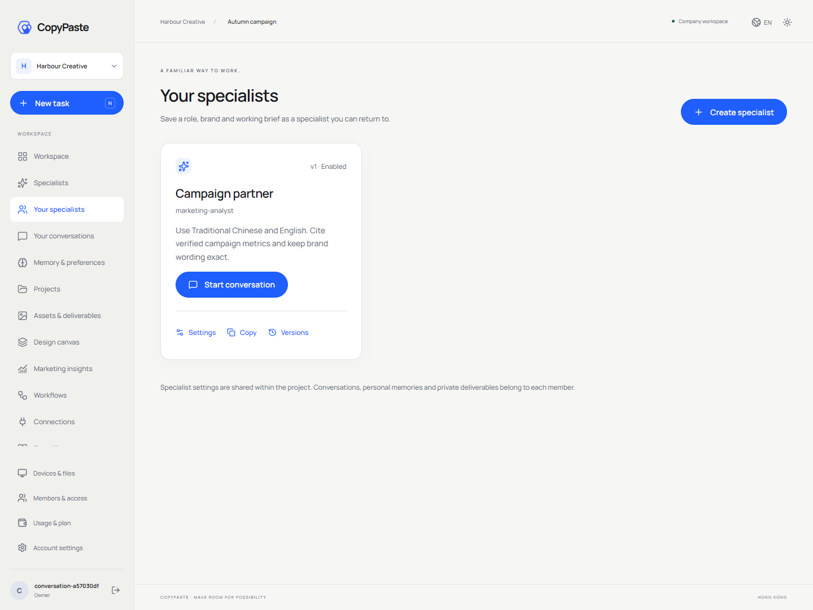
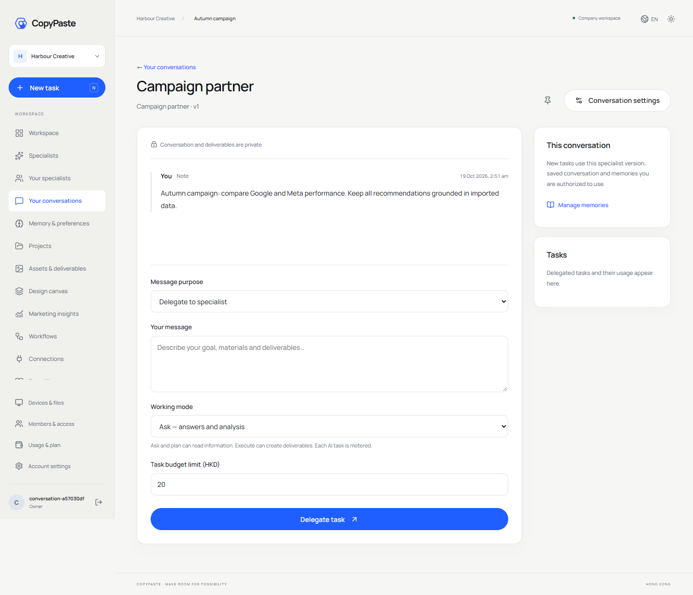
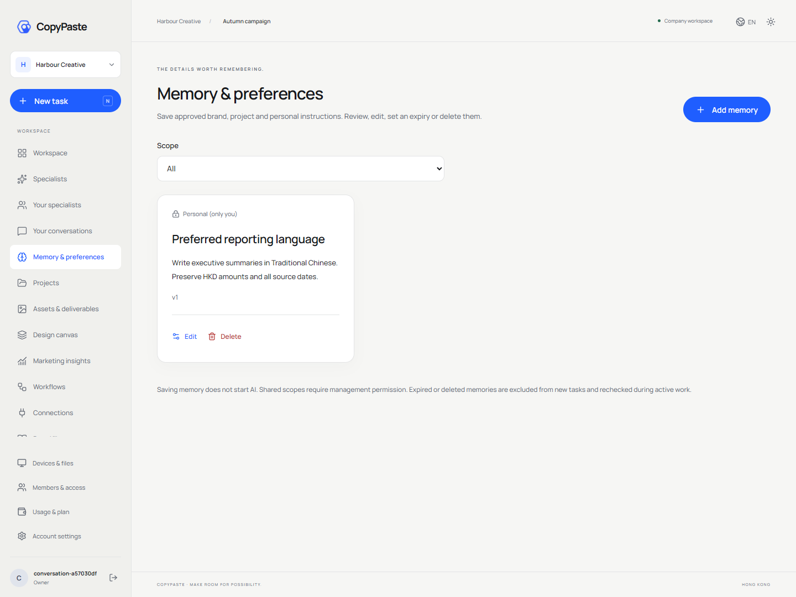
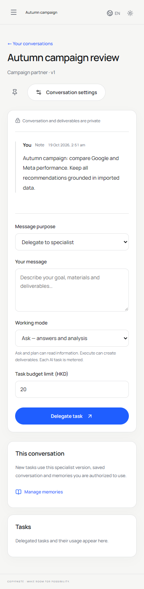
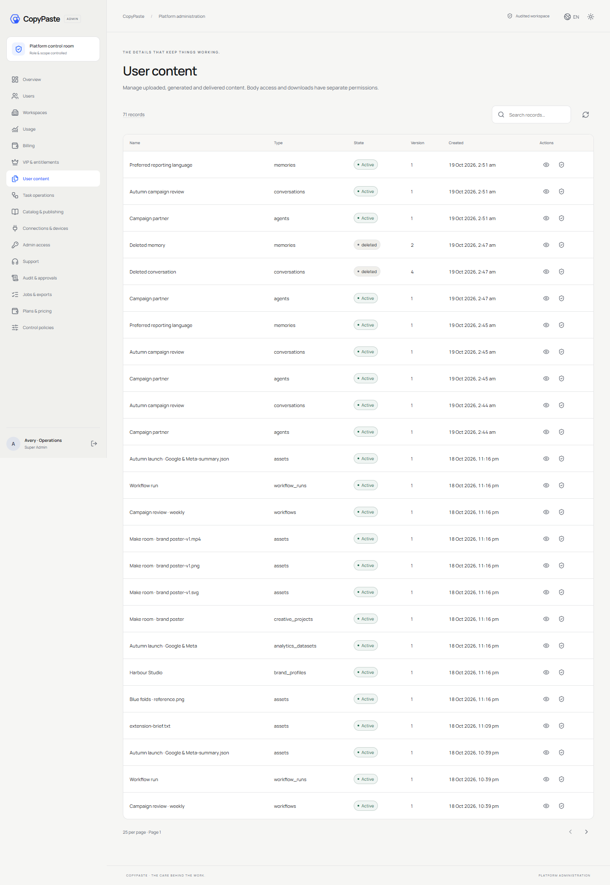
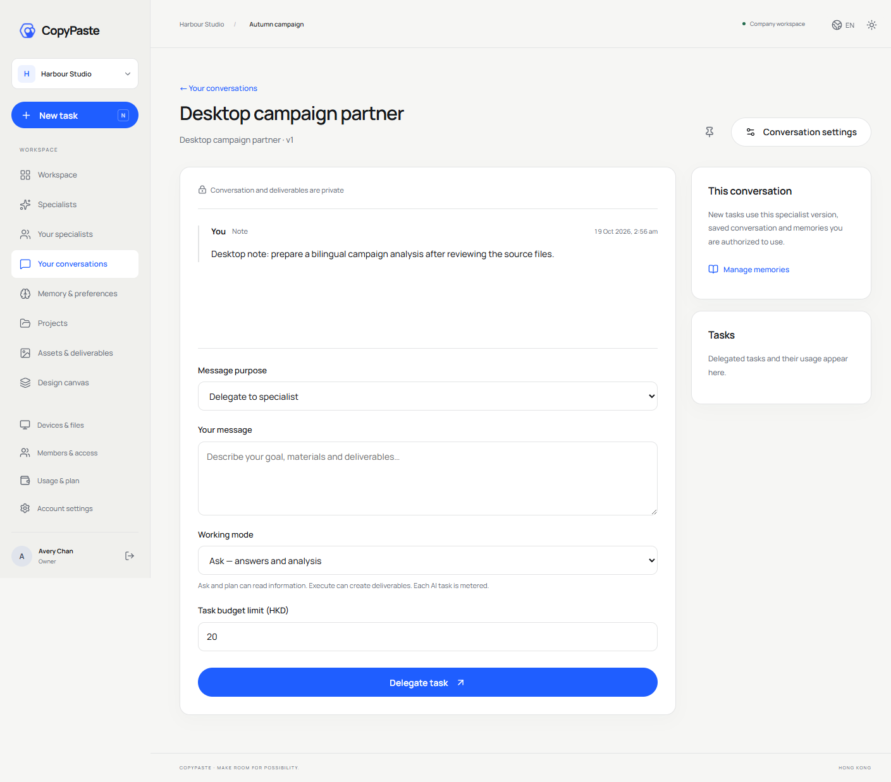

# 0.2.0 持续专家、私密会话与记忆验收

版本：1.7 · 2026-10-19 · 范围：原生 Windows 本机试点。0.1.0 的历史记录保留在 [上一版验收](04-implementation-acceptance.md)；本版机器汇总为 [implementation-evidence.json](implementation-evidence.json)。仓库与启动见 [实施清单](../technical/12-implementation-and-repositories.md)，执行规则见 [持续工作约束](../technical/13-persistent-agents-conversations-memory.md)。

## 1. 本轮可用流程

用户访问 → 邮箱验证 → 创建企业与项目 → 从 18 个预设创建专属专家 → 私密会话 → 笔记或 ask / plan / execute → 独立任务预算 → 真实状态、用量与成果 → 明确发布共享副本。专家职责、工具子集和品牌版本化；会话可明确采纳更新。记忆支持企业、品牌、项目、会话和个人五种范围。

保存笔记、管理专家与记忆不调用 AI。模型未配置时，委派明确失败，不增加消息对应的任务、预留或虚构回复。已提交模型任务按实际用量结算；费用不确定保持预留并对账。测试中的受控 Runtime 与真实 Codex Responses fixture 用于验证代码规则，尚未证明公司实际模型或 Image 2 的业务能力。

## 2. 实际检查

| 检查 | 本次结果及范围 |
| --- | --- |
| 六仓库 | 真实类型检查、构建通过；含 Desktop 渲染器快照来源哈希 |
| 平台 | 37 项通过，0 失败/跳过/取消；真实 PostgreSQL、原有身份/权限/费用/媒体/内核及新增 10 项持续工作测试 |
| Desktop | 3 项原生逻辑测试通过；实际 DPAPI 跨进程、路径/create-only/撤销/重放、固定 origin |
| Web/Admin 基线 | 实际邮箱注册与初始化、13 个原有工作区模块、16 个后台页面、设计/数据/流程、费用与 VIP |
| 持续工作浏览器 | 8 组通过：专家/笔记重载、未配置 AI 明确失败、记忆版本、会话检索/置顶/归档、390px/深色、后台正文隔离、明确删除 |
| Chrome | 实际 MV3、Chrome identity PKCE、明确文件上传、仅会话 token 存储与退出撤销 |
| 打包 Desktop | 6 组通过：浏览器 PKCE/加密凭证、专家/私密笔记重载、目录授权、签名云命令、真实 Native Host 帧、撤销 |
| Windows 产物 | 0.2.0 实际 isPackaged/窗口启动；生成 x64 Setup 与 Portable，当前未签名 |
| 原生生命周期 | pg_ctl checkpoint 关闭、五个自有端口释放、无崩溃恢复重启、专家/会话/记忆记录保留、既有 5173/5174 PID 保持 |
| 仓库与交付 | 双语 README、实际截图、Mermaid、私有配置排除、来源哈希；六个 Git bundle、三个 ZIP、两个 EXE 的恢复与摘要另附机器记录 |

原始报告与可复现脚本随独立 delivery 仓库交付。类型/构建/测试/路由共 15 个执行步骤保存在 `evidence/verification.json`；浏览器流程分别保存在 `web-admin.json`、`persistent-work.json`、`extension.json`、`desktop.json`、`packaged-windows.json`。`native-controller.json` 记录真实重启前后元数据数量，无客户正文或密钥。

## 3. 新增逻辑约束的覆盖

专家版本不可变、CAS 冲突、非创建者/非项目管理者修改拒绝；禁止扩大注册工具与覆盖 Codex 内核。消息客户端 UUID 并发去重，单条消息只有一个任务与预留；每会话一个在途任务。私密会话不能通过通用父任务入口脱离原会话继续执行。

API 与 RLS 同时拒绝其他成员读取私密会话、消息、任务、事件、版本及文件。共享任务不能读取同一用户其他私密任务的产物，避免把私密文件经共享任务输出泄露。私密文件不能直接公开分享；明确发布后创建新的共享副本，删除原会话不会删除用户已发布的副本。

记忆检查范围、所有者、品牌/项目绑定、到期和版本。已受理任务读取固定旧版本；删除或隔离使后续工具和最终提交重新检查失败。删除清空可读取正文与缓存响应，保留幂等墓碑；重复旧请求返回已删除结果，不重建内容。普通客户管理员的项目权限不提供其他用户私密正文权限。

ask / plan 的服务端工具集合只读。批准计划检查任务/计划版本、完整输入摘要、当前专家/记忆与会话版本、归档状态、权限、预算；计划生成期间新增记忆或笔记也会使原批准失效。并发或更换幂等键的重复批准仍只创建一个执行子任务。Admin 重试保留私密归属、模式和固定上下文，并重新校验当前权限与权益。

删除有在途或待对账任务的会话返回 ACTIVE_TASKS。归档不取消已受理工作。后台正文读取需独立权限并留审计；隔离阻止用户读取及后续工具；已删除的会话/记忆没有恢复操作。资产公开下载在读取对象前后复核共享状态和公开归属。

## 4. 实际界面

截图来自本机真实应用与虚构 fixture 数据，拍摄后关闭本次浏览器与应用实例。移动和深色截图均检查了实际布局/主题状态。

## 5. 剩余范围与真实性

完整需求没有因本轮实现而删除。公司网关仍需精确 Base URL、模型/媒体别名、服务器凭证和实际费率；18 个角色/28 个 Skill 包均保留 pending_live_validation，尚不能认定至少 12 个角色完成真实任务、修改与异常准入。Google/Meta、SMTP、S3 仍需真实环境授权和联调。

SSO、云端定时计划、并行专业团队、完整云目录和任务检查点、SSE 与协同编辑、字体授权与复杂导出、完整生成视频/语音、Codex 自主本地文件工具、客户端结果签名、物理对象/运行缓存回收、完整管理员开户/停用 UI 与客户支持委托尚未全部实现。本轮删除针对 API/RLS/可读取内容及重放缓存，不代表物理存储立即擦除。

生产 OS 账号/ACL/出站隔离、负载/备份恢复/SLO、Windows 签名、多平台与完整无障碍验收仍待执行。当前产物是 localhost 原生试点，未自动安装、上架、推送远端或部署生产。37+3 项代码测试和客户端检查不能证明不存在其他缺陷；原 102 条综合验收继续保留 not_run，需逐条满足原前置与故障条件后再认定。

## 6. 复现顺序

在 delivery 仓库执行 `npm run verify`，再执行 `qa:web`、`qa:persistent`、`qa:extension`；Desktop 先构建 `npm run package`，再执行 `qa:desktop`、`qa:packaged`。浏览器脚本均在 finally 关闭自身资源。`qa:lifecycle` 要求先停止现有 CopyPaste 控制器，核查后停止自身栈，再 `npm start` 恢复查看。

运行 `python -X utf8 scripts/review-repositories.py` 检查候选源码，提交六仓库后使用 `npm run release` 生成集中产物与清单。文档检查在根目录执行 `python -X utf8 docs/tools/validate_docs.py`。发布清单与 [离线恢复记录](release-restore-check.json) 保存本轮实际提交、tree、来源索引及 SHA-256，历史 0.1.0 机器证据保留独立副本。
