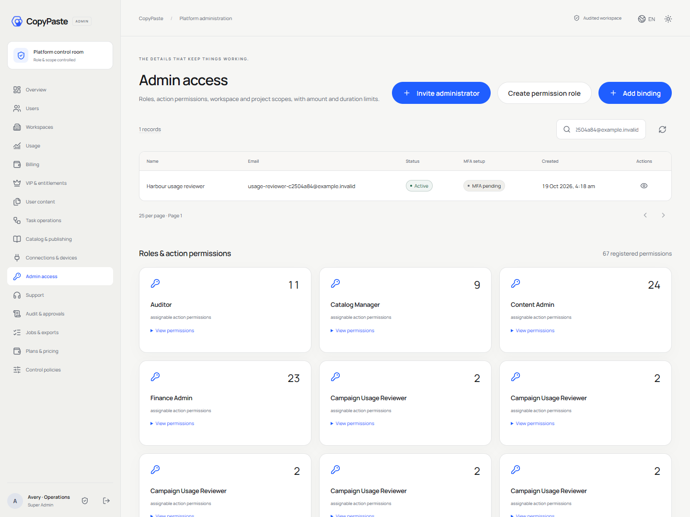
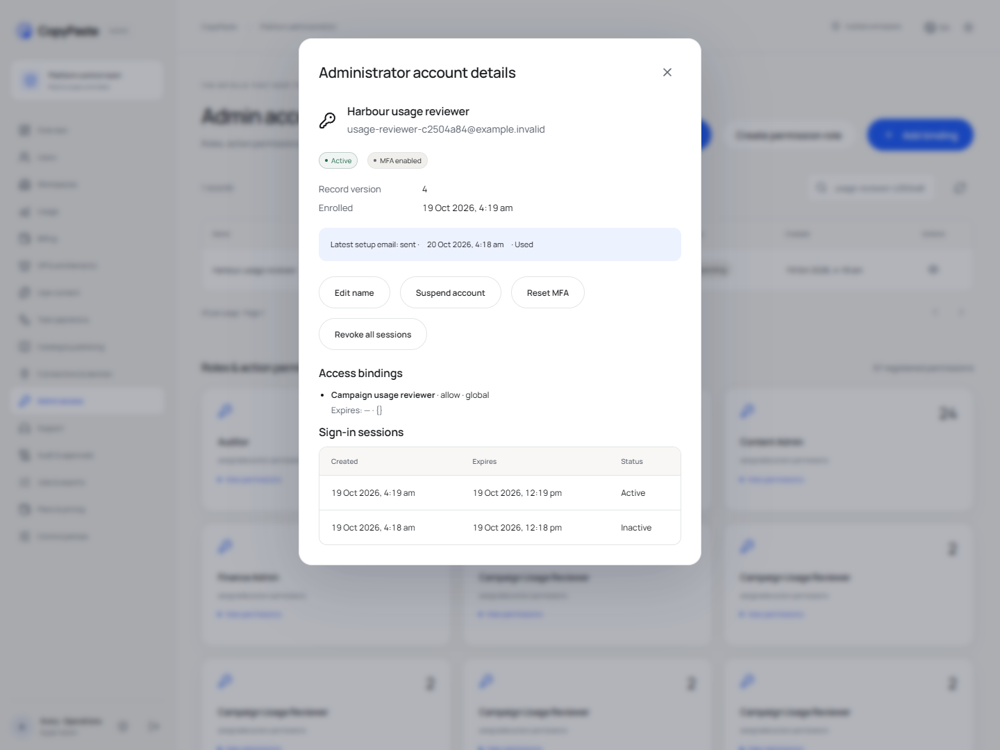
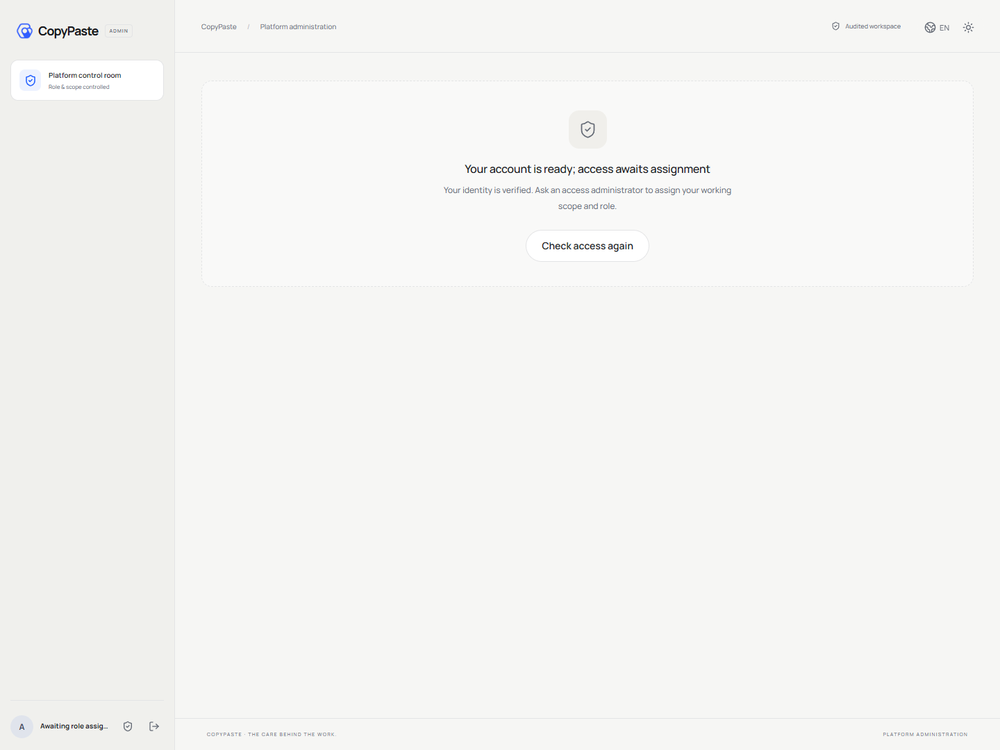

# 0.3.0 管理员身份生命周期验收

版本：1.8 · 2026-10-19 · 范围：原生 Windows 本机试点。实现规则见 [账号生命周期](../technical/14-admin-identity-lifecycle.md)，独立仓库、启动与生产边界见 [实施清单](../technical/12-implementation-and-repositories.md)。当前机器汇总为 [implementation-evidence.json](implementation-evidence.json)；[0.2.0 验收](05-persistent-work-acceptance.md)及原始报告保留历史。

## 本轮增量

受信 CLI 引导首次超管 → 后台输入受邀邮箱、姓名、原因及可选初始授权 → 同事务开户与委派检查 → 邮件能力仅发本人 → 验证邮箱 → 本人确认新验证器的真实 TOTP → 独立 Admin 会话 → 按实际角色进入后台。没有业务权限的账号可完成身份开通，并显示等待授权。

账号详情提供姓名编辑、邀请状态、MFA 状态、角色/范围、会话元数据、停用/恢复、重发、另一管理员重设 MFA 与会话撤销。本人可在近期登录及新邮箱证明后更换验证器；确认前保留原验证器，成功后撤销旧会话并保持当前新会话。普通客户身份不具有后台开户或授权能力。

## 已执行检查

| 检查 | 实际范围 |
| --- | --- |
| 原生构建 | 六个独立仓库类型检查与构建，Desktop 独立渲染器来源校验 |
| 平台 | 51 项真实逻辑测试，包括新增 14 组管理员身份测试；0 失败、跳过、取消 |
| 身份数据库/API | 原子邀请/初始角色、同键幂等、公开字段去敏、邮箱绑定/限次/单消费、真实 TOTP/重放、过期 setup、角色调整后重新验证、状态 CAS、停用/恢复、投递失败/重试、本人更换、他人重设、会话撤销、委派限额与过期 MFA、旧接口别名的同等版本/原因约束 |
| 并发恢复保护 | pending 邀请不算恢复超管；并发停用仅一项提交，另一项 LAST_SUPER_ADMIN 并回滚；最后超管 MFA 重设回滚 |
| 解除限制与委派 | 自删 deny 拒绝；只持 revoke、缺少被恢复权限、超限额/有效期均拒绝；global/tenant/project 按交集授权，较小范围的显式 deny 不能用更大委派绕过；删除同键重试无重复副作用 |
| 管理员浏览器 | 6 组真实 Chromium：邀请与受限角色；收件人 OTP/真实 TOTP/地址去令牌；本人更换与旧 Cookie 失效；停用/恢复和安全会话；390px/滚动锁定/重发废弃旧链接；无权限开通/等待授权与新增授权撤销原会话 |
| 原有跨端流程 | Web/Admin 基线、持续专家/会话/记忆、Chrome PKCE/上传、打包 Desktop PKCE/目录/签名命令及 Native Host |
| 原生客户端 | Desktop 3 项逻辑测试、实际 0.3.0 Windows 包启动/版本；未签名 x64 Setup/Portable |
| 交付 | 源码审查、README/图/截图、六仓库 Git bundle、三个 ZIP、两个 EXE、摘要及实际离线恢复另附机器证据 |

新增真实数据库测试为 platform `tests/admin-identities.test.ts`，浏览器脚本为 delivery `scripts/qa-admin-identities.ts`，原始结果为 `evidence/verification.json` 和 `evidence/admin-identities.json`。浏览器 OTP 按实际返回的 challenge ID 读取对应开发邮件，避免拿旧邮件误测；TOTP 使用真实时间算法，不模拟成功。所有自建页面、上下文和浏览器均在 finally 关闭。

浏览器检查发现并修复了列表刷新导致详情弹窗卸载的问题；弹窗状态提升到稳定的页面层，变更后继续展示同一账号。另外修复了同一页打开替换邀请时 fragment 改变却未更新能力的问题，重发后的新链接会重新检查并清空旧设置状态。弹窗打开时锁定背景滚动，关闭恢复原状态；移动截图检查实际页面没有横向溢出。截图隐藏验证器密钥与邮箱/TOTP 输入，不包含邀请令牌。

## 实际页面

## 验收边界

本轮使用真实本机数据库、原生客户端和开发邮件箱，未向真实人员寄送邀请。原生关闭/重启还对管理员状态、授权版本、邀请设置、会话及绑定元数据计算摘要并核对一致；不读取密钥、验证码或客户正文。生产 SMTP、企业 SSO、公司真实 AI/图片/视频、广告 OAuth 与 S3 仍需实际环境配置与联调。18 个角色/28 个 Skill 包保留 pending_live_validation；其完整任务质量尚未准入。

云端定时、并行团队、完整云目录和暂停检查点、SSE 与协作、字体授权与复杂导出、完整视频/语音、Codex 自主本地文件工具、客户端结果签名、物理对象/缓存回收、客户支持委托、线上收单和生产 OS/网络隔离等继续跟踪。Windows 签名、负载/恢复/SLO、多平台及完整无障碍验收尚未完成。

51+3 项代码测试和实际客户端检查仅证明其明确覆盖的规则。原 102 条综合验收仍为 not_run，不以页面存在或局部测试代替全量产品验收。当前为 localhost 原生试点，未自动安装、上架、推送远端或部署生产。
